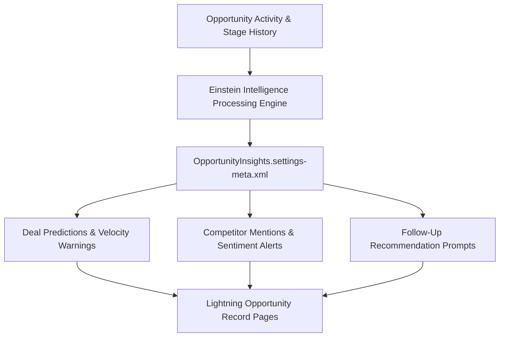

## Architectural Overview

`OpportunityInsightsSettings` governs the activation of Salesforce Sales Cloud Einstein Opportunity Insights. This AI-powered capability analyzes email interactions, calendar events, opportunity stage progression history, and competitor mentions to generate real-time deal intelligence.

From an enterprise pipeline architecture perspective, `OpportunityInsightsSettings` bridges core CRM operational data with predictive machine learning models. Surfacing automated warnings (such as stalled deal velocities, negative sentiment in customer correspondence, or unresponded proposals) empowers sales teams to take timely corrective interventions.



## Directory and File Conventions

`OpportunityInsightsSettings` is a singleton settings metadata type located in the `settings/` folder.

| Property | Value |
| :--- | :--- |
| **Metadata Type Name** | `Settings` (member: `OpportunityInsights`) / `OpportunityInsightsSettings` |
| **SFDX Folder** | `force-app/main/default/settings/` |
| **File Name** | `OpportunityInsights.settings-meta.xml` |
| **Scratch Org Setting Key** | `opportunityInsightsSettings` |

## Key Metadata Fields

The XML schema defines core insight generation parameters:

| Field Name | Field Type | Required | Architectural Description |
| :--- | :--- | :--- | :--- |
| `enableOpportunityInsights` | `boolean` | No | Master switch activating Einstein Opportunity Insights on standard Opportunity records. |
| `enableSmartCreateInsights` | `boolean` | No | Enables smart automated insight generation based on inbound customer email activity. |

> [!NOTE]
> Utilizing `OpportunityInsightsSettings` requires proper Sales Cloud Einstein licensing and Activity Capture permissions assigned to active sales users.

## Declarative XML and Package Manifest Examples

A standard production settings file activating opportunity insights:

```xml title="force-app/main/default/settings/OpportunityInsights.settings-meta.xml"
<?xml version="1.0" encoding="UTF-8"?>
<OpportunityInsightsSettings xmlns="http://soap.sforce.com/2006/04/metadata">
    <enableOpportunityInsights>true</enableOpportunityInsights>
    <enableSmartCreateInsights>true</enableSmartCreateInsights>
</OpportunityInsightsSettings>
```

### Scratch Org Configuration (`config/project-scratch-def.json`)

To enable opportunity insights in development scratch orgs:

```json title="config/project-scratch-def.json"
{
  "orgName": "Einstein Sales Scratch Org",
  "edition": "Enterprise",
  "features": ["SalesCloudEinstein"],
  "settings": {
    "opportunityInsightsSettings": {
      "enableOpportunityInsights": true,
      "enableSmartCreateInsights": true
    }
  }
}
```

### Package Manifest (`package.xml`)

```xml title="manifest/package.xml"
<?xml version="1.0" encoding="UTF-8"?>
<Package xmlns="http://soap.sforce.com/2006/04/metadata">
    <types>
        <members>OpportunityInsights</members>
        <name>Settings</name>
    </types>
    <version>68.0</version>
</Package>
```

## CLI Retrieval and Deployment Commands

Retrieve and deploy settings with the Salesforce CLI:

```bash
# Retrieve Opportunity Insights settings
sf project retrieve start --metadata Settings:OpportunityInsights

# Deploy Opportunity Insights settings
sf project deploy start --metadata Settings:OpportunityInsights
```

## Architect Best Practices and Gotchas

- **Licensing and Feature Prerequisites:** In CI/CD pipelines, deploying `Settings:OpportunityInsights` into scratch orgs or developer edition orgs lacking Sales Cloud Einstein feature licenses will result in deployment failure. Use conditional deployment scripts or feature flags.
- **Lightning Page Integration:** Enabling the metadata setting activates backend insight calculations, but users will not see them unless the `Einstein Opportunity Insights` component is added to your target Opportunity Lightning Record Pages ([FlexiPage](/docs/metadata/flexipage-metadata-type/)).
- **Data Volume Considerations:** Machine learning insight models require sufficient historical opportunity and activity volume to generate accurate predictions; new scratch orgs will show blank insight cards until baseline data is generated.

> [!TIP]
> Ensure Einstein Activity Capture (EAC) or standard email integration is operational so the AI engine has access to conversational signals.
