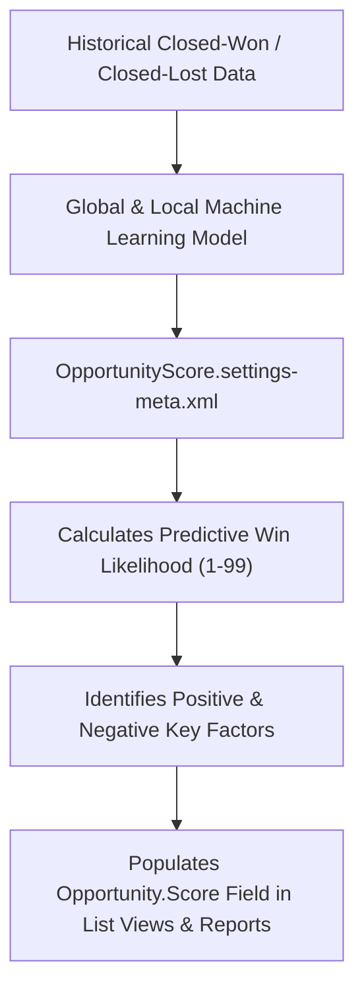

## Architectural Overview

`OpportunityScoreSettings` controls the activation and algorithmic configuration of Salesforce Einstein Opportunity Scoring. When enabled, this feature uses automated machine learning to analyze historical deal patterns, stage durations, and engagement metrics to assign each open opportunity a predictive win score ranging from 1 to 99.

From an enterprise solution architecture viewpoint, `OpportunityScoreSettings` is pivotal because it provisions standard scoring fields and relationships directly on the `Opportunity` schema (such as `Score`, `ScoreReason`, and `OpportunityScore`). It enables revenue operations teams to build automated tiering, routing logic, and forecast categorization based on empirical data rather than subjective rep sentiment.



## Directory and File Conventions

`OpportunityScoreSettings` is managed in the `settings/` folder as a singleton configuration file.

| Property | Value |
| :--- | :--- |
| **Metadata Type Name** | `Settings` (member: `OpportunityScore`) / `OpportunityScoreSettings` |
| **SFDX Folder** | `force-app/main/default/settings/` |
| **File Name** | `OpportunityScore.settings-meta.xml` |
| **Scratch Org Setting Key** | `opportunityScoreSettings` |

## Key Metadata Fields

The configuration fields defined in `OpportunityScoreSettings` include:

| Field Name | Field Type | Required | Architectural Description |
| :--- | :--- | :--- | :--- |
| `enableOpportunityScoring` | `boolean` | No | Master activation switch for Einstein Opportunity Scoring across the organization. |
| `enableModelFactors` | `boolean` | No | Enables the calculation and display of explanatory key contributing factors alongside numeric scores. |

> [!NOTE]
> Einstein Opportunity Scoring is available to all Sales Cloud users without requiring an add-on license, but the metadata setting must be activated to expose the schema elements.

## Declarative XML and Package Manifest Examples

A standard production settings file activating Einstein Opportunity Scoring:

```xml title="force-app/main/default/settings/OpportunityScore.settings-meta.xml"
<?xml version="1.0" encoding="UTF-8"?>
<OpportunityScoreSettings xmlns="http://soap.sforce.com/2006/04/metadata">
    <enableOpportunityScoring>true</enableOpportunityScoring>
</OpportunityScoreSettings>
```

### Scratch Org Configuration (`config/project-scratch-def.json`)

To enable opportunity scoring in scratch org testing environments:

```json title="config/project-scratch-def.json"
{
  "orgName": "Predictive Sales Scratch Org",
  "edition": "Enterprise",
  "settings": {
    "opportunityScoreSettings": {
      "enableOpportunityScoring": true
    }
  }
}
```

### Package Manifest (`package.xml`)

```xml title="manifest/package.xml"
<?xml version="1.0" encoding="UTF-8"?>
<Package xmlns="http://soap.sforce.com/2006/04/metadata">
    <types>
        <members>OpportunityScore</members>
        <name>Settings</name>
    </types>
    <version>68.0</version>
</Package>
```

## CLI Retrieval and Deployment Commands

Manage `OpportunityScoreSettings` with the Salesforce CLI:

```bash
# Retrieve Opportunity Score settings
sf project retrieve start --metadata Settings:OpportunityScore

# Deploy Opportunity Score settings
sf project deploy start --metadata Settings:OpportunityScore
```

## Architect Best Practices and Gotchas

- **Schema Compilation Ordering:** Page layouts, FlexiPages, reports, or Apex code that reference `Opportunity.Score` will fail deployment if `OpportunityScoreSettings` is not deployed first. Maintain strict deployment step sequencing.
- **Model Training Latency:** In newly created sandboxes or developer orgs with sparse data, scores will not appear immediately. Salesforce requires approximately 200 closed-won opportunities and 200 closed-lost opportunities over the previous 24 months to calibrate a customized local model, falling back to a global baseline model in smaller orgs.
- **Automation Execution Filters:** Be cautious when using changes to `Opportunity.Score` as criteria in Record-Triggered Flows. Automated scoring refreshes run asynchronously in the background and can trigger flow executions outside normal user interactions.

> [!TIP]
> Expose the `Score` field in Opportunity kanban views and list views to provide sales managers with instant visibility into pipeline health.
