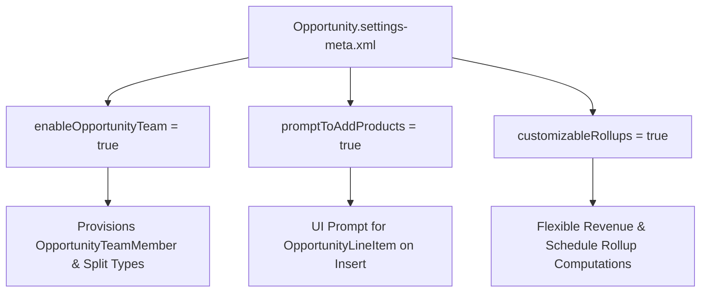

## Architectural Overview

`OpportunitySettings` is an org-level settings metadata type that governs the core business capabilities of the Salesforce Sales Cloud Opportunity pipeline. It provisions and configures critical revenue management mechanisms, including Opportunity Teams (`OpportunityTeamMember`), Opportunity Splits, product addition prompts on deal creation, and customizable rollup calculations.

From an Enterprise Architect perspective, `OpportunitySettings` acts as a structural gatekeeper. Just like `AccountSettings`, attempting to compile Apex classes, sharing rules, or permission sets that reference team selling constructs before `OpportunitySettings` has activated them in the target org results in compile-time build failures.



## Directory and File Conventions

`OpportunitySettings` files are located in the `settings/` directory and referenced as `Settings:Opportunity`.

| Property | Value |
| :--- | :--- |
| **Metadata Type Name** | `Settings` (member: `Opportunity`) / `OpportunitySettings` |
| **SFDX Folder** | `force-app/main/default/settings/` |
| **File Name** | `Opportunity.settings-meta.xml` |
| **Scratch Org Setting Key** | `opportunitySettings` |

## Key Metadata Fields

The XML schema for `OpportunitySettings` defines core pipeline and team selling behaviors:

| Field Name | Field Type | Required | Architectural Description |
| :--- | :--- | :--- | :--- |
| `enableOpportunityTeam` | `boolean` | No | Enables team selling and provisions the `OpportunityTeamMember` standard entity. |
| `promptToAddProducts` | `boolean` | No | Automatically directs users to the Product selection page immediately upon saving a new Opportunity. |
| `autoActivateNewReminders` | `boolean` | No | Automatically creates and activates update reminders for active sales managers. |
| `enableUpdateReminders` | `boolean` | No | Activates automated pipeline update reminder emails sent to opportunity owners. |
| `customizableRollups` | `boolean` | No | Enables configurable rollup calculations for revenue schedules and line items. |

> [!NOTE]
> Enabling `enableOpportunityTeam` is an architectural requirement prior to configuring `OpportunitySplit` and `OpportunitySplitType` metadata.

## Declarative XML and Package Manifest Examples

A standard production settings manifest for enterprise team selling and deal governance:

```xml title="force-app/main/default/settings/Opportunity.settings-meta.xml"
<?xml version="1.0" encoding="UTF-8"?>
<OpportunitySettings xmlns="http://soap.sforce.com/2006/04/metadata">
    <autoActivateNewReminders>false</autoActivateNewReminders>
    <customizableRollups>false</customizableRollups>
    <enableOpportunityTeam>true</enableOpportunityTeam>
    <enableUpdateReminders>true</enableUpdateReminders>
    <promptToAddProducts>true</promptToAddProducts>
</OpportunitySettings>
```

### Scratch Org Configuration (`config/project-scratch-def.json`)

To enable Opportunity Teams and deal product prompts in scratch orgs:

```json title="config/project-scratch-def.json"
{
  "orgName": "Enterprise Sales Pipeline Scratch Org",
  "edition": "Enterprise",
  "settings": {
    "opportunitySettings": {
      "enableOpportunityTeam": true,
      "promptToAddProducts": true,
      "enableUpdateReminders": false
    }
  }
}
```

### Package Manifest (`package.xml`)

```xml title="manifest/package.xml"
<?xml version="1.0" encoding="UTF-8"?>
<Package xmlns="http://soap.sforce.com/2006/04/metadata">
    <types>
        <members>Opportunity</members>
        <name>Settings</name>
    </types>
    <version>68.0</version>
</Package>
```

## CLI Retrieval and Deployment Commands

Manage `OpportunitySettings` with the Salesforce CLI:

```bash
# Retrieve Opportunity settings from the org
sf project retrieve start --metadata Settings:Opportunity

# Deploy Opportunity settings to the target org
sf project deploy start --metadata Settings:Opportunity
```

## Architect Best Practices and Gotchas

- **Build Sequence Dependencies:** Any Apex code, Flow, or Permission Set referencing `OpportunityTeamMember` requires `enableOpportunityTeam: true`. Deploy `Settings:Opportunity` in your baseline deployment phase before application code.
- **Data Deletion Risks on Disable:** Disabling `enableOpportunityTeam` in an environment will permanently delete all existing `OpportunityTeamMember` records and remove associated implicit record sharing.
- **Split Configuration Sequence:** If your project uses Opportunity Splits (`OpportunitySplitType`), ensure `OpportunitySettings` is deployed and active before deploying split types; otherwise, metadata deployment will fail with dependency errors.

> [!WARNING]
> Setting `enableOpportunityTeam` to `false` in an active production org revokes team-based row-level access across the entire opportunity hierarchy.
