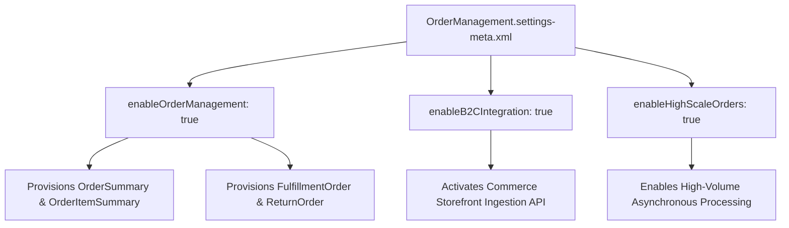

## Architectural Overview

The `OrderManagementSettings` metadata type controls the core activation switches for Salesforce Order Management (SOM). In omnichannel architectures linking B2B Commerce, B2C Commerce, or third-party storefronts to Salesforce, SOM serves as the central hub for order capture, inventory reservation, fulfillment routing, and payment settlement.

Deploying `OrderManagementSettings` activates the immutable order ledger schema—including `OrderSummary`, `OrderItemSummary`, `FulfillmentOrder`, `PaymentAuthorization`, and `ReturnOrder`. Without this metadata type configured in your source control repository, automated CI/CD builds deploying SOM flows, [CustomObject](/docs/metadata/custom-object-metadata-type/) extensions, or [ApexClass](/docs/metadata/apex-class-metadata-type/) triggers fail immediately due to missing schema objects.



## Directory and File Conventions

In SFDX source format, `OrderManagementSettings` is represented as an XML file under the `settings/` directory and referenced using the `Settings` type with member `OrderManagement`.

| Property | Value |
| :--- | :--- |
| **Metadata Type Name** | `Settings` (member: `OrderManagement`) / `OrderManagementSettings` |
| **SFDX Directory** | `force-app/main/default/settings/` |
| **File Suffix** | `.settings-meta.xml` |
| **Full File Path** | `force-app/main/default/settings/OrderManagement.settings-meta.xml` |
| **Scratch Org Setting Key** | `orderManagementSettings` |

## Key Metadata Fields

The `OrderManagementSettings` metadata type exposes several configuration flags that determine how orders are ingested and orchestrated:

| Field Name | Field Type | Required | Architectural Description |
| :--- | :--- | :--- | :--- |
| `enableOrderManagement` | `boolean` | No | Enables the Salesforce Order Management engine and provisions order summary standard entities. |
| `enableB2CIntegration` | `boolean` | No | Enables native B2C Commerce (Salesforce B2C Commerce Cloud) integration pipelines and sync webhooks. |
| `enableHighScaleOrders` | `boolean` | No | Activates high-scale ingestion, queuing peak order traffic into asynchronous ingestion buffers. |
| `enableOrderSummaries` | `boolean` | No | Controls whether orders automatically transition into immutable `OrderSummary` aggregate records. |

> [!NOTE]
> Setting `enableHighScaleOrders` to `true` alters the transactional architecture of order creation. Orders are accepted asynchronously via high-scale endpoints and staged before database commit, preventing CPU timeout bottlenecks during flash sales.

## Declarative XML and Package Manifest Examples

Below is an enterprise configuration for an omnichannel order processing deployment:

```xml title="force-app/main/default/settings/OrderManagement.settings-meta.xml"
<?xml version="1.0" encoding="UTF-8"?>
<OrderManagementSettings xmlns="http://soap.sforce.com/2006/04/metadata">
    <enableB2CIntegration>true</enableB2CIntegration>
    <enableHighScaleOrders>true</enableHighScaleOrders>
    <enableOrderManagement>true</enableOrderManagement>
    <enableOrderSummaries>true</enableOrderSummaries>
</OrderManagementSettings>
```

### Scratch Org Definition Configuration

When creating scratch orgs for order management development, include the feature license and settings configuration:

```json title="config/project-scratch-def.json"
{
  "orgName": "Omnichannel SOM Dev Org",
  "edition": "Enterprise",
  "features": ["OrderManagement", "B2BCommerce"],
  "settings": {
    "orderManagementSettings": {
      "enableOrderManagement": true,
      "enableB2CIntegration": true,
      "enableHighScaleOrders": true,
      "enableOrderSummaries": true
    }
  }
}
```

### Package Manifest (`package.xml`)

```xml title="manifest/package.xml"
<?xml version="1.0" encoding="UTF-8"?>
<Package xmlns="http://soap.sforce.com/2006/04/metadata">
    <types>
        <members>OrderManagement</members>
        <name>Settings</name>
    </types>
    <version>68.0</version>
</Package>
```

## CLI Retrieval and Deployment Commands

Manage `OrderManagementSettings` using the Salesforce CLI (`sf`):

```bash
# Retrieve OrderManagementSettings from the org
sf project retrieve start --metadata Settings:OrderManagement

# Deploy OrderManagementSettings to a target environment
sf project deploy start --metadata Settings:OrderManagement

# Deploy with dry-run validation
sf project deploy validate --metadata Settings:OrderManagement --test-level RunLocalTests
```

## Architect Best Practices and Gotchas

- **Dependency Pipeline Sequencing:** Always deploy `OrderManagement.settings-meta.xml` in an initial foundational deployment step before deploying [Flow](/docs/metadata/flow-metadata-type/) definitions, [ApexClass](/docs/metadata/apex-class-metadata-type/) fulfillment triggers, or custom fields on `OrderSummary`.
- **Irreversibility in Production:** Once Order Management is active and business transactions generate `OrderSummary` records, toggling `enableOrderManagement` off is permanently restricted. Test all settings in full sandboxes before applying to production.
- **High-Scale Order Ingestion Timing:** When `enableHighScaleOrders` is active, order insertion does not invoke synchronous Apex triggers on `Order`. Ensure routing logic executes against `OrderSummaryCreatedEvent` or asynchronous platform events.

> [!WARNING]
> Scratch org creation will fail if `"OrderManagement"` is specified in `features` but the parent dev hub lacks the Salesforce Order Management license allocation.
