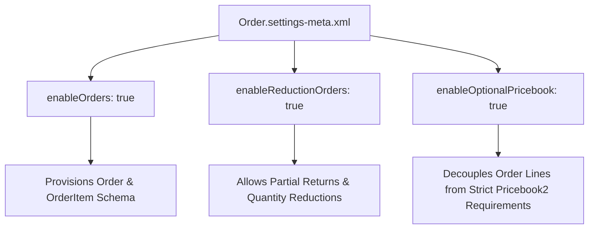

## Architectural Overview

The `OrderSettings` metadata type controls foundational switches for core order processing in Sales Cloud and Revenue workflows. It determines whether the standard `Order` and `OrderItem` objects are enabled, whether reduction orders can be issued against existing contracts, and whether line items can record negative pricing or quantities.

In enterprise release pipelines, `OrderSettings` must be synchronized early in scratch org definitions and package manifests. If custom fields on `Order`, [ApexClass](/docs/metadata/apex-class-metadata-type/) triggers, or [Flow](/docs/metadata/flow-metadata-type/) automation are deployed into an environment where orders are disabled, the metadata deploy fails with compilation errors referencing nonexistent schema.



## Directory and File Conventions

In SFDX source format, `OrderSettings` is stored in the `settings/` directory and referenced as `Settings:Order`.

| Property | Value |
| :--- | :--- |
| **Metadata Type Name** | `Settings` (member: `Order`) / `OrderSettings` |
| **SFDX Directory** | `force-app/main/default/settings/` |
| **File Suffix** | `.settings-meta.xml` |
| **Full File Path** | `force-app/main/default/settings/Order.settings-meta.xml` |
| **Scratch Org Setting Key** | `orderSettings` |

## Key Metadata Fields

The `OrderSettings` XML structure contains boolean parameters governing standard order validation:

| Field Name | Field Type | Required | Architectural Description |
| :--- | :--- | :--- | :--- |
| `enableOrders` | `boolean` | No | Enables the standard `Order` and `OrderItem` objects across the org. |
| `enableReductionOrders` | `boolean` | No | Enables reduction orders to support credit adjustments, product exchanges, and partial cancellations. |
| `enableNegativeQuantity` | `boolean` | No | Permits negative quantity values on order line items to represent return credits. |
| `enableZeroQuantity` | `boolean` | No | Allows lines with zero quantity for promotional giveaways or warranties. |
| `enableOptionalPricebook` | `boolean` | No | Allows creation of orders without linking to a `Pricebook2` record. |

> [!NOTE]
> When `enableOptionalPricebook` is set to `false`, every order record created via UI, API, or automated integration must provide a valid `Pricebook2Id`, even if line items are added programmatically later.

## Declarative XML and Package Manifest Examples

Below is a production-ready `Order.settings-meta.xml` configuration:

```xml title="force-app/main/default/settings/Order.settings-meta.xml"
<?xml version="1.0" encoding="UTF-8"?>
<OrderSettings xmlns="http://soap.sforce.com/2006/04/metadata">
    <enableNegativeQuantity>true</enableNegativeQuantity>
    <enableOptionalPricebook>false</enableOptionalPricebook>
    <enableOrders>true</enableOrders>
    <enableReductionOrders>true</enableReductionOrders>
    <enableZeroQuantity>true</enableZeroQuantity>
</OrderSettings>
```

### Scratch Org Configuration (`project-scratch-def.json`)

To ensure scratch orgs provision the `Order` entity consistently for integration testing:

```json title="config/project-scratch-def.json"
{
  "orgName": "Enterprise Sales Order Dev Org",
  "edition": "Enterprise",
  "settings": {
    "orderSettings": {
      "enableOrders": true,
      "enableReductionOrders": true,
      "enableNegativeQuantity": true,
      "enableZeroQuantity": true,
      "enableOptionalPricebook": false
    }
  }
}
```

### Package Manifest (`package.xml`)

```xml title="manifest/package.xml"
<?xml version="1.0" encoding="UTF-8"?>
<Package xmlns="http://soap.sforce.com/2006/04/metadata">
    <types>
        <members>Order</members>
        <name>Settings</name>
    </types>
    <version>68.0</version>
</Package>
```

## CLI Retrieval and Deployment Commands

Manage `OrderSettings` via Salesforce CLI (`sf`):

```bash
# Retrieve OrderSettings from the current target org
sf project retrieve start --metadata Settings:Order

# Deploy OrderSettings to the target environment
sf project deploy start --metadata Settings:Order

# Validate deployment without committing changes
sf project deploy validate --metadata Settings:Order
```

## Architect Best Practices and Gotchas

- **Disabling Orders in Production:** Disabling `enableOrders` in an active production org is blocked if records exist in `Order` or `OrderItem`. Always plan order decommissioning as a multi-step data archiving strategy.
- **Negative Quantities vs. Reduction Orders:** Architectural patterns differ between standard reduction orders and negative quantities. Use Reduction Orders when maintaining GAAP revenue recognition trails; use negative quantities only when lightweight line adjustments are required by downstream ERP systems.
- **Contract and Account Relationships:** When `enableOrders` is activated, ensure standard Account and Contract lookup relationships are assigned appropriate sharing rules and delete restrictions.

> [!WARNING]
> If `enableOptionalPricebook` is changed from `true` to `false`, existing integrations inserting `Order` records without `Pricebook2Id` will immediately encounter `REQUIRED_FIELD_MISSING` runtime exceptions.
