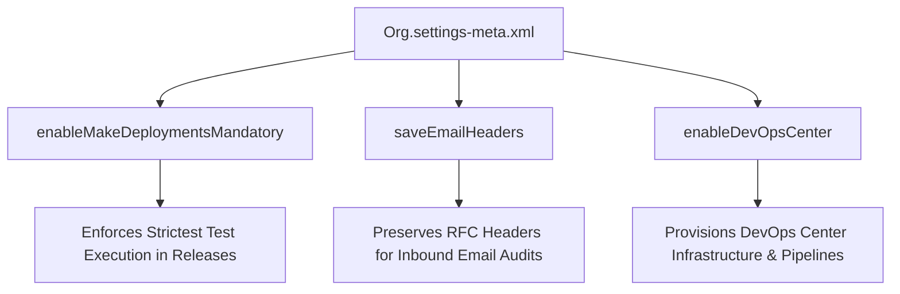

## Architectural Overview

The `OrgSettings` metadata type represents high-level organizational parameters that control operational governance, developer tooling policies, and cross-application defaults. While object-specific settings handle individual schemas, `OrgSettings` captures platform-wide infrastructure behaviors that apply across the entire subscriber tenant.

Architects leverage `OrgSettings` to enforce deployment safety gates in CI/CD pipelines, control email header retention for compliance audits, and manage developer tooling activation such as DevOps Center. Maintaining `Org.settings-meta.xml` in version control guarantees identical operational parameters between development sandboxes, staging environments, and production.



## Directory and File Conventions

In SFDX source format, `OrgSettings` is stored in the `settings/` folder and identified with the `Settings` type using member `Org`.

| Property | Value |
| :--- | :--- |
| **Metadata Type Name** | `Settings` (member: `Org`) / `OrgSettings` |
| **SFDX Directory** | `force-app/main/default/settings/` |
| **File Suffix** | `.settings-meta.xml` |
| **Full File Path** | `force-app/main/default/settings/Org.settings-meta.xml` |
| **Scratch Org Setting Key** | `orgSettings` |

## Key Metadata Fields

The `OrgSettings` type contains critical governance switches:

| Field Name | Field Type | Required | Architectural Description |
| :--- | :--- | :--- | :--- |
| `enableMakeDeploymentsMandatory` | `boolean` | No | Prevents ad-hoc metadata alterations without formalized release package deployment execution. |
| `saveEmailHeaders` | `boolean` | No | Preserves full Internet email headers on incoming email services for compliance and spam forensics. |
| `enableDevOpsCenter` | `boolean` | No | Activates the Salesforce DevOps Center application and enables pipeline branch tracking. |
| `enableCustomerSuccessPortal` | `boolean` | No | Controls access and backend connector infrastructure for legacy Customer Success Portal integration. |

> [!NOTE]
> Setting `saveEmailHeaders` to `true` increases email storage consumption on tasks and email messages, but is mandatory for regulated industries requiring non-repudiation audit trails for incoming correspondence.

## Declarative XML and Package Manifest Examples

Below is a standard declarative configuration for enterprise governance:

```xml title="force-app/main/default/settings/Org.settings-meta.xml"
<?xml version="1.0" encoding="UTF-8"?>
<OrgSettings xmlns="http://soap.sforce.com/2006/04/metadata">
    <enableDevOpsCenter>true</enableDevOpsCenter>
    <enableMakeDeploymentsMandatory>false</enableMakeDeploymentsMandatory>
    <saveEmailHeaders>true</saveEmailHeaders>
</OrgSettings>
```

### Scratch Org Definition Configuration

Align scratch org instances with production governance settings:

```json title="config/project-scratch-def.json"
{
  "orgName": "Governance Framework Scratch Org",
  "edition": "Enterprise",
  "settings": {
    "orgSettings": {
      "enableDevOpsCenter": true,
      "saveEmailHeaders": true
    }
  }
}
```

### Package Manifest (`package.xml`)

```xml title="manifest/package.xml"
<?xml version="1.0" encoding="UTF-8"?>
<Package xmlns="http://soap.sforce.com/2006/04/metadata">
    <types>
        <members>Org</members>
        <name>Settings</name>
    </types>
    <version>68.0</version>
</Package>
```

## CLI Retrieval and Deployment Commands

Manage `OrgSettings` via Salesforce CLI commands:

```bash
# Retrieve OrgSettings from the target org
sf project retrieve start --metadata Settings:Org

# Deploy OrgSettings to validate environment parity
sf project deploy start --metadata Settings:Org

# Check deployment status with verbose output
sf project deploy report
```

## Architect Best Practices and Gotchas

- **Environment-Specific Overrides:** Be cautious when promoting `Org.settings-meta.xml` between sandbox and production tiers. Deployment restrictions and developer flags like `enableDevOpsCenter` must align with environment-specific release management policies.
- **Dependency on Org Edition:** Some flags defined in `OrgSettings` require specific platform licenses or Enterprise edition tiers and will fail during deployment on lower edition developer orgs.
- **Auditing and Compliance:** Always combine `saveEmailHeaders` with data retention policies to prevent unbounded growth of `EmailMessage` records consuming core data storage.

> [!WARNING]
> Deploying unexpected changes to `enableMakeDeploymentsMandatory` can halt rapid hotfix workflows in production environments by requiring complete deployment validations.
