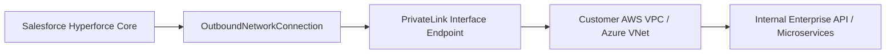

## Architectural Overview

`OutboundNetworkConnection` is an enterprise security metadata type introduced for Salesforce Hyperforce infrastructure. In highly regulated industries such as healthcare, banking, and government, transmitting sensitive payloads across the public internet—even when secured with TLS—violates data residency and perimeter isolation policies.

`OutboundNetworkConnection` establishes an egress conduit from Salesforce Hyperforce directly into a customer-managed cloud Virtual Private Cloud (VPC) via Amazon Web Services (AWS) PrivateLink or Microsoft Azure Private Link. When coupled with Named Credentials or external service callouts in [ApexClass](/docs/metadata/apex-class-metadata-type/) code, traffic flows entirely across dedicated cloud backbone fiber with zero exposure to public IP routing.



## Directory and File Conventions

`OutboundNetworkConnection` files are stored in the `outboundNetworkConnections` directory in SFDX source format.

| Property | Value |
| :--- | :--- |
| **Metadata Type Name** | `OutboundNetworkConnection` |
| **SFDX Directory** | `force-app/main/default/outboundNetworkConnections/` |
| **File Suffix** | `.outboundNetworkConnection-meta.xml` |
| **Full File Path** | `force-app/main/default/outboundNetworkConnections/<connectionName>.outboundNetworkConnection-meta.xml` |

## Key Metadata Fields

The `OutboundNetworkConnection` metadata type defines network tunnel topology and target endpoints:

| Field Name | Field Type | Required | Architectural Description |
| :--- | :--- | :--- | :--- |
| `connectionName` | `string` | Yes | Unique API name representing the private endpoint connection. |
| `description` | `string` | No | Architectural purpose and topology documentation for the connection. |
| `endpointType` | `string` | Yes | Target cloud infrastructure provider (e.g., `AwsPrivateLink`, `AzurePrivateLink`). |
| `status` | `string` | No | Operational status of the link (e.g., `Provisioned`, `Pending`, `Failed`). |
| `targetUrl` | `string` | Yes | Private DNS hostname or VPC endpoint service name to which outbound traffic is directed. |
| `region` | `string` | Yes | Cloud hosting region of the target VPC (e.g., `us-east-1`, `eu-west-1`). |

> [!NOTE]
> `OutboundNetworkConnection` requires the subscriber Salesforce org to reside on Hyperforce infrastructure. Attempting to deploy this metadata type into a first-generation Salesforce data center will result in deployment failure.

## Declarative XML and Package Manifest Examples

Below is a declarative definition of an AWS PrivateLink outbound connection:

```xml title="force-app/main/default/outboundNetworkConnections/AWS_Payment_VPC.outboundNetworkConnection-meta.xml"
<?xml version="1.0" encoding="UTF-8"?>
<OutboundNetworkConnection xmlns="http://soap.sforce.com/2006/04/metadata">
    <connectionName>AWS_Payment_VPC</connectionName>
    <description>Dedicated AWS PrivateLink route to internal core billing microservices.</description>
    <endpointType>AwsPrivateLink</endpointType>
    <region>us-east-1</region>
    <status>Provisioned</status>
    <targetUrl>vpce-0123456789abcdef0-example.vpce-svc.us-east-1.vpce.amazonaws.com</targetUrl>
</OutboundNetworkConnection>
```

### Package Manifest (`package.xml`)

```xml title="manifest/package.xml"
<?xml version="1.0" encoding="UTF-8"?>
<Package xmlns="http://soap.sforce.com/2006/04/metadata">
    <types>
        <members>AWS_Payment_VPC</members>
        <name>OutboundNetworkConnection</name>
    </types>
    <version>68.0</version>
</Package>
```

## CLI Retrieval and Deployment Commands

Manage `OutboundNetworkConnection` configurations via `sf`:

```bash
# Retrieve all outbound network connections
sf project retrieve start --metadata OutboundNetworkConnection

# Retrieve a specific named connection
sf project retrieve start --metadata OutboundNetworkConnection:AWS_Payment_VPC

# Deploy outbound network connection configuration
sf project deploy start --metadata OutboundNetworkConnection:AWS_Payment_VPC
```

## Architect Best Practices and Gotchas

- **Asynchronous Cloud Handshake:** Deploying an `OutboundNetworkConnection` initiates an external cloud handshake between Salesforce and AWS/Azure. The connection remains in `Pending` status until the cloud network administrator accepts the endpoint connection request in their cloud console.
- **DNS and TLS Certificate Considerations:** Even though traffic flows over PrivateLink, the target API must serve a valid TLS certificate matching the private DNS domain. Self-signed certificates are rejected unless an enterprise CA is explicitly provisioned.
- **Scratch Org Limitations:** Scratch orgs generally do not support automated provisioning of cloud PrivateLink endpoints unless configured in dedicated Hyperforce test pools with pre-authorized VPC peering.

> [!WARNING]
> Deleting or modifying `OutboundNetworkConnection` in production will immediately sever active API integrations routed through associated Named Credentials, triggering fatal connection timeouts.
