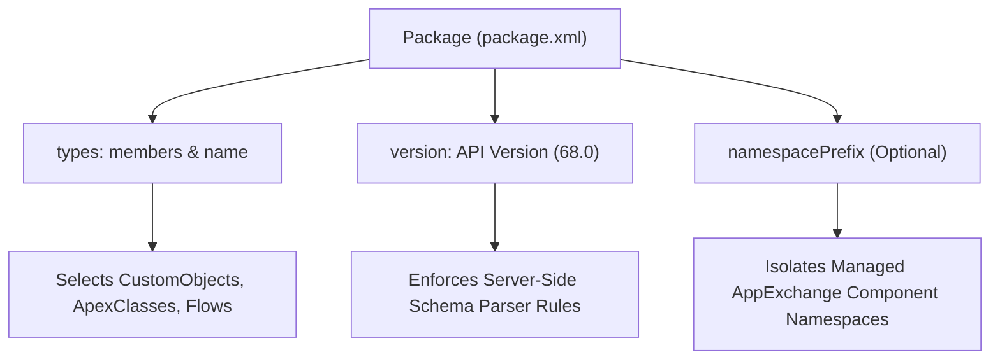

## Architectural Overview

The `Package` metadata type is the cornerstone of the Salesforce Metadata API. It represents the root element of `package.xml`, the foundational manifest that tells Salesforce deployment engines precisely which metadata types, specific members, and API schemas are being transferred between local workspaces and remote orgs.

Even in modern Salesforce DX source-format workflows where developers interact with modular directory structures, the CLI internally compiles source trees into `Package` structures when executing deployments against the metadata endpoints. Furthermore, `Package` defines unmanaged packages, AppExchange distribution definitions, and package version boundaries in managed packaging lifecycles.



## Directory and File Conventions

The `Package` manifest typically resides at the root of a deployment bundle or inside the `manifest/` directory of an SFDX project.

| Property | Value |
| :--- | :--- |
| **Metadata Type Name** | `Package` |
| **Manifest Path** | `manifest/package.xml` or `package.xml` |
| **File Format** | Plain XML |
| **Root XML Tag** | `<Package xmlns="http://soap.sforce.com/2006/04/metadata">` |

## Key Metadata Fields

The XML schema of `Package` consists of structural elements describing deployment payloads:

| Field Name | Field Type | Required | Architectural Description |
| :--- | :--- | :--- | :--- |
| `types` | `PackageTypeMembers[]` | Yes | List of metadata types and their individual member components included in the package. |
| `types.members` | `string[]` | Yes | Explicit member names or wildcards (`*`) included under the metadata type. |
| `types.name` | `string` | Yes | Official Metadata API type name (e.g., `ApexClass`, `CustomObject`). |
| `version` | `string` | Yes | Salesforce Metadata API version targeting the deployment (e.g., `68.0`). |
| `fullName` | `string` | No | Developer name of the unmanaged or managed package container. |
| `namespacePrefix` | `string` | No | Namespace identifier isolating packaged components from subscriber conflicts. |

> [!NOTE]
> When generating package manifests for destructive deployments (`destructiveChanges.xml`), the exact same `Package` XML schema is used to instruct the server on which components to remove.

## Declarative XML and Package Manifest Examples

Below is an enterprise `package.xml` manifest illustrating multiple metadata types and specific member declarations:

```xml title="manifest/package.xml"
<?xml version="1.0" encoding="UTF-8"?>
<Package xmlns="http://soap.sforce.com/2006/04/metadata">
    <types>
        <members>AccountService</members>
        <members>AccountServiceTest</members>
        <name>ApexClass</name>
    </types>
    <types>
        <members>Account.Customer_Tier__c</members>
        <members>Contact.Loyalty_ID__c</members>
        <name>CustomField</name>
    </types>
    <types>
        <members>Customer_Success_Operations</members>
        <name>PermissionSet</name>
    </types>
    <version>68.0</version>
</Package>
```

### Managed Package Container Manifest

When defining an unmanaged package container or export definition:

```xml title="src/package.xml"
<?xml version="1.0" encoding="UTF-8"?>
<Package xmlns="http://soap.sforce.com/2006/04/metadata">
    <fullName>CoreFinanceExtension</fullName>
    <types>
        <members>*</members>
        <name>ApexClass</name>
    </types>
    <version>68.0</version>
</Package>
```

## CLI Retrieval and Deployment Commands

Using the manifest file with Salesforce CLI:

```bash
# Generate a complete manifest from the current source tree
sf project generate manifest --output-dir manifest

# Retrieve components explicitly declared in package.xml
sf project retrieve start --manifest manifest/package.xml

# Deploy components defined in package.xml
sf project deploy start --manifest manifest/package.xml

# Execute dry-run validation with test execution
sf project deploy validate --manifest manifest/package.xml --test-level RunLocalTests
```

## Architect Best Practices and Gotchas

- **Wildcard Pitfalls:** While `<members>*</members>` works for Apex classes, components, and custom applications, it does not retrieve standard objects or in-folder metadata like Reports, Dashboards, and Document folders. Standard fields require explicit member naming (e.g., `<members>Account.Industry</members>`).
- **API Version Locking:** Keeping the `<version>` element synchronized across team members and CI/CD pipelines avoids schema drift where newer platform features pass locally but fail during automated builds.
- **Decomposition in SFDX:** Prefer SFDX source format for daily development, using `package.xml` manifests primarily as deployment filters for targeted delta releases or legacy Ant/Metadata API integrations.

> [!WARNING]
> Deploying a `package.xml` containing an incompatible API version can trigger unexpected compilation regressions if older Apex syntax is evaluated against newer compiler strictness levels.
