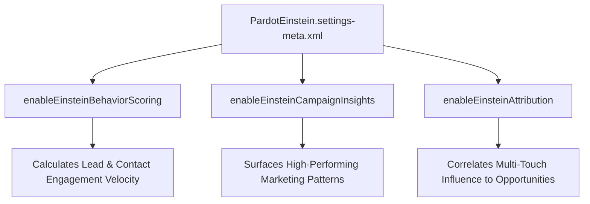

## Architectural Overview

The `PardotEinsteinSettings` metadata type controls machine learning and predictive analytics features connecting Salesforce CRM with Marketing Cloud Account Engagement (formerly Pardot). It governs features such as Einstein Behavior Scoring, Einstein Campaign Insights, and Einstein Attribution.

From an application architecture perspective, activating these models provisions background data sync jobs that analyze prospect engagement signals—such as email opens, form submissions, and video interactions—to generate predictive scores on Lead and Contact records. CI/CD pipelines deploying custom [FlexiPage](/docs/metadata/flexipage-metadata-type/) layouts with Einstein scoring widgets must ensure `PardotEinsteinSettings` is deployed first to avoid component dependency errors.



## Directory and File Conventions

In SFDX source format, `PardotEinsteinSettings` is stored in the `settings/` directory and referenced using the `Settings` type with member `PardotEinstein`.

| Property | Value |
| :--- | :--- |
| **Metadata Type Name** | `Settings` (member: `PardotEinstein`) / `PardotEinsteinSettings` |
| **SFDX Directory** | `force-app/main/default/settings/` |
| **File Suffix** | `.settings-meta.xml` |
| **Full File Path** | `force-app/main/default/settings/PardotEinstein.settings-meta.xml` |
| **Scratch Org Setting Key** | `pardotEinsteinSettings` |

## Key Metadata Fields

The XML schema of `PardotEinsteinSettings` configures individual AI model activations:

| Field Name | Field Type | Required | Architectural Description |
| :--- | :--- | :--- | :--- |
| `enableEinsteinBehaviorScoring` | `boolean` | No | Enables machine learning evaluation of prospect actions to produce engagement behavior scores. |
| `enableEinsteinCampaignInsights` | `boolean` | No | Analyzes campaign recipient demographics and engagement to identify key trends. |
| `enableEinsteinAttribution` | `boolean` | No | Activates multi-touch AI campaign influence modeling on Opportunity records. |
| `enableEinsteinKeyAccounts` | `boolean` | No | Enables Account-Based Marketing (ABM) predictive scoring on target account hierarchies. |

> [!NOTE]
> Training Einstein Behavior Scoring models requires a minimum baseline of historical prospect engagement records. In new scratch orgs or sandboxes without data, the models remain idle until sufficient activity history is generated.

## Declarative XML and Package Manifest Examples

Below is an enterprise configuration for activating Pardot Einstein AI features:

```xml title="force-app/main/default/settings/PardotEinstein.settings-meta.xml"
<?xml version="1.0" encoding="UTF-8"?>
<PardotEinsteinSettings xmlns="http://soap.sforce.com/2006/04/metadata">
    <enableEinsteinAttribution>true</enableEinsteinAttribution>
    <enableEinsteinBehaviorScoring>true</enableEinsteinBehaviorScoring>
    <enableEinsteinCampaignInsights>true</enableEinsteinCampaignInsights>
    <enableEinsteinKeyAccounts>true</enableEinsteinKeyAccounts>
</PardotEinsteinSettings>
```

### Scratch Org Definition Configuration

When creating scratch orgs for testing Account Engagement components:

```json title="config/project-scratch-def.json"
{
  "orgName": "Pardot Einstein Testing Org",
  "edition": "Enterprise",
  "features": ["Pardot", "EinsteinAnalytics"],
  "settings": {
    "pardotEinsteinSettings": {
      "enableEinsteinBehaviorScoring": true,
      "enableEinsteinCampaignInsights": true,
      "enableEinsteinAttribution": true
    }
  }
}
```

### Package Manifest (`package.xml`)

```xml title="manifest/package.xml"
<?xml version="1.0" encoding="UTF-8"?>
<Package xmlns="http://soap.sforce.com/2006/04/metadata">
    <types>
        <members>PardotEinstein</members>
        <name>Settings</name>
    </types>
    <version>68.0</version>
</Package>
```

## CLI Retrieval and Deployment Commands

Manage `PardotEinsteinSettings` via the Salesforce CLI (`sf`):

```bash
# Retrieve PardotEinsteinSettings from the target org
sf project retrieve start --metadata Settings:PardotEinstein

# Deploy PardotEinsteinSettings to synchronize AI configurations
sf project deploy start --metadata Settings:PardotEinstein

# Validate deployment into a target sandbox
sf project deploy validate --metadata Settings:PardotEinstein
```

## Architect Best Practices and Gotchas

- **Feature License Requirements:** Deploying `PardotEinsteinSettings` into an environment lacking Marketing Cloud Account Engagement Plus, Advanced, or Premium editions will fail with license entitlement errors.
- **Lightning Page Dependencies:** Do not add the Einstein Behavior Scoring Lightning component to Lead or Contact record pages in packages without bundling `PardotEinsteinSettings` as a pre-requisite.
- **Data Refresh Lag:** When `enableEinsteinBehaviorScoring` is enabled, initial model scoring cycles run asynchronously every few hours. Do not expect instantaneous score recalculation upon record creation.

> [!WARNING]
> Disabling `enableEinsteinBehaviorScoring` wipes model state and historical scoring variance tracking, requiring a complete retraining cycle upon reactivation.
