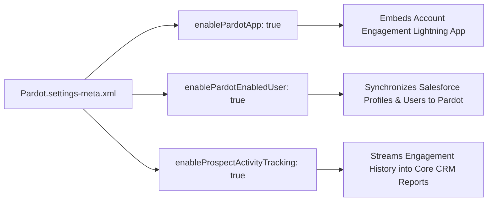

## Architectural Overview

The `PardotSettings` metadata type manages the structural connector linking core Salesforce CRM with Marketing Cloud Account Engagement (formerly Pardot). Rather than relying on legacy connector users and manual API sync, modern enterprise architectures use `PardotSettings` to manage the v2 B2B Marketing connector, Salesforce User Sync, and Connected Campaigns.

By committing `Pardot.settings-meta.xml` into version control, enterprise architects can programmatically automate the provisioning of marketing applications across developer sandboxes and staging environments. This ensures that custom fields on Campaign, Lead, and Contact map seamlessly to prospect databases without manual admin intervention during release windows.



## Directory and File Conventions

In SFDX source format, `PardotSettings` is represented in the `settings/` folder as `Pardot.settings-meta.xml` and referenced as `Settings:Pardot`.

| Property | Value |
| :--- | :--- |
| **Metadata Type Name** | `Settings` (member: `Pardot`) / `PardotSettings` |
| **SFDX Directory** | `force-app/main/default/settings/` |
| **File Suffix** | `.settings-meta.xml` |
| **Full File Path** | `force-app/main/default/settings/Pardot.settings-meta.xml` |
| **Scratch Org Setting Key** | `pardotSettings` |

## Key Metadata Fields

The `PardotSettings` type contains critical connector parameters:

| Field Name | Field Type | Required | Architectural Description |
| :--- | :--- | :--- | :--- |
| `enablePardotApp` | `boolean` | No | Enables the Lightning Account Engagement native app experience within Salesforce. |
| `enablePardotEnabledUser` | `boolean` | No | Enables Salesforce User Sync, managing Pardot user roles through Salesforce profiles and permission sets. |
| `enableProspectActivityTracking` | `boolean` | No | Streams prospect page views, form submissions, and email engagement directly into Salesforce records. |
| `enableMarketingAppExtension` | `boolean` | No | Activates external activity tracking endpoints for custom marketing app integrations. |

> [!NOTE]
> When `enablePardotEnabledUser` (User Sync) is turned on, user creation and role assignments in Pardot become read-only, deferring complete user lifecycle governance to Salesforce identity management.

## Declarative XML and Package Manifest Examples

Below is an enterprise configuration for synchronizing Salesforce CRM with Account Engagement:

```xml title="force-app/main/default/settings/Pardot.settings-meta.xml"
<?xml version="1.0" encoding="UTF-8"?>
<PardotSettings xmlns="http://soap.sforce.com/2006/04/metadata">
    <enableMarketingAppExtension>true</enableMarketingAppExtension>
    <enablePardotApp>true</enablePardotApp>
    <enablePardotEnabledUser>true</enablePardotEnabledUser>
    <enableProspectActivityTracking>true</enableProspectActivityTracking>
</PardotSettings>
```

### Scratch Org Definition Configuration

When setting up scratch orgs for marketing development:

```json title="config/project-scratch-def.json"
{
  "orgName": "Account Engagement Dev Org",
  "edition": "Enterprise",
  "features": ["Pardot", "MarketingCloud"],
  "settings": {
    "pardotSettings": {
      "enablePardotApp": true,
      "enablePardotEnabledUser": true,
      "enableProspectActivityTracking": true
    }
  }
}
```

### Package Manifest (`package.xml`)

```xml title="manifest/package.xml"
<?xml version="1.0" encoding="UTF-8"?>
<Package xmlns="http://soap.sforce.com/2006/04/metadata">
    <types>
        <members>Pardot</members>
        <name>Settings</name>
    </types>
    <version>68.0</version>
</Package>
```

## CLI Retrieval and Deployment Commands

Manage `PardotSettings` using `sf`:

```bash
# Retrieve Pardot settings from the authenticated org
sf project retrieve start --metadata Settings:Pardot

# Deploy Pardot settings to the target environment
sf project deploy start --metadata Settings:Pardot

# Validate deployment against target org
sf project deploy validate --metadata Settings:Pardot
```

## Architect Best Practices and Gotchas

- **User Sync Prerequisites:** Prior to enabling `enablePardotEnabledUser`, verify that Salesforce user profiles and [PermissionSet](/docs/metadata/permission-set-metadata-type/) assignments have corresponding Pardot role mappings configured in Setup.
- **Connected Campaigns Dependency:** To maximize ROI reporting, couple `PardotSettings` with Connected Campaigns so campaign hierarchies in Salesforce CRM automatically mirror marketing execution structures in Account Engagement.
- **Sandbox Refresh Strategy:** When refreshing full or partial sandboxes, Account Engagement connectors disconnect by default. Deploying `Pardot.settings-meta.xml` helps automate the re-initialization of marketing app configurations.

> [!WARNING]
> Enabling `enablePardotEnabledUser` cannot be reversed if external non-Salesforce users in Pardot are permanently decommissioned during the initial sync merge.
