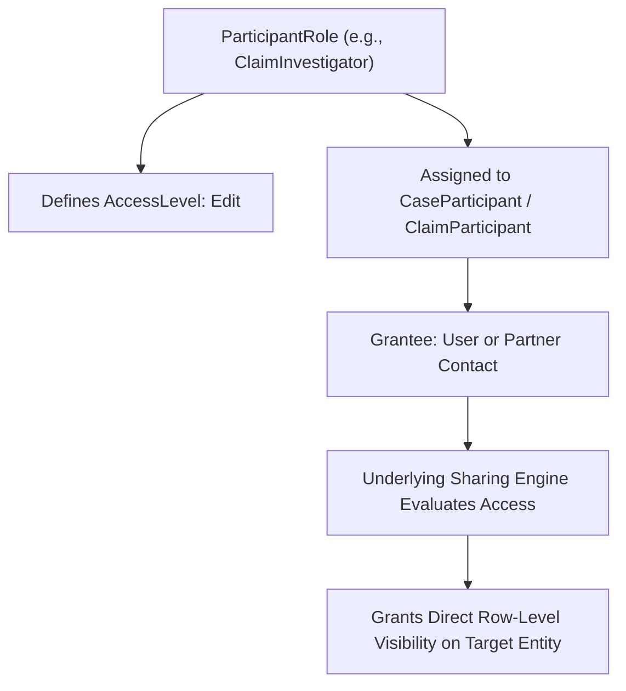

## Architectural Overview

`ParticipantRole` is an industry data model metadata type used heavily in Salesforce Financial Services Cloud (FSC), Health Cloud, and Public Sector Solutions. Modern service workflows—such as insurance claim processing, patient care management, legal investigations, and public complaints—involve complex stakeholder networks of internal employees, external advocates, medical professionals, and beneficiaries.

Rather than building brittle custom sharing mechanisms or excessive public groups, Salesforce employs `ParticipantRole` to model relational roles (e.g., "Primary Investigator", "Care Coordinator", "Legal Guardian"). When a user or contact is added to a record's participant list, the associated `ParticipantRole` dynamically determines their row-level access permissions (Read or Edit), streamlining compliance and auditability.



## Directory and File Conventions

In SFDX source format, each `ParticipantRole` is stored as an XML file within the `participantRoles/` directory.

| Property | Value |
| :--- | :--- |
| **Metadata Type Name** | `ParticipantRole` |
| **SFDX Directory** | `force-app/main/default/participantRoles/` |
| **File Suffix** | `.participantRole-meta.xml` |
| **Full File Path** | `force-app/main/default/participantRoles/<RoleDeveloperName>.participantRole-meta.xml` |

## Key Metadata Fields

The XML schema of `ParticipantRole` includes configuration for labels, access grants, and lifecycle states:

| Field Name | Field Type | Required | Architectural Description |
| :--- | :--- | :--- | :--- |
| `masterLabel` | `string` | Yes | Human-readable title displayed in participant selector interfaces. |
| `roleDescription` | `string` | No | Architectural and governance explanation of the role's responsibilities. |
| `accessLevel` | `string` | No | Default record-level access granted to members of this role (`Read`, `Edit`, `None`). |
| `status` | `string` | No | Operational status (`Active`, `Inactive`) controlling whether the role can be assigned. |

> [!NOTE]
> `ParticipantRole` records govern record-level access in conjunction with [SharingRules](/docs/metadata/sharing-rules-metadata-type/). They grant access via underlying share tables without replacing profile or permission set object-level security.

## Declarative XML and Package Manifest Examples

Below is a declarative definition for a Lead Claim Adjuster role in insurance processing:

```xml title="force-app/main/default/participantRoles/Lead_Claim_Adjuster.participantRole-meta.xml"
<?xml version="1.0" encoding="UTF-8"?>
<ParticipantRole xmlns="http://soap.sforce.com/2006/04/metadata">
    <accessLevel>Edit</accessLevel>
    <masterLabel>Lead Claim Adjuster</masterLabel>
    <roleDescription>Primary operational investigator responsible for claim resolution and payout authorization.</roleDescription>
    <status>Active</status>
</ParticipantRole>
```

### Read-Only Auditor Role

```xml title="force-app/main/default/participantRoles/Compliance_Auditor.participantRole-meta.xml"
<?xml version="1.0" encoding="UTF-8"?>
<ParticipantRole xmlns="http://soap.sforce.com/2006/04/metadata">
    <accessLevel>Read</accessLevel>
    <masterLabel>Compliance Auditor</masterLabel>
    <roleDescription>Internal audit and regulatory observer with read-only record access.</roleDescription>
    <status>Active</status>
</ParticipantRole>
```

### Package Manifest (`package.xml`)

```xml title="manifest/package.xml"
<?xml version="1.0" encoding="UTF-8"?>
<Package xmlns="http://soap.sforce.com/2006/04/metadata">
    <types>
        <members>*</members>
        <name>ParticipantRole</name>
    </types>
    <version>68.0</version>
</Package>
```

## CLI Retrieval and Deployment Commands

Manage `ParticipantRole` components using the Salesforce CLI:

```bash
# Retrieve all participant roles
sf project retrieve start --metadata ParticipantRole

# Deploy a specific participant role
sf project deploy start --metadata ParticipantRole:Lead_Claim_Adjuster

# Validate participant role metadata deployment
sf project deploy validate --metadata ParticipantRole
```

## Architect Best Practices and Gotchas

- **Industry Cloud Entitlement:** Deploying `ParticipantRole` requires the target org to have an active Industry Cloud license (e.g., FSC, Health Cloud, Public Sector) that supports participant management.
- **Access Level Downgrades:** If a `ParticipantRole` access level is modified from `Edit` to `Read`, existing record sharing records are asynchronously recalculated by the sharing recalculation queue.
- **Deactivation Over Deletion:** Once a `ParticipantRole` has been assigned to historical records in production, deleting the metadata will fail. Instead, set `status` to `Inactive` to prevent new assignments while preserving historical integrity.

> [!WARNING]
> Setting `accessLevel` to `Edit` bypasses read-only restrictions for participants who have standard object edit rights. Ensure strict field-level security is enforced on sensitive fields.
