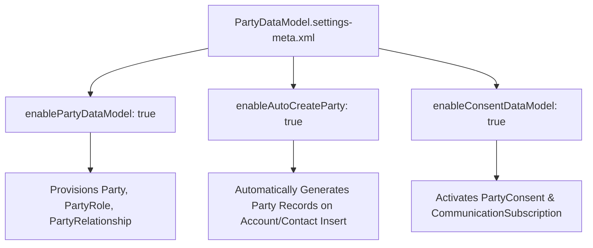

## Architectural Overview

The `PartyDataModelSettings` metadata type activates and configures the unified Party Data Model across the Salesforce platform. In modern enterprise architectures spanning multiple clouds (Sales, Service, Marketing Cloud, and Salesforce Data Cloud), customer identity is fragmented across `Account`, `Contact`, `Lead`, `User`, and third-party systems.

The Party Data Model introduces standardized entities—such as `Party`, `PartyRole`, `PartyConsent`, and `Individual`—that decouple human and organizational identity from transactional CRM roles. Activating `PartyDataModelSettings` enables unified identity resolution, multi-party consent management for GDPR/CCPA compliance, and clean integration into Data Cloud identity graphs.



## Directory and File Conventions

In SFDX source format, `PartyDataModelSettings` is stored in the `settings/` directory and referenced as `Settings:PartyDataModel`.

| Property | Value |
| :--- | :--- |
| **Metadata Type Name** | `Settings` (member: `PartyDataModel`) / `PartyDataModelSettings` |
| **SFDX Directory** | `force-app/main/default/settings/` |
| **File Suffix** | `.settings-meta.xml` |
| **Full File Path** | `force-app/main/default/settings/PartyDataModel.settings-meta.xml` |
| **Scratch Org Setting Key** | `partyDataModelSettings` |

## Key Metadata Fields

The `PartyDataModelSettings` metadata schema controls party entity provisioning and automatic creation triggers:

| Field Name | Field Type | Required | Architectural Description |
| :--- | :--- | :--- | :--- |
| `enablePartyDataModel` | `boolean` | No | Enables core Party Data Model standard objects and relationship hierarchies. |
| `enableAutoCreateParty` | `boolean` | No | Automatically creates and associates a corresponding `Party` record when an `Account` or `Contact` is inserted. |
| `enablePartyRole` | `boolean` | No | Enables multi-role associations (`PartyRole`) allowing a single entity to act as customer, supplier, and partner simultaneously. |
| `enableConsentDataModel` | `boolean` | No | Activates privacy and consent management tables tied to party records. |

> [!NOTE]
> Setting `enableAutoCreateParty` to `true` introduces system DML overhead during bulk data loads of Accounts and Contacts. Ensure bulk data migration scripts account for automatic child party generation.

## Declarative XML and Package Manifest Examples

Below is an enterprise configuration for enabling the unified party schema:

```xml title="force-app/main/default/settings/PartyDataModel.settings-meta.xml"
<?xml version="1.0" encoding="UTF-8"?>
<PartyDataModelSettings xmlns="http://soap.sforce.com/2006/04/metadata">
    <enableAutoCreateParty>true</enableAutoCreateParty>
    <enableConsentDataModel>true</enableConsentDataModel>
    <enablePartyDataModel>true</enablePartyDataModel>
    <enablePartyRole>true</enablePartyRole>
</PartyDataModelSettings>
```

### Scratch Org Definition Configuration

When testing Data Cloud ingestion pipelines in scratch orgs:

```json title="config/project-scratch-def.json"
{
  "orgName": "Party Data Model Scratch Org",
  "edition": "Enterprise",
  "features": ["DataCloud", "PrivacyManagement"],
  "settings": {
    "partyDataModelSettings": {
      "enablePartyDataModel": true,
      "enableAutoCreateParty": true,
      "enableConsentDataModel": true,
      "enablePartyRole": true
    }
  }
}
```

### Package Manifest (`package.xml`)

```xml title="manifest/package.xml"
<?xml version="1.0" encoding="UTF-8"?>
<Package xmlns="http://soap.sforce.com/2006/04/metadata">
    <types>
        <members>PartyDataModel</members>
        <name>Settings</name>
    </types>
    <version>68.0</version>
</Package>
```

## CLI Retrieval and Deployment Commands

Manage `PartyDataModelSettings` via the Salesforce CLI (`sf`):

```bash
# Retrieve PartyDataModelSettings from target org
sf project retrieve start --metadata Settings:PartyDataModel

# Deploy PartyDataModelSettings to remote org
sf project deploy start --metadata Settings:PartyDataModel

# Validate deployment without saving changes
sf project deploy validate --metadata Settings:PartyDataModel
```

## Architect Best Practices and Gotchas

- **Schema Pre-requisite for Data Cloud:** Deploy `PartyDataModel.settings-meta.xml` before establishing Data Cloud data streams pointing to CRM `Account` and `Contact` objects. This guarantees that party mapping fields exist.
- **Bulk Ingestion Performance:** When running initial data migrations with millions of rows, consider setting `enableAutoCreateParty` to `false` during data ingestion, backfilling party tables in batch Apex, and then deploying `enableAutoCreateParty: true` for ongoing operational sync.
- **Privacy Enforcement:** Combine the party data model with `Individual` object sharing rules to ensure privacy preferences (e.g., Do Not Call, Do Not Track) propagate cleanly across all child party roles.

> [!WARNING]
> Disabling `enablePartyDataModel` after creating downstream relationship records will break custom reports and integrations relying on party lookup keys.
