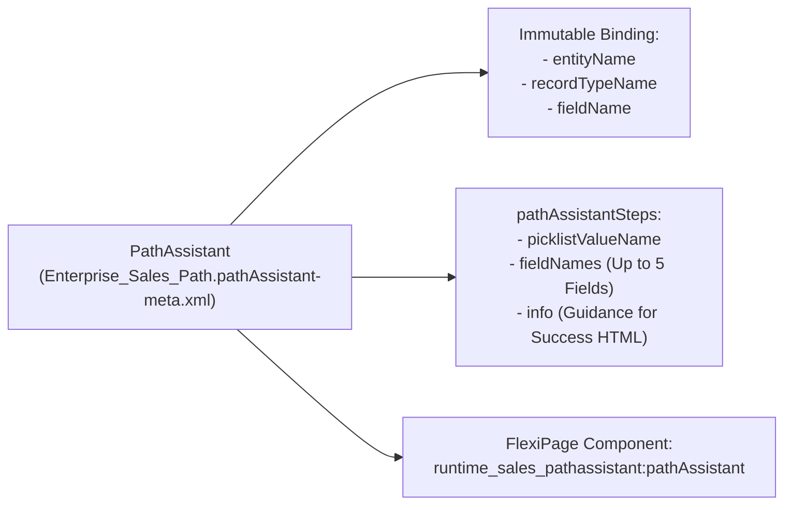

The `PathAssistant` metadata type configures **Lightning Path**—the interactive chevron progress bar rendered on a [FlexiPage](/docs/metadata/flexipage-metadata-type/) record page that guides users through the lifecycle stages of an `Opportunity`, `Lead`, `Case`, `Quote`, `Order`, `WorkOrder`, or custom object. Introduced in API version 34.0, `PathAssistant` binds a specific `entityName`, `recordTypeName`, and driving picklist `fieldName` to stage-specific key fields (`fieldNames`) and **Guidance for Success** coaching text (`info`).

In Salesforce DX projects, path definitions live in `force-app/main/default/pathAssistants/` with the `.pathAssistant-meta.xml` suffix.



## Key Metadata Fields

| Field | Location | Required | Description |
|---|---|---|---|
| `masterLabel` | Root | Yes | Display name of the Path in Setup -> Path Settings |
| `active` | Root | Yes | Whether the Path is active (`true`) or inactive (`false`) |
| `entityName` | Root | Yes | **Not updateable**. API name of the object (`Opportunity`, `Lead`, `Invoice__c`, etc.) |
| `fieldName` | Root | Yes | **Not updateable**. API name of the driving picklist field (`StageName`, `Status`, etc.) |
| `recordTypeName` | Root | Yes | **Not updateable**. Developer name of the [RecordType](/docs/metadata/record-type-metadata-type/) (or `__MASTER__` if no record types exist) |
| `picklistValueName` | `pathAssistantSteps` | Yes | Exact API name of the picklist value for that stage |
| `fieldNames` | `pathAssistantSteps` | No | Up to 5 field API names displayed under the chevron for this stage |
| `info` | `pathAssistantSteps` | No | HTML coaching instructions (**Guidance for Success**) shown alongside key fields |

## Production-Grade XML Example

Below is a `PathAssistant` (`Enterprise_Sales_Path.pathAssistant-meta.xml`) for `Opportunity` (`Enterprise_Sales` RecordType):

```xml
<?xml version="1.0" encoding="UTF-8"?>
<PathAssistant xmlns="http://soap.sforce.com/2006/04/metadata">
    <active>true</active>
    <entityName>Opportunity</entityName>
    <fieldName>StageName</fieldName>
    <masterLabel>Enterprise Sales Path</masterLabel>
    <pathAssistantSteps>
        <fieldNames>Amount</fieldNames>
        <fieldNames>CloseDate</fieldNames>
        <fieldNames>LeadSource</fieldNames>
        <fieldNames>NextStep</fieldNames>
        <info>&lt;p&gt;&lt;strong&gt;Discovery Checklist:&lt;/strong&gt;&lt;/p&gt;&lt;ul&gt;&lt;li&gt;Identify executive sponsor and budget owner.&lt;/li&gt;&lt;li&gt;Document current-state pain points and target go-live quarter.&lt;/li&gt;&lt;/ul&gt;</info>
        <picklistValueName>Discovery</picklistValueName>
    </pathAssistantSteps>
    <pathAssistantSteps>
        <fieldNames>Amount</fieldNames>
        <fieldNames>CloseDate</fieldNames>
        <fieldNames>NextStep</fieldNames>
        <info>&lt;p&gt;&lt;strong&gt;Technical Validation:&lt;/strong&gt; Complete Solutions Architect security review and attach signed POC success criteria.&lt;/p&gt;</info>
        <picklistValueName>Technical Validation</picklistValueName>
    </pathAssistantSteps>
    <recordTypeName>Enterprise_Sales</recordTypeName>
</PathAssistant>
```

> [!WARNING]
> **Missing Steps in `.pathAssistant-meta.xml`**: If a picklist value exists in the driving `RecordType` or [BusinessProcess](/docs/metadata/business-process-metadata-type/) but has no Key Fields or Guidance configured, Salesforce simply omits its `<pathAssistantSteps>` block from the XML file. The chevron step still renders in the UI—it just has no expandable drawer.

