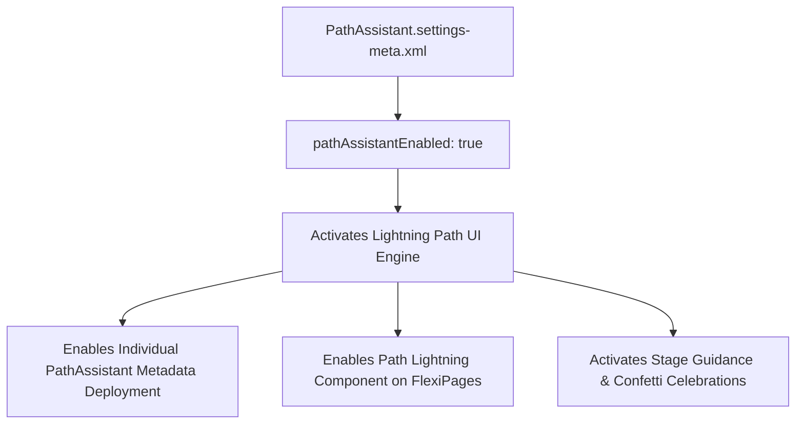

## Architectural Overview

The `PathAssistantSettings` metadata type represents the global feature switch governing Lightning Path in Salesforce. Lightning Path visually guides sales and service representatives through stages of a business process (such as Lead qualification, Opportunity closing, or Case escalation) with step-by-step guidance and key field prompts.

While individual path definitions are stored in `PathAssistant` metadata records, `PathAssistantSettings` provides the org-wide prerequisite activation. In automated CI/CD and scratch org provisioning pipelines, failing to deploy `PathAssistant.settings-meta.xml` before deploying [FlexiPage](/docs/metadata/flexipage-metadata-type/) components or individual `PathAssistant` definitions causes deployment errors stating that Path is not enabled in the target subscriber org.



## Directory and File Conventions

In SFDX source format, `PathAssistantSettings` is stored in the `settings/` directory and referenced as `Settings:PathAssistant`.

| Property | Value |
| :--- | :--- |
| **Metadata Type Name** | `Settings` (member: `PathAssistant`) / `PathAssistantSettings` |
| **SFDX Directory** | `force-app/main/default/settings/` |
| **File Suffix** | `.settings-meta.xml` |
| **Full File Path** | `force-app/main/default/settings/PathAssistant.settings-meta.xml` |
| **Scratch Org Setting Key** | `pathAssistantSettings` |

## Key Metadata Fields

The XML schema of `PathAssistantSettings` contains flags managing global path behavior:

| Field Name | Field Type | Required | Architectural Description |
| :--- | :--- | :--- | :--- |
| `pathAssistantEnabled` | `boolean` | No | Globally enables the Lightning Path component and runtime guidance engine. |
| `canSubtypeIncludeCollapsePath` | `boolean` | No | Controls whether users can collapse or expand the guidance drawer under the path Chevron bar. |

> [!NOTE]
> Individual milestone celebration animations (such as confetti upon reaching "Closed Won") are configured on the discrete `PathAssistant` metadata instances, but depend entirely on `pathAssistantEnabled` being set to `true`.

## Declarative XML and Package Manifest Examples

Below is a declarative `PathAssistant.settings-meta.xml` enabling Lightning Path:

```xml title="force-app/main/default/settings/PathAssistant.settings-meta.xml"
<?xml version="1.0" encoding="UTF-8"?>
<PathAssistantSettings xmlns="http://soap.sforce.com/2006/04/metadata">
    <canSubtypeIncludeCollapsePath>true</canSubtypeIncludeCollapsePath>
    <pathAssistantEnabled>true</pathAssistantEnabled>
</PathAssistantSettings>
```

### Scratch Org Definition Configuration

Enable Path Assistant inside developer scratch orgs:

```json title="config/project-scratch-def.json"
{
  "orgName": "Sales Cloud Path Dev Org",
  "edition": "Enterprise",
  "settings": {
    "pathAssistantSettings": {
      "pathAssistantEnabled": true,
      "canSubtypeIncludeCollapsePath": true
    }
  }
}
```

### Package Manifest (`package.xml`)

```xml title="manifest/package.xml"
<?xml version="1.0" encoding="UTF-8"?>
<Package xmlns="http://soap.sforce.com/2006/04/metadata">
    <types>
        <members>PathAssistant</members>
        <name>Settings</name>
    </types>
    <version>68.0</version>
</Package>
```

## CLI Retrieval and Deployment Commands

Manage `PathAssistantSettings` using Salesforce CLI:

```bash
# Retrieve PathAssistantSettings from the target environment
sf project retrieve start --metadata Settings:PathAssistant

# Deploy PathAssistantSettings to remote org
sf project deploy start --metadata Settings:PathAssistant

# Validate settings deployment
sf project deploy validate --metadata Settings:PathAssistant
```

## Architect Best Practices and Gotchas

- **Deployment Sequencing:** Always include `Settings:PathAssistant` in the foundational package tier. If a `FlexiPage` referencing the `runtime_sales_pathassistant:pathAssistant` component is deployed prior to `PathAssistantSettings`, the deployment will fail.
- **Picklist Value Dependencies:** Individual paths depend on picklist fields. If picklist values are renamed or deactivated, paths referencing those values will fail validation, even if `pathAssistantEnabled` remains true.
- **Mobile Experience Consistency:** Path guidance is responsive and renders on Salesforce Mobile. Ensure custom guidance rich text blocks do not contain fixed-width tables that break small-screen rendering.

> [!WARNING]
> Disabling `pathAssistantEnabled` hides all configured paths across Lead, Opportunity, and Custom Object Lightning pages immediately without deleting underlying path definitions.
