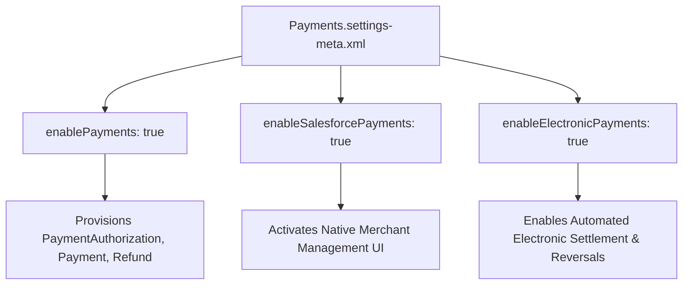

## Architectural Overview

The `PaymentsSettings` metadata type represents the platform-level activation switches for Salesforce Payments. In enterprise architectures incorporating B2B Commerce, D2C Commerce, Order Management, or Revenue Cloud, payment collection requires robust ledgering of authorizations, captures, voids, and refunds.

Deploying `PaymentsSettings` provisions the core payment domain objects: `Payment`, `PaymentAuthorization`, `PaymentGateway`, `Refund`, and `PaymentMethod`. When building automated CI/CD pipelines, deploying `Payments.settings-meta.xml` is an essential first step. Without it, custom payment triggers, [Flow](/docs/metadata/flow-metadata-type/) orchestrations, and payment UI components will fail compilation due to missing entity types.



## Directory and File Conventions

In SFDX source format, `PaymentsSettings` is located under the `settings/` directory and referenced using the `Settings` type with member `Payments`.

| Property | Value |
| :--- | :--- |
| **Metadata Type Name** | `Settings` (member: `Payments`) / `PaymentsSettings` |
| **SFDX Directory** | `force-app/main/default/settings/` |
| **File Suffix** | `.settings-meta.xml` |
| **Full File Path** | `force-app/main/default/settings/Payments.settings-meta.xml` |
| **Scratch Org Setting Key** | `paymentsSettings` |

## Key Metadata Fields

The XML schema of `PaymentsSettings` contains feature activation booleans:

| Field Name | Field Type | Required | Architectural Description |
| :--- | :--- | :--- | :--- |
| `enablePayments` | `boolean` | No | Enables the core Salesforce Payments platform and standard data model. |
| `enableSalesforcePayments` | `boolean` | No | Activates the native Salesforce Payments app and automated merchant onboarding. |
| `enableElectronicPayments` | `boolean` | No | Enables processing of real-time electronic credit card and digital wallet transactions. |

> [!NOTE]
> In addition to deploying `PaymentsSettings`, your subscriber org must possess the appropriate Salesforce Payments license entitlements or Commerce Cloud SKU allocation.

## Declarative XML and Package Manifest Examples

Below is a declarative configuration enabling Salesforce Payments:

```xml title="force-app/main/default/settings/Payments.settings-meta.xml"
<?xml version="1.0" encoding="UTF-8"?>
<PaymentsSettings xmlns="http://soap.sforce.com/2006/04/metadata">
    <enableElectronicPayments>true</enableElectronicPayments>
    <enablePayments>true</enablePayments>
    <enableSalesforcePayments>true</enableSalesforcePayments>
</PaymentsSettings>
```

### Scratch Org Definition Configuration

When testing payment flows in scratch orgs:

```json title="config/project-scratch-def.json"
{
  "orgName": "Commerce Payments Dev Org",
  "edition": "Enterprise",
  "features": ["CommercePayments", "OrderManagement"],
  "settings": {
    "paymentsSettings": {
      "enablePayments": true,
      "enableSalesforcePayments": true,
      "enableElectronicPayments": true
    }
  }
}
```

### Package Manifest (`package.xml`)

```xml title="manifest/package.xml"
<?xml version="1.0" encoding="UTF-8"?>
<Package xmlns="http://soap.sforce.com/2006/04/metadata">
    <types>
        <members>Payments</members>
        <name>Settings</name>
    </types>
    <version>68.0</version>
</Package>
```

## CLI Retrieval and Deployment Commands

Manage `PaymentsSettings` via Salesforce CLI commands:

```bash
# Retrieve PaymentsSettings from target environment
sf project retrieve start --metadata Settings:Payments

# Deploy PaymentsSettings to target org
sf project deploy start --metadata Settings:Payments

# Validate settings deployment
sf project deploy validate --metadata Settings:Payments
```

## Architect Best Practices and Gotchas

- **Pipeline Ordering:** Always stage `Payments.settings-meta.xml` before deploying payment gateway adapters or custom fields on `Payment` or `Refund`.
- **Data Protection and PII:** Payment records often link to customer accounts and contacts. Ensure [SharingRules](/docs/metadata/sharing-rules-metadata-type/) on payment entities are set to `Private` with access restricted strictly to finance and customer support operations.
- **Ledger Immutability:** Salesforce treats payment records as an immutable financial ledger. Once a `Payment` record is created with `Status = Processed`, direct edits to amount or transaction date are blocked by the platform.

> [!WARNING]
> Toggling `enablePayments` off in an environment with existing payment records can orphan critical accounting trails and break recurring subscription billing.
