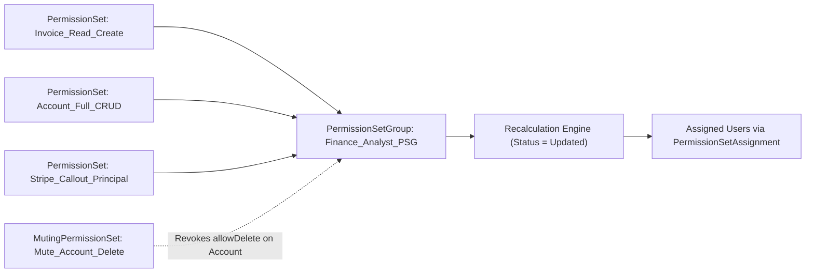

## Overview

The `PermissionSetGroup` metadata type (`permissionsetgroups/<Name>.permissionsetgroup-meta.xml`) bundles smaller, task-oriented [PermissionSet](/docs/metadata/permission-set-metadata-type/) components into job-role personas (such as `Sales_Operations_Persona` or `Finance_Controller_Group`). Instead of assigning 15 individual permission sets to every new hire, administrators and User Access Policies assign a single `PermissionSetGroup`.

Under the hood, Salesforce compiles all member `<permissionSets>` and subtracts any permissions listed in `<mutingPermissionSets>` into a single hidden aggregate `PermissionSet` record (`PermissionSet.PermissionSetGroupId`). This architecture delivers single-query runtime permission checks while keeping your source-controlled security model modular.



As shown in the diagram above, `Finance_Analyst_PSG` combines three reusable feature Permission Sets and applies a `MutingPermissionSet` to strip `Delete` access on `Account` for analysts without altering the shared `Account_Full_CRUD` permission set.

## Prerequisites

- **Permissions:** "Manage Profiles and Permission Sets" to deploy; "View Setup and Configuration" or "Assign Permission Sets" to query.
- **Member Dependencies:** All referenced `<permissionSets>` and `<mutingPermissionSets>` must exist in the target org or be included in the same `package.xml` deployment.
- **API Version:** Introduced in API version 45.0. Verified against API version `68.0` (Winter '27).

## PermissionSetGroup XML Fields

| XML Field | Type | Required | Description & Best Practice |
| :--- | :--- | :--- | :--- |
| `label` | `string` | ✅ Yes | Display name in Setup (`Finance Analyst Group`). |
| `description` | `string` | No | Documents the persona and business justification for audit compliance. |
| `permissionSets` | `string[]` | No | Array of member `PermissionSet` API names. For managed package permission sets, prepend the namespace (`ns__PermSetName`). |
| `mutingPermissionSets` | `string[]` | No | References the single `MutingPermissionSet` API name (`<GroupName>_Muted`) that disables specific inherited permissions. |
| `hasActivationRequired` | `boolean` | No | Introduced in v53.0. If `true`, requires session-based activation before the group's permissions apply. |
| `status` | `string` | No | Recalculation state (`Updated`, `Outdated`, `Updating`, `Failed`). Omit or leave as `Updated` in Git source files. |

> [!TIP]
> Do not commit `<status>Outdated</status>` or `<status>Updating</status>` into Git if you retrieve a `PermissionSetGroup` immediately after modifying one of its child permission sets. Always wait for recalculation to finish (`Updated`) or strip the `<status>` tag from your `.permissionsetgroup-meta.xml` file.

## Querying PermissionSetGroup via SOQL

Salesforce exposes three standard SOQL objects for inspecting Permission Set Groups: `PermissionSetGroup`, `PermissionSetGroupComponent`, and `PermissionSetAssignment`.

### 1. Check PermissionSetGroup Recalculation Status Across the Org
Verify that no groups are stuck in `Failed` or `Outdated` status after a deployment:

```soql
SELECT Id, DeveloperName, MasterLabel, Status,
       HasActivationRequired, Description, LastModifiedDate
FROM PermissionSetGroup
ORDER BY Status ASC, DeveloperName ASC
```

### 2. Inspect All Member Permission Sets Inside a Group
Use `PermissionSetGroupComponent` to audit the exact composition of a persona group:

```soql
SELECT PermissionSetGroup.DeveloperName, PermissionSetGroup.Status,
       PermissionSet.Name, PermissionSet.Label, PermissionSet.IsCustom
FROM PermissionSetGroupComponent
WHERE PermissionSetGroup.DeveloperName = 'Finance_Mgmt_PermSetGroup'
ORDER BY PermissionSet.Name ASC
```

### 3. Query Users Assigned to a PermissionSetGroup
```soql
SELECT Assignee.Name, Assignee.Username, PermissionSetGroup.DeveloperName, ExpirationDate
FROM PermissionSetAssignment
WHERE PermissionSetGroup.DeveloperName = 'Finance_Mgmt_PermSetGroup'
  AND Assignee.IsActive = true
```

## Example

The following example shows a `Finance_Mgmt_PermSetGroup.permissionsetgroup-meta.xml` file that aggregates two feature permission sets (`Invoice_Billing_Manager` and `Account_Operations`) and applies a muting permission set (`Finance_Mgmt_Muted`) to remove delete permissions.

```xml title="force-app/main/default/permissionsetgroups/Finance_Mgmt_PermSetGroup.permissionsetgroup-meta.xml"
<?xml version="1.0" encoding="UTF-8"?>
<PermissionSetGroup xmlns="http://soap.sforce.com/2006/04/metadata">
    <description>Persona bundle for regional finance analysts. Mutes Account and Invoice deletion.</description>
    <hasActivationRequired>false</hasActivationRequired>
    <label>Finance Management Group</label>
    <mutingPermissionSets>Finance_Mgmt_Muted</mutingPermissionSets>
    <permissionSets>Invoice_Billing_Manager</permissionSets>
    <permissionSets>Account_Operations</permissionSets>
    <status>Updated</status>
</PermissionSetGroup>
```

### Package Manifest (`package.xml`) with Member PermissionSets

When retrieving or deploying a `PermissionSetGroup`, always include its member `PermissionSet` and `MutingPermissionSet` definitions:

```xml title="manifest/package.xml"
<?xml version="1.0" encoding="UTF-8"?>
<Package xmlns="http://soap.sforce.com/2006/04/metadata">
    <types>
        <members>Finance_Mgmt_PermSetGroup</members>
        <name>PermissionSetGroup</name>
    </types>
    <types>
        <members>Invoice_Billing_Manager</members>
        <members>Account_Operations</members>
        <name>PermissionSet</name>
    </types>
    <types>
        <members>Finance_Mgmt_Muted</members>
        <name>MutingPermissionSet</name>
    </types>
    <version>68.0</version>
</Package>
```

## Limits and Gotchas

- **PermissionSets per Group Limit:** A single `PermissionSetGroup` can contain up to **100 Permission Sets**.
- **Groups per Org Limit:** Up to **700–1,000 Permission Set Groups** depending on edition.
- **Unit Test Recalculation in Apex:** When creating or modifying `PermissionSetGroupComponent` records in `@IsTest` methods, call `Test.calculatePermissionSetGroup(psgId)` to force synchronous recalculation during the test execution.
- **Dependency Chain on Muting:** If a `MutingPermissionSet` mutes `Read` access on an object, Salesforce automatically mutes `Create`, `Edit`, `Delete`, `View All`, and `Modify All` on that object within the group.

## Related Official Documentation

- [PermissionSetGroup Metadata API Reference](https://developer.salesforce.com/docs/atlas.en-us.api_meta.meta/api_meta/meta_permissionsetgroup.htm): XML elements and manifest samples.
- [PermissionSetGroup Object Reference](https://developer.salesforce.com/docs/atlas.en-us.object_reference.meta/object_reference/sforce_api_objects_permissionsetgroup.htm): Standard SOQL fields and recalculation statuses.

