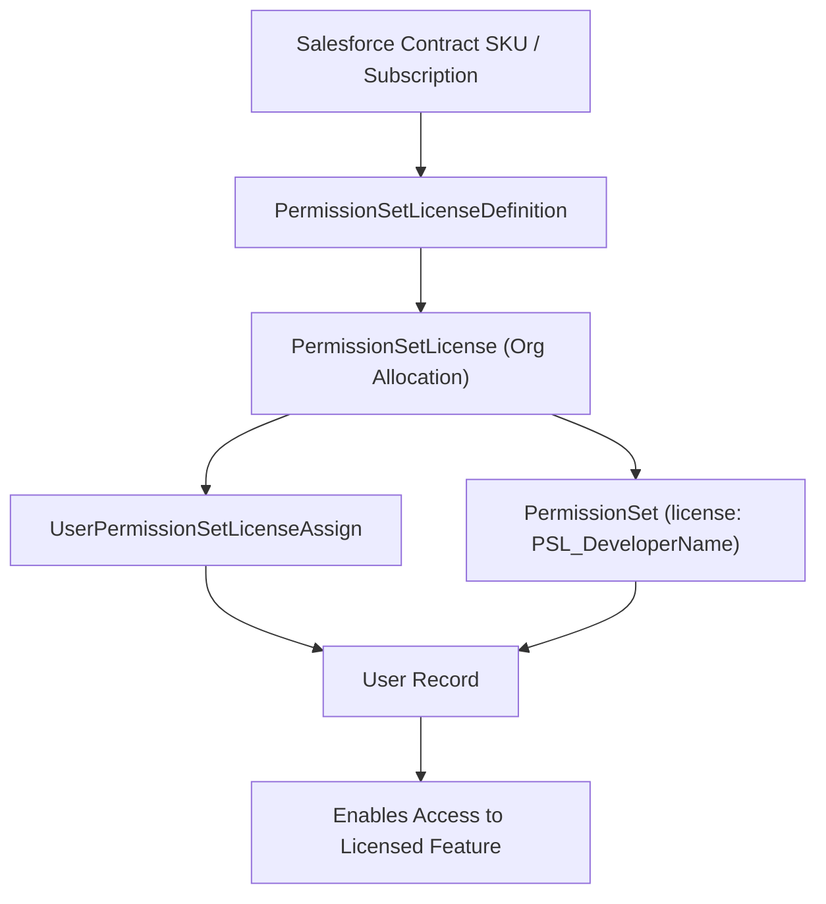

## Architectural Overview

`PermissionSetLicenseDefinition` represents the underlying system definition of Permission Set Licenses (PSLs) in Salesforce. While base user licenses (e.g., Salesforce, Identity, Platform) determine the fundamental data and administrative capabilities of a user, PSLs grant incremental access to specialized features—such as CRM Analytics, Service Cloud Voice, Field Service, or Health Cloud.

In source-driven development and packaging, [PermissionSet](/docs/metadata/permission-set-metadata-type/) components often include a `<hasActivationRequired>` flag or an explicit `<license>` tag referencing a permission set license developer name. Understanding `PermissionSetLicenseDefinition` enables Technical Architects to audit license pools, enforce entitlement checks in CI/CD pipelines, and prevent deployment failures caused by missing licenses in scratch orgs or sandboxes.



## Directory and File Conventions

`PermissionSetLicenseDefinition` is a system-level metadata entity. While PSLs cannot be arbitrarily created by subscribers through metadata XML deployments, their developer names are referenced in permission sets and inspected via the Tooling and Metadata APIs.

| Property | Value |
| :--- | :--- |
| **Metadata / Tooling Entity** | `PermissionSetLicenseDefinition` / `PermissionSetLicense` |
| **Referencing Metadata Type** | `PermissionSet` (`<license>` tag) |
| **Query Mechanism** | SOQL / Tooling API (`PermissionSetLicense`) |
| **Scratch Org Def Key** | `"features"` array in `project-scratch-def.json` |

## Key Entity Fields

When inspecting PSL definitions through the Tooling and REST APIs, the following fields determine feature entitlement:

| Field Name | Field Type | Architectural Description |
| :--- | :--- | :--- |
| `DeveloperName` | `string` | Unique API developer name referenced by `PermissionSet` metadata (e.g., `SalesConsoleUser`). |
| `MasterLabel` | `string` | User-facing display name of the permission set license in Setup. |
| `Status` | `string` | Status of the license allocation (`Active`, `Suspended`). |
| `TotalLicenses` | `integer` | Total number of seats provisioned across the subscriber tenant. |
| `UsedLicenses` | `integer` | Count of active users currently assigned this permission set license. |
| `PermissionSetLicenseKey` | `string` | Internal system key identifying the underlying feature permission suite. |

> [!NOTE]
> If a `PermissionSet` specifies a `<license>` tag, the target org must possess an active `PermissionSetLicense` matching that developer name. If the license is missing or consumed, metadata deployment succeeds, but automated user assignment will throw `LICENSE_REQUIRED` exceptions.

## Declarative XML and Package Manifest Examples

Below is a declarative `PermissionSet` metadata file referencing an underlying Permission Set License:

```xml title="force-app/main/default/permissionsets/Sales_Insights_User.permissionset-meta.xml"
<?xml version="1.0" encoding="UTF-8"?>
<PermissionSet xmlns="http://soap.sforce.com/2006/04/metadata">
    <description>Grants access to advanced sales insights and predictive forecasting.</description>
    <hasActivationRequired>false</hasActivationRequired>
    <label>Sales Insights User</label>
    <license>SalesUserPsl</license>
    <userPermissions>
        <enabled>true</enabled>
        <name>ViewAllData</name>
    </userPermissions>
</PermissionSet>
```

### Scratch Org Feature Entitlement Configuration

To provision the required permission set licenses inside developer scratch orgs, declare them in the scratch org definition `features` array:

```json title="config/project-scratch-def.json"
{
  "orgName": "Sales Insights Feature Org",
  "edition": "Enterprise",
  "features": ["SalesUserPsl", "ServiceCloudVoiceUserPsl"],
  "settings": {
    "userManagementSettings": {
      "enableEnhancedPermsetList": true
    }
  }
}
```

### Package Manifest (`package.xml`)

```xml title="manifest/package.xml"
<?xml version="1.0" encoding="UTF-8"?>
<Package xmlns="http://soap.sforce.com/2006/04/metadata">
    <types>
        <members>Sales_Insights_User</members>
        <name>PermissionSet</name>
    </types>
    <version>68.0</version>
</Package>
```

## CLI Inspection and Query Commands

Query available permission set licenses and usage in target orgs using the Salesforce CLI:

```bash
# Query active permission set licenses and seat allocations
sf data query --query "SELECT Id, DeveloperName, MasterLabel, TotalLicenses, UsedLicenses, Status FROM PermissionSetLicense" --target-org prodOrg

# Query users assigned to a specific PSL
sf data query --query "SELECT Id, Assignee.Name, PermissionSetLicense.DeveloperName FROM PermissionSetLicenseAssign WHERE PermissionSetLicense.DeveloperName = 'SalesUserPsl'"

# Assign a permission set license to a user
sf org assign permsetlicense --name SalesUserPsl --target-org devOrg
```

## Architect Best Practices and Gotchas

- **Scratch Org Provisioning Failures:** A frequent source of CI/CD pipeline breakage occurs when permission sets with `<license>` tags are deployed into scratch orgs that lack the corresponding feature flag in `project-scratch-def.json`. Always test scratch definitions with newly referenced licenses.
- **Auditing Seat Depletion:** In large enterprise orgs, implement automated SOQL monitoring scripts on `PermissionSetLicense` to alert platform teams when `UsedLicenses` reaches 95% of `TotalLicenses`.
- **Decoupling Permission Sets:** Where possible, design permission sets without the `<license>` restriction unless the user permission strictly demands a PSL. This preserves architectural flexibility across mixed user tiers.

> [!WARNING]
> You cannot unassign a Permission Set License from a user if they are currently assigned any permission set that explicitly requires that license.
