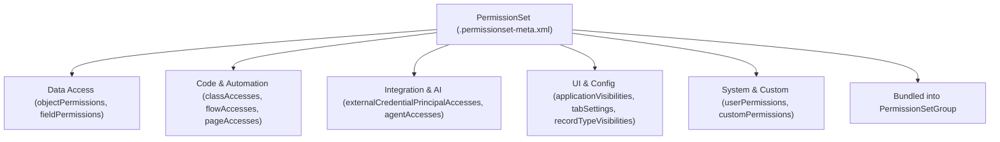

## Overview

The `PermissionSet` metadata type (`permissionsets/<Name>.permissionset-meta.xml`) is Salesforce's recommended mechanism for granting functional access to users. While a [Profile](/docs/metadata/profile-metadata-type/) establishes a user's minimum baseline settings (such as login IP ranges and default page layouts), `PermissionSet` components grant modular, additive permissions for objects (`objectPermissions`), fields (`fieldPermissions`), Apex classes (`classAccesses`), Flows (`flowAccesses`), External Credential Principals (`externalCredentialPrincipalAccesses`), and Agentforce Agents (`agentAccesses`).

Crucially, starting in API version `40.0`, retrieving or deploying a `PermissionSet` is a **full-replacement operation**: retrieving a `PermissionSet` pulls all of its junction permissions automatically without needing to include the referenced objects or classes in `package.xml`, and deploying a `PermissionSet` overwrites its entire state in the target org.



As shown in the diagram above, a single `PermissionSet` encapsulates five permission domains and rolls up cleanly into a [PermissionSetGroup](/docs/metadata/permission-set-group-metadata-type/) for persona-based user assignment.

## Prerequisites

- **Permissions:** "Manage Profiles and Permission Sets" and "Customize Application" permissions to deploy; "View Setup and Configuration" to query metadata.
- **Referenced Components:** Every object, field, Apex class, Flow, or External Credential referenced in the `.permissionset-meta.xml` file must exist in the target org or be included in the same deployment payload.
- **API Version:** Verified against API version `68.0` (Winter '27).

## Key XML Elements in PermissionSet

| XML Element | Introduced | Purpose & Deployment Behavior |
| :--- | :--- | :--- |
| `label` | v22.0 | **Required.** Human-readable name (≤80 characters) shown in Setup. |
| `hasActivationRequired` | v37.0 | When `true`, the permission set only takes effect during an active session-based activation (`SessionPermissionSetActivation`). |
| `license` | v38.0 | Optional User License or Permission Set License name. Leave blank to keep the permission set license-agnostic whenever possible. |
| `objectPermissions` | v23.0 | Grants `allowCreate`, `allowRead`, `allowEdit`, `allowDelete`, `viewAllRecords`, `modifyAllRecords`, and `viewAllFields` (v63.0+). |
| `fieldPermissions` | v23.0 | Grants `readable` and `editable` access per `Object.Field` name. |
| `classAccesses` | v23.0 | Enables top-level `@AuraEnabled`, `@RestResource`, or SOAP [ApexClass](/docs/metadata/apex-class-metadata-type/) execution. |
| `externalCredentialPrincipalAccesses` | v59.0 | Authorizes callout principals defined in [ExternalCredential](/docs/metadata/external-credential-metadata-type/) (`ExternalCredentialName-PrincipalName`). |
| `agentAccesses` | v63.0 | Grants access to Agentforce Employee Agents (`agentName` and `enabled`). |

> [!WARNING]
> Because `PermissionSet` deployment in API v40.0+ is a **complete replacement**, never deploy a hand-trimmed `.permissionset-meta.xml` file containing only one new field permission unless you want all existing permissions in that set wiped out. Always retrieve the full file from the target org or maintain the complete file in Git.

## Querying PermissionSet, CRUD, and FLS via SOQL

`PermissionSet`, `ObjectPermissions`, `FieldPermissions`, `SetupEntityAccess`, and `PermissionSetAssignment` are all first-class standard SOQL objects.

### 1. Audit Which Permission Sets Grant Read/Edit Access to a Sensitive Field
Use `FieldPermissions` in standard SOQL to verify Field-Level Security across all custom Permission Sets (filtering out profile-owned sets with `Parent.IsOwnedByProfile = false`):

```soql
SELECT Parent.Name, Parent.Label, SobjectType, Field,
       PermissionsRead, PermissionsEdit
FROM FieldPermissions
WHERE SobjectType = 'Invoice__c'
  AND Field = 'Invoice__c.ERP_External_Id__c'
  AND Parent.IsOwnedByProfile = false
ORDER BY Parent.Name ASC
```

### 2. Audit Object CRUD and Modify All Data Across Permission Sets
Query `ObjectPermissions` to spot overly permissive `PermissionsModifyAllRecords` or `PermissionsViewAllRecords` grants:

```soql
SELECT Parent.Name, Parent.Label, SobjectType,
       PermissionsCreate, PermissionsRead, PermissionsEdit, PermissionsDelete,
       PermissionsViewAllRecords, PermissionsModifyAllRecords
FROM ObjectPermissions
WHERE SobjectType = 'Invoice__c'
  AND Parent.IsOwnedByProfile = false
```

### 3. Find All Active Users Assigned to a Specific Permission Set
```soql
SELECT AssigneeId, Assignee.Name, Assignee.Username,
       PermissionSet.Name, SystemModstamp
FROM PermissionSetAssignment
WHERE PermissionSet.Name = 'Invoice_Billing_Manager'
  AND Assignee.IsActive = true
ORDER BY Assignee.Name ASC
```

## Example

The following `Invoice_Billing_Manager.permissionset-meta.xml` grants full CRUD on `Invoice__c`, FLS on its custom fields, access to `InvoiceBillingService` Apex class, access to the `Stripe_Gateway-NamedPrincipal` external credential, and a custom permission.

```xml title="force-app/main/default/permissionsets/Invoice_Billing_Manager.permissionset-meta.xml"
<?xml version="1.0" encoding="UTF-8"?>
<PermissionSet xmlns="http://soap.sforce.com/2006/04/metadata">
    <classAccesses>
        <apexClass>InvoiceBillingService</apexClass>
        <enabled>true</enabled>
    </classAccesses>
    <customPermissions>
        <enabled>true</enabled>
        <name>Approve_High_Value_Invoices</name>
    </customPermissions>
    <description>Grants billing managers full access to Invoices, billing Apex services, and Stripe callouts.</description>
    <externalCredentialPrincipalAccesses>
        <enabled>true</enabled>
        <externalCredentialPrincipal>Stripe_Auth-NamedPrincipal</externalCredentialPrincipal>
    </externalCredentialPrincipalAccesses>
    <fieldPermissions>
        <editable>true</editable>
        <field>Invoice__c.Billing_Account__c</field>
        <readable>true</readable>
    </fieldPermissions>
    <fieldPermissions>
        <editable>false</editable>
        <field>Invoice__c.ERP_External_Id__c</field>
        <readable>true</readable>
    </fieldPermissions>
    <hasActivationRequired>false</hasActivationRequired>
    <label>Invoice Billing Manager</label>
    <objectPermissions>
        <allowCreate>true</allowCreate>
        <allowDelete>false</allowDelete>
        <allowEdit>true</allowEdit>
        <allowRead>true</allowRead>
        <modifyAllRecords>false</modifyAllRecords>
        <object>Invoice__c</object>
        <viewAllRecords>true</viewAllRecords>
    </objectPermissions>
    <tabSettings>
        <tab>Invoice__c</tab>
        <visibility>Visible</visibility>
    </tabSettings>
</PermissionSet>
```

Assign the permission set to a scratch org or sandbox user via the `sf` CLI:

```bash
sf org assign permset --name Invoice_Billing_Manager --target-org UATSandbox
```

## Limits and Gotchas

- **Maximum Permission Sets per Org:** Up to 1,500 custom permission sets per org (varies by edition).
- **Master-Detail Dependency on `objectPermissions`:** If `Invoice_Line__c` has a Master-Detail relationship to `Invoice__c`, granting `allowRead` or `allowCreate` on `Invoice_Line__c` requires `<allowRead>true</allowRead>` on the parent `Invoice__c` object within the same `PermissionSet`, or the deployment fails.
- **Inactive Record Types Ignored:** `recordTypeVisibilities` are never retrieved or deployed for inactive [RecordType](/docs/metadata/record-type-metadata-type/) components.

## Related Official Documentation

- [PermissionSet Metadata API Reference](https://developer.salesforce.com/docs/atlas.en-us.api_meta.meta/api_meta/meta_permissionset.htm): Full XML schema for all permission set junction types.
- [PermissionSet Object Reference](https://developer.salesforce.com/docs/atlas.en-us.object_reference.meta/object_reference/sforce_api_objects_permissionset.htm): Standard SOQL schema for `PermissionSet`, `ObjectPermissions`, and `FieldPermissions`.

