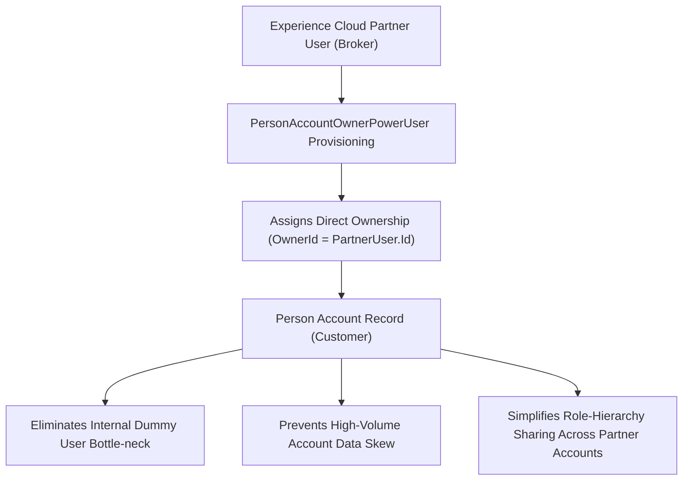

## Architectural Overview

In standard Salesforce B2C implementations, Person Accounts represent individual consumers by fusing the `Account` and `Contact` standard objects. Historically, the platform enforced a strict security rule: only internal Salesforce CRM users could be assigned as the `OwnerId` of an Account or Person Account record.

In distributed B2B2C business models—such as insurance broker networks, automotive dealer portals, or wealth advisory practices using Experience Cloud—external partners need to create, manage, and own their consumer client records. Without special provisioning, architects were forced to route all consumer accounts under a single dummy internal user, generating severe account data ownership skew and locking database tables during recalculation.

The `PersonAccountOwnerPowerUser` metadata type enables designated external community and partner power user roles to hold direct ownership of Person Account records. This distributes data ownership, prevents sharing recalculation bottlenecks, and simplifies portal record visibility.



## Directory and File Conventions

In SFDX source format, `PersonAccountOwnerPowerUser` configurations are stored under the `personAccountOwnerPowerUsers/` directory or managed within community settings bundles.

| Property | Value |
| :--- | :--- |
| **Metadata Type Name** | `PersonAccountOwnerPowerUser` |
| **SFDX Directory** | `force-app/main/default/personAccountOwnerPowerUsers/` |
| **File Suffix** | `.personAccountOwnerPowerUser-meta.xml` |
| **Full File Path** | `force-app/main/default/personAccountOwnerPowerUsers/<Name>.personAccountOwnerPowerUser-meta.xml` |

## Key Metadata Fields

The XML schema of `PersonAccountOwnerPowerUser` configures user license privileges and portal bindings:

| Field Name | Field Type | Required | Architectural Description |
| :--- | :--- | :--- | :--- |
| `developerName` | `string` | Yes | Unique API developer name representing the power user configuration. |
| `masterLabel` | `string` | Yes | Label describing the partner role or community persona. |
| `portalType` | `string` | Yes | Target portal framework type (`Partner`, `CustomerSuccess`, `Network`). |
| `userType` | `string` | Yes | External community license category (`PowerPartner`, `CspLitePortal`). |

> [!NOTE]
> Person Accounts must be enabled in the target subscriber org before deploying `PersonAccountOwnerPowerUser` metadata. In scratch org definitions, include `"PersonAccounts"` under `"features"`.

## Declarative XML and Package Manifest Examples

Below is a declarative `PersonAccountOwnerPowerUser` configuration for an insurance broker community:

```xml title="force-app/main/default/personAccountOwnerPowerUsers/Broker_Power_User.personAccountOwnerPowerUser-meta.xml"
<?xml version="1.0" encoding="UTF-8"?>
<PersonAccountOwnerPowerUser xmlns="http://soap.sforce.com/2006/04/metadata">
    <developerName>Broker_Power_User</developerName>
    <masterLabel>Broker Power User</masterLabel>
    <portalType>Partner</portalType>
    <userType>PowerPartner</userType>
</PersonAccountOwnerPowerUser>
```

### Scratch Org Definition Configuration

When testing partner Person Account ownership in scratch orgs:

```json title="config/project-scratch-def.json"
{
  "orgName": "Partner Person Account Dev Org",
  "edition": "Enterprise",
  "features": ["PersonAccounts", "Communities", "PartnerRoles"],
  "settings": {
    "communitiesSettings": {
      "enableNetworksViaAPI": true
    }
  }
}
```

### Package Manifest (`package.xml`)

```xml title="manifest/package.xml"
<?xml version="1.0" encoding="UTF-8"?>
<Package xmlns="http://soap.sforce.com/2006/04/metadata">
    <types>
        <members>Broker_Power_User</members>
        <name>PersonAccountOwnerPowerUser</name>
    </types>
    <version>68.0</version>
</Package>
```

## CLI Retrieval and Deployment Commands

Manage `PersonAccountOwnerPowerUser` using `sf`:

```bash
# Retrieve PersonAccountOwnerPowerUser configurations
sf project retrieve start --metadata PersonAccountOwnerPowerUser

# Deploy specific power user configuration
sf project deploy start --metadata PersonAccountOwnerPowerUser:Broker_Power_User

# Validate deployment into a target sandbox
sf project deploy validate --metadata PersonAccountOwnerPowerUser
```

## Architect Best Practices and Gotchas

- **Role Hierarchy Limits for Partners:** Partner users with ownership privileges create partner executive and manager roles in the role hierarchy. Ensure partner account creation does not exceed platform limits on portal role hierarchy nodes.
- **Sharing Rule Optimization:** When partner users own Person Accounts, ensure Organization-Wide Defaults (OWD) for Account are configured as `Private` for external users and `Public Read/Write` or `Private` for internal users. Use Criteria-Based [SharingRules](/docs/metadata/sharing-rules-metadata-type/) or Sharing Sets to expose records to internal supervisors.
- **Partner User Deactivation:** When an external broker or partner leaves the organization, their owned Person Accounts must be systematically reassigned to avoid orphaned records blocking customer service interactions.

> [!WARNING]
> Enabling external ownership of Person Accounts grants external users full record owner privileges (including deleting or re-sharing records) unless explicitly restricted by validation rules or Apex triggers.
