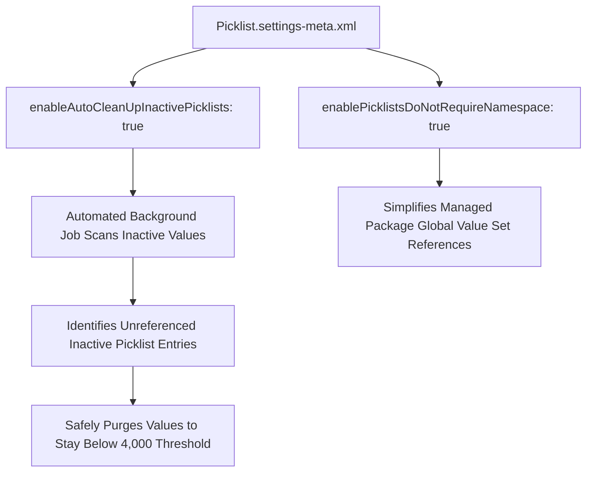

## Architectural Overview

The `PicklistSettings` metadata type manages platform governance settings for custom picklists and global value sets across Salesforce. In mature enterprise orgs that have operated for years, picklist fields on `Account`, `Contact`, `Opportunity`, and custom objects often accumulate thousands of deprecated, inactive values.

Salesforce enforces a strict platform ceiling: a single picklist field cannot contain more than 4,000 total values (active plus inactive). When unrestricted integrations insert arbitrary picklist entries into unrestricted fields, the limit is quickly reached, causing unexpected runtime save failures. `PicklistSettings` provides automated lifecycle management—enabling automatic pruning of unreferenced inactive picklist values and standardizing value set resolution.



## Directory and File Conventions

In SFDX source format, `PicklistSettings` is stored in the `settings/` directory and referenced as `Settings:Picklist`.

| Property | Value |
| :--- | :--- |
| **Metadata Type Name** | `Settings` (member: `Picklist`) / `PicklistSettings` |
| **SFDX Directory** | `force-app/main/default/settings/` |
| **File Suffix** | `.settings-meta.xml` |
| **Full File Path** | `force-app/main/default/settings/Picklist.settings-meta.xml` |
| **Scratch Org Setting Key** | `picklistSettings` |

## Key Metadata Fields

The XML schema of `PicklistSettings` exposes parameters controlling picklist retention and namespaces:

| Field Name | Field Type | Required | Architectural Description |
| :--- | :--- | :--- | :--- |
| `enableAutoCleanUpInactivePicklists` | `boolean` | No | Enables the automated clean-up service that deletes unused inactive picklist values on custom fields. |
| `enablePicklistsDoNotRequireNamespace` | `boolean` | No | Allows unmanaged custom fields to reference packaged global value sets without namespace prefixes in code. |

> [!NOTE]
> The automated cleanup initiated by `enableAutoCleanUpInactivePicklists` permanently removes inactive picklist values that are not present in any existing record in the database. Active values are never touched.

## Declarative XML and Package Manifest Examples

Below is a declarative configuration for automated picklist governance:

```xml title="force-app/main/default/settings/Picklist.settings-meta.xml"
<?xml version="1.0" encoding="UTF-8"?>
<PicklistSettings xmlns="http://soap.sforce.com/2006/04/metadata">
    <enableAutoCleanUpInactivePicklists>true</enableAutoCleanUpInactivePicklists>
    <enablePicklistsDoNotRequireNamespace>true</enablePicklistsDoNotRequireNamespace>
</PicklistSettings>
```

### Scratch Org Definition Configuration

When standardizing scratch org definitions for continuous integration:

```json title="config/project-scratch-def.json"
{
  "orgName": "Enterprise Data Governance Org",
  "edition": "Enterprise",
  "settings": {
    "picklistSettings": {
      "enableAutoCleanUpInactivePicklists": true,
      "enablePicklistsDoNotRequireNamespace": true
    }
  }
}
```

### Package Manifest (`package.xml`)

```xml title="manifest/package.xml"
<?xml version="1.0" encoding="UTF-8"?>
<Package xmlns="http://soap.sforce.com/2006/04/metadata">
    <types>
        <members>Picklist</members>
        <name>Settings</name>
    </types>
    <version>68.0</version>
</Package>
```

## CLI Retrieval and Deployment Commands

Manage `PicklistSettings` using the Salesforce CLI:

```bash
# Retrieve PicklistSettings from the active target org
sf project retrieve start --metadata Settings:Picklist

# Deploy PicklistSettings to target environment
sf project deploy start --metadata Settings:Picklist

# Validate picklist settings deployment
sf project deploy validate --metadata Settings:Picklist
```

## Architect Best Practices and Gotchas

- **Restricted vs. Unrestricted Fields:** For new custom fields, always set `<restricted>true</restricted>` in [CustomField](/docs/metadata/custom-field-metadata-type/) definitions. This prevents automated API integrations from creating rogue inactive values in the first place.
- **Reporting Historical Data Drift:** Before enabling `enableAutoCleanUpInactivePicklists`, verify whether historical analytics or Data Cloud queries rely on inactive picklist values. If historical records hold inactive values, those values are preserved; only values with zero record references are purged.
- **Global Value Set Modularization:** Migrate custom picklists containing shared business domains (e.g., Country codes, Industry classifications) to Global Value Sets to enforce consistency across multiple objects.

> [!WARNING]
> Once unused inactive values are pruned by the automatic cleanup service, they cannot be recovered from the Recycle Bin and must be manually recreated if needed again.
