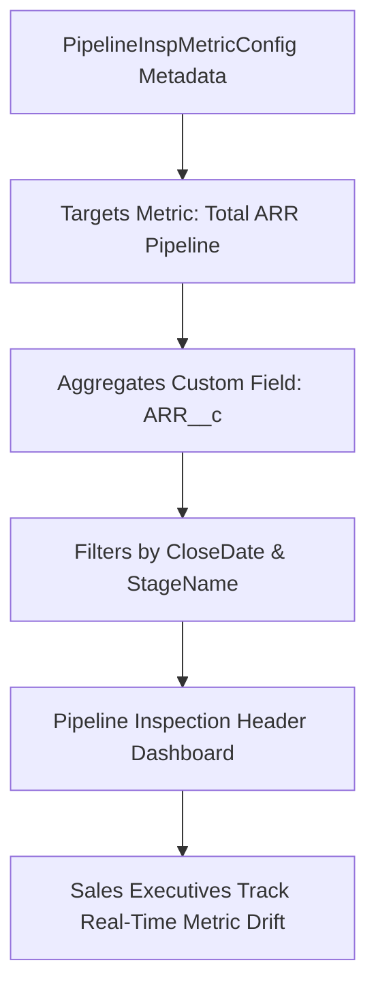

## Architectural Overview

`PipelineInspMetricConfig` is a metadata type in Sales Cloud that customizes the metric cards displayed at the top of the Pipeline Inspection view. Pipeline Inspection provides sales leaders and account executives with consolidated deal health metrics, tracking recent changes to deal size, close dates, and stage progression.

While Salesforce provides out-of-the-box metrics (e.g., Total Pipeline, Moved In, Moved Out, Increased, Decreased), enterprise revenue architectures frequently use custom currency fields—such as Annual Recurring Revenue (ARR), Net New ACV, or Total Contract Value (TCV)—instead of the standard `Opportunity.Amount` field. Using `PipelineInspMetricConfig`, architects can declaratively adjust aggregation targets, filtering criteria, and metric definitions, versioning them across deployment pipelines.



## Directory and File Conventions

In SFDX source format, each `PipelineInspMetricConfig` record is stored as an individual XML file in the `pipelineInspMetricConfigs/` folder.

| Property | Value |
| :--- | :--- |
| **Metadata Type Name** | `PipelineInspMetricConfig` |
| **SFDX Directory** | `force-app/main/default/pipelineInspMetricConfigs/` |
| **File Suffix** | `.pipelineInspMetricConfig-meta.xml` |
| **Full File Path** | `force-app/main/default/pipelineInspMetricConfigs/<MetricName>.pipelineInspMetricConfig-meta.xml` |

## Key Metadata Fields

The XML structure of `PipelineInspMetricConfig` defines how metric values are aggregated and rendered:

| Field Name | Field Type | Required | Architectural Description |
| :--- | :--- | :--- | :--- |
| `masterLabel` | `string` | Yes | Display name of the metric card shown to sales reps in the Pipeline Inspection UI. |
| `metricType` | `string` | Yes | Calculation logic category (e.g., `TotalPipeline`, `MovedIn`, `MovedOut`, `Increased`). |
| `aggregationField` | `string` | Yes | Target Opportunity field to sum (e.g., `Opportunity.Amount` or custom `Opportunity.ARR__c`). |
| `dateField` | `string` | No | Date field driving the timeframe filter (defaults to `Opportunity.CloseDate`). |
| `isActive` | `boolean` | No | Controls whether the metric is currently active and rendered in the user interface. |

> [!NOTE]
> Custom currency or number fields specified in `aggregationField` must be deployed to the target environment before or simultaneously with `PipelineInspMetricConfig`.

## Declarative XML and Package Manifest Examples

Below is a declarative XML definition configuring an ARR metric for SaaS deal inspection:

```xml title="force-app/main/default/pipelineInspMetricConfigs/Total_ARR_Pipeline.pipelineInspMetricConfig-meta.xml"
<?xml version="1.0" encoding="UTF-8"?>
<PipelineInspMetricConfig xmlns="http://soap.sforce.com/2006/04/metadata">
    <aggregationField>Opportunity.Annual_Contract_Value__c</aggregationField>
    <dateField>Opportunity.CloseDate</dateField>
    <isActive>true</isActive>
    <masterLabel>Total ACV Pipeline</masterLabel>
    <metricType>TotalPipeline</metricType>
</PipelineInspMetricConfig>
```

### Metric Tracking Pushed Deals

```xml title="force-app/main/default/pipelineInspMetricConfigs/Pushed_Deals_ACV.pipelineInspMetricConfig-meta.xml"
<?xml version="1.0" encoding="UTF-8"?>
<PipelineInspMetricConfig xmlns="http://soap.sforce.com/2006/04/metadata">
    <aggregationField>Opportunity.Annual_Contract_Value__c</aggregationField>
    <dateField>Opportunity.CloseDate</dateField>
    <isActive>true</isActive>
    <masterLabel>Pushed Deals ACV</masterLabel>
    <metricType>MovedOut</metricType>
</PipelineInspMetricConfig>
```

### Package Manifest (`package.xml`)

```xml title="manifest/package.xml"
<?xml version="1.0" encoding="UTF-8"?>
<Package xmlns="http://soap.sforce.com/2006/04/metadata">
    <types>
        <members>*</members>
        <name>PipelineInspMetricConfig</name>
    </types>
    <types>
        <members>Opportunity.Annual_Contract_Value__c</members>
        <name>CustomField</name>
    </types>
    <version>68.0</version>
</Package>
```

## CLI Retrieval and Deployment Commands

Manage `PipelineInspMetricConfig` via `sf`:

```bash
# Retrieve all pipeline inspection metric configurations
sf project retrieve start --metadata PipelineInspMetricConfig

# Deploy a specific metric configuration
sf project deploy start --metadata PipelineInspMetricConfig:Total_ARR_Pipeline

# Validate deployment against target org
sf project deploy validate --metadata PipelineInspMetricConfig
```

## Architect Best Practices and Gotchas

- **Pipeline Inspection Prerequisite:** Ensure Pipeline Inspection is enabled in your org Setup (`PipelineInspectionSettings`) before deploying custom metric configurations.
- **Multi-Currency Considerations:** In multi-currency organizations, `PipelineInspMetricConfig` automatically converts aggregated custom currency fields into the viewing user's personal currency. Ensure dated exchange rates (Advanced Currency Management) are active if tracking closed periods.
- **Field-Level Security (FLS):** If a user lacks read access to the custom field declared in `aggregationField`, the metric card displays zero or becomes hidden for that user profile.

> [!WARNING]
> Renaming or deleting the field specified in `aggregationField` without updating the metric metadata will cause Pipeline Inspection view load failures.
