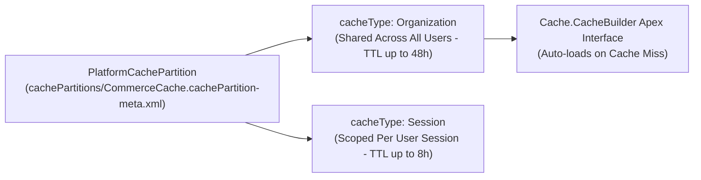

## Why the `PlatformCachePartition` Metadata Type Is Essential for High-Scale Orgs

Repeatedly running SOQL queries for static or semi-static data—such as complex pricing matrices, user territory hierarchies, external OAuth access tokens, or API feature flags—consumes SOQL governor limits and adds latency to every transaction.

**`PlatformCachePartition`** (`cachePartitions/<Name>.cachePartition-meta.xml`) divides your org's in-memory Redis-backed **Platform Cache** into isolated logical buckets (`local.<PartitionName>`) so critical integrations and UI components never evict each other's cached keys.



---

## Key Metadata Fields on `PlatformCachePartition`

| Field | Type | Required | Description |
|---|---|---|---|
| `masterLabel` | `string` | Yes | Display label of the partition in Setup. |
| `isDefaultPartition` | `boolean` | Yes | Marks this partition as the org's default partition (only one partition can be `true`). |
| `description` | `string` | No | Documents which features or Apex classes own this partition. |
| `platformCachePartitionTypes.cacheType` | `PlatformCacheType` | Yes | `Organization` (Org Cache) or `Session` (Session Cache). |
| `platformCachePartitionTypes.allocatedCapacity` | `int` | Yes | Total MB allocated to this cache type (sum of purchased, trial, and partner capacity). |
| `platformCachePartitionTypes.allocatedPurchasedCapacity` | `int` | Yes | MB of purchased org-wide cache allocated to this partition. |
| `platformCachePartitionTypes.allocatedTrialCapacity` | `int` | Yes | MB of trial cache allocated to this partition. |
| `platformCachePartitionTypes.allocatedPartnerCapacity` | `int` | Yes | *(API v51.0+)* MB of free partner capacity allocated in Developer Edition / ISV orgs. |

---

## Real-World XML Example (`cachePartitions/CoreIntegrationCache.cachePartition-meta.xml`)

```xml
<?xml version="1.0" encoding="UTF-8"?>
<PlatformCachePartition xmlns="http://soap.sforce.com/2006/04/metadata">
    <description>Dedicated Org and Session cache partition for ERP pricing tables and per-user session state.</description>
    <isDefaultPartition>false</isDefaultPartition>
    <masterLabel>Core Integration Cache</masterLabel>
    <platformCachePartitionTypes>
        <allocatedCapacity>10</allocatedCapacity>
        <allocatedPartnerCapacity>0</allocatedPartnerCapacity>
        <allocatedPurchasedCapacity>10</allocatedPurchasedCapacity>
        <allocatedTrialCapacity>0</allocatedTrialCapacity>
        <cacheType>Organization</cacheType>
    </platformCachePartitionTypes>
    <platformCachePartitionTypes>
        <allocatedCapacity>5</allocatedCapacity>
        <allocatedPartnerCapacity>0</allocatedPartnerCapacity>
        <allocatedPurchasedCapacity>5</allocatedPurchasedCapacity>
        <allocatedTrialCapacity>0</allocatedTrialCapacity>
        <cacheType>Session</cacheType>
    </platformCachePartitionTypes>
</PlatformCachePartition>
```

---

## Querying `PlatformCachePartition` and `PlatformCachePartitionType` via SOQL

You can inspect all cache partitions and their megabyte allocations in standard SOQL:

```sql
SELECT Id, DeveloperName, MasterLabel, IsDefaultPartition, Description,
       (SELECT CacheType, AllocatedCapacity, AllocatedPurchasedCapacity,
               AllocatedTrialCapacity, AllocatedPartnerCapacity
        FROM PlatformCachePartitionTypes)
FROM PlatformCachePartition
WHERE NamespacePrefix = null
ORDER BY DeveloperName ASC
```

---

## Senior Architect Best Practices & Gotchas

> [!TIP]
> **Commit `0` MB Allocation in Git for Scratch Org Portability:** If you commit `<allocatedPurchasedCapacity>10</allocatedPurchasedCapacity>` to Git, deploying to a Developer Edition or Scratch Org that only has `0` or `3` MB of free cache will fail with `Exceeded maximum cache allocation`. Commit `0` MB in your base SFDX repository so the partition always deploys cleanly, and allocate MB capacity in Production or via environment-specific replacements.

- **Always Use `Cache.CacheBuilder` Instead of Manual `get`/`put`:** Implementing the `Cache.CacheBuilder` Apex interface (`Cache.Org.get(PricingCacheBuilder.class, 'USD_Rates')`) automatically handles cache misses when keys expire or are evicted—even when a partition has `0` MB allocated!
