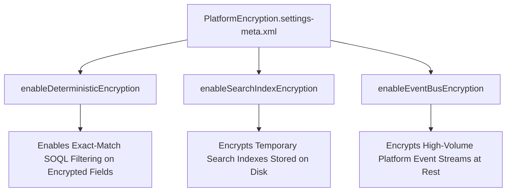

## Architectural Overview

`PlatformEncryptionSettings` is a critical security metadata type governing Salesforce Shield Platform Encryption. While perimeter TLS protects data in transit, Shield Platform Encryption provides natively integrated encryption-at-rest for sensitive customer data stored in the database, search index files, attachments, and event buses.

Managing `PlatformEncryptionSettings` in source control ensures that cryptographic parameters—such as deterministic encryption support, search index encryption, and event bus encryption—are systematically replicated across development, UAT, and production environments. Enterprise architects rely on this metadata type to fulfill strict regulatory compliance requirements (such as HIPAA, GDPR, PCI-DSS, and FedRAMP) without manual setup drift.



## Directory and File Conventions

In SFDX source format, `PlatformEncryptionSettings` is stored in the `settings/` directory and referenced as `Settings:PlatformEncryption`.

| Property | Value |
| :--- | :--- |
| **Metadata Type Name** | `Settings` (member: `PlatformEncryption`) / `PlatformEncryptionSettings` |
| **SFDX Directory** | `force-app/main/default/settings/` |
| **File Suffix** | `.settings-meta.xml` |
| **Full File Path** | `force-app/main/default/settings/PlatformEncryption.settings-meta.xml` |
| **Scratch Org Setting Key** | `platformEncryptionSettings` |

## Key Metadata Fields

The XML schema of `PlatformEncryptionSettings` controls platform cryptographic policies:

| Field Name | Field Type | Required | Architectural Description |
| :--- | :--- | :--- | :--- |
| `enableDeterministicEncryption` | `boolean` | No | Enables deterministic encryption, allowing exact match filtering and grouping in SOQL. |
| `enableSearchIndexEncryption` | `boolean` | No | Encrypts search index files containing tokens of encrypted records. |
| `enableEventBusEncryption` | `boolean` | No | Encrypts event payloads at rest in the high-volume streaming event bus. |
| `isShieldEnabled` | `boolean` | No | Indicates whether core Shield platform services are provisioned and active. |

> [!NOTE]
> Setting `enableDeterministicEncryption` to `true` is essential for application architecture if custom or standard fields encrypted with Shield must be referenced in SOQL `WHERE` clauses, report filters, or lookup relationships.

## Declarative XML and Package Manifest Examples

Below is an enterprise configuration for Shield Platform Encryption:

```xml title="force-app/main/default/settings/PlatformEncryption.settings-meta.xml"
<?xml version="1.0" encoding="UTF-8"?>
<PlatformEncryptionSettings xmlns="http://soap.sforce.com/2006/04/metadata">
    <enableDeterministicEncryption>true</enableDeterministicEncryption>
    <enableEventBusEncryption>true</enableEventBusEncryption>
    <enableSearchIndexEncryption>true</enableSearchIndexEncryption>
    <isShieldEnabled>true</isShieldEnabled>
</PlatformEncryptionSettings>
```

### Scratch Org Definition Configuration

When provisioning scratch orgs with Shield Platform Encryption:

```json title="config/project-scratch-def.json"
{
  "orgName": "Shield Security Scratch Org",
  "edition": "Enterprise",
  "features": ["ShieldPlatformEncryption"],
  "settings": {
    "platformEncryptionSettings": {
      "enableDeterministicEncryption": true,
      "enableSearchIndexEncryption": true,
      "enableEventBusEncryption": true
    }
  }
}
```

### Package Manifest (`package.xml`)

```xml title="manifest/package.xml"
<?xml version="1.0" encoding="UTF-8"?>
<Package xmlns="http://soap.sforce.com/2006/04/metadata">
    <types>
        <members>PlatformEncryption</members>
        <name>Settings</name>
    </types>
    <version>68.0</version>
</Package>
```

## CLI Retrieval and Deployment Commands

Manage `PlatformEncryptionSettings` using `sf`:

```bash
# Retrieve PlatformEncryptionSettings from the target org
sf project retrieve start --metadata Settings:PlatformEncryption

# Deploy PlatformEncryptionSettings to target environment
sf project deploy start --metadata Settings:PlatformEncryption

# Validate settings deployment without saving
sf project deploy validate --metadata Settings:PlatformEncryption
```

## Architect Best Practices and Gotchas

- **Tenant Secret Provisioning:** Deploying `PlatformEncryptionSettings` configures platform policies, but encryption requires an active tenant secret. In automated CI/CD pipelines, generate an initial tenant secret via Tooling API or Setup before applying field-level encryption.
- **SOQL Limitations with Probabilistic Encryption:** Standard probabilistic encryption generates randomized ciphertext, preventing fields from being used in `ORDER BY`, `GROUP BY`, or `WHERE` statements. Use deterministic encryption (`enableDeterministicEncryption: true`) when query filtering is mandatory.
- **Apex Governor Limits:** Decryption happens seamlessly in the platform runtime, but excessive SOQL retrieval of encrypted long text areas can incur CPU and memory serialization overhead.

> [!WARNING]
> Encrypting fields already referenced in complex formula fields, external IDs, or third-party AppExchange packages will block field encryption until formula dependencies are removed.
