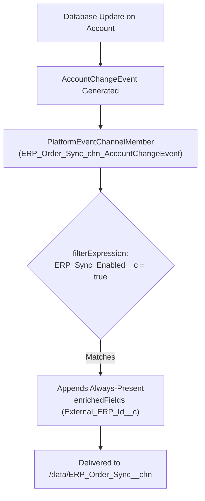

The `PlatformEventChannelMember` metadata type links a Change Data Capture (CDC) entity (such as `AccountChangeEvent` or `Invoice__ChangeEvent`) or a custom Platform Event to either the standard `ChangeEvents` channel or a custom [PlatformEventChannel](/docs/metadata/platform-event-channel-metadata-type/) (`MyChannel__chn`). Introduced in API version 47.0, it also configures **CDC Field Enrichment** (`enrichedFields`) and **Server-Side Stream Filtering** (`filterExpression`).

In Salesforce DX projects, channel members live in `force-app/main/default/platformEventChannelMembers/` with the `.platformEventChannelMember-meta.xml` suffix.



## Critical Naming Rule: Single Underscores in `fullName`

Because Salesforce reserves double underscores (`__`) in `fullName` strictly for namespace prefixes and type suffixes, you **must** collapse `__chn` and `__ChangeEvent` into single underscores in the filename and `package.xml` `<members>` entry:

| Target Channel (`eventChannel`) | Selected Entity (`selectedEntity`) | Required File / Member `fullName` |
|---|---|---|
| `ChangeEvents` (Standard CDC) | `AccountChangeEvent` | `ChangeEvents_AccountChangeEvent` |
| `ChangeEvents` (Standard CDC) | `Invoice__ChangeEvent` | `ChangeEvents_Invoice_ChangeEvent` |
| `ERP_Order_Sync__chn` (Custom) | `AccountChangeEvent` | `ERP_Order_Sync_chn_AccountChangeEvent` |
| `ERP_Order_Sync__chn` (Custom) | `Invoice__ChangeEvent` | `ERP_Order_Sync_chn_Invoice_ChangeEvent` |

## Key Metadata Fields

| Field | Type | Required | Description |
|---|---|---|---|
| `eventChannel` | `string` | Yes | `ChangeEvents` (for standard Setup -> Change Data Capture) or `<CustomChannel>__chn` |
| `selectedEntity` | `string` | Yes | Event API name (`AccountChangeEvent`, `Custom_Obj__ChangeEvent`, or `Custom_Event__e`) |
| `enrichedFields` | `EnrichedField[]` | No | Up to 10 non-empty fields (`<name>`) always included in `UPDATE` and `DELETE` CDC payloads (v51.0+) |
| `filterExpression` | `string` | No | SOQL-like server-side filter expression (v56.0+) |

## Production-Grade XML Example (Enriched + Filtered CDC Stream)

Below is a `PlatformEventChannelMember` (`ERP_Order_Sync_chn_AccountChangeEvent.platformEventChannelMember-meta.xml`) that enriches every Account CDC event with `ERP_Customer_Number__c` and filters the stream to only Accounts in the `AMER` region:

```xml
<?xml version="1.0" encoding="UTF-8"?>
<PlatformEventChannelMember xmlns="http://soap.sforce.com/2006/04/metadata">
    <enrichedFields>
        <name>ERP_Customer_Number__c</name>
    </enrichedFields>
    <enrichedFields>
        <name>Tax_Identification_Number__c</name>
    </enrichedFields>
    <eventChannel>ERP_Order_Sync__chn</eventChannel>
    <filterExpression><![CDATA[Region__c = 'AMER']]></filterExpression>
    <selectedEntity>AccountChangeEvent</selectedEntity>
</PlatformEventChannelMember>
```

> [!TIP]
> **Why `enrichedFields` Eliminates Middleware Lookups**: Without `enrichedFields`, a CDC `UPDATE` or `DELETE` event only contains the Salesforce 18-character `RecordIds` header and the specific fields that changed in that transaction—forcing your middleware to make a REST API callback just to look up the record's external ERP key (`ERP_Customer_Number__c`). Adding `ERP_Customer_Number__c` to `enrichedFields` includes the external key in every single update and delete event automatically.

## Querying `PlatformEventChannelMember` via Tooling API

```sql
-- Inspect all CDC and Platform Event channel memberships and filter expressions (Tooling API)
SELECT Id, DeveloperName, EventChannel, SelectedEntity, FilterExpression
FROM PlatformEventChannelMember
ORDER BY EventChannel, SelectedEntity
```

