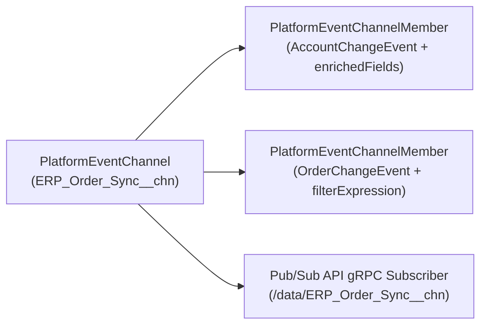

The `PlatformEventChannel` metadata type defines a **custom event channel** (`__chn`) that external middleware (subscribing via the [Pub/Sub API](/docs/apis/pubsub-api-eventbus/) or CometD) can subscribe to in order to receive a dedicated, filtered stream of **Change Data Capture (CDC)** events, **Custom Platform Events**, or **Real-Time Event Monitoring** events.

In Salesforce DX projects, custom channels are stored in `force-app/main/default/platformEventChannels/` with the `.platformEventChannel-meta.xml` suffix (for example, `ERP_Order_Sync__chn.platformEventChannel-meta.xml`).



## Why Custom `PlatformEventChannel` Architecture Matters

If you enable Change Data Capture on 15 objects in Setup, every subscriber listening to the default `/data/ChangeEvents` topic receives change events for all 15 objects—quickly exhausting daily event delivery allocations when multiple downstream systems (ERP, Data Warehouse, Billing) listen simultaneously. By provisioning dedicated `PlatformEventChannel` streams per downstream subscriber and pairing them with [PlatformEventChannelMember](/docs/metadata/platform-event-channel-member-metadata-type/) filters, each consumer receives only the objects and rows it actually cares about.

## Key Metadata Fields

| Field | Type | Required | Description |
|---|---|---|---|
| `channelType` | `PlatformEventChannelType` | Yes | `data` (for Change Data Capture channels) or `event` (for custom Platform Events or RTEM events) |
| `eventType` | `PlatformEventChannelEventType` | No | Introduced in API v61.0: `data` (with `channelType: data`), `custom`, or `monitoring` (with `channelType: event`) |
| `label` | `string` | Yes | Human-readable label of the custom channel |

## Production-Grade XML Examples

### 1. Custom Change Data Capture Channel (`ERP_Order_Sync__chn.platformEventChannel-meta.xml`)

Subscribed via `/data/ERP_Order_Sync__chn`:

```xml
<?xml version="1.0" encoding="UTF-8"?>
<PlatformEventChannel xmlns="http://soap.sforce.com/2006/04/metadata">
    <channelType>data</channelType>
    <label>ERP Order Sync CDC Channel</label>
</PlatformEventChannel>
```

### 2. Custom Platform Event Grouping Channel (`Billing_Events__chn.platformEventChannel-meta.xml`)

Subscribed via `/event/Billing_Events__chn` (API version 61.0+):

```xml
<?xml version="1.0" encoding="UTF-8"?>
<PlatformEventChannel xmlns="http://soap.sforce.com/2006/04/metadata">
    <channelType>event</channelType>
    <eventType>custom</eventType>
    <label>Consolidated Billing Platform Events Channel</label>
</PlatformEventChannel>
```

> [!WARNING]
> **Upgrading Legacy API v45.0–46.0 Files**: In API version 47.0 and later, `<channelMembers>` is no longer valid inside `PlatformEventChannel`. Always define channel entities in separate [PlatformEventChannelMember](/docs/metadata/platform-event-channel-member-metadata-type/) files.

## Querying `PlatformEventChannel` via Tooling API

```sql
-- List all custom PlatformEventChannels in the org (Tooling API)
SELECT Id, DeveloperName, MasterLabel, ChannelType, EventType
FROM PlatformEventChannel
ORDER BY MasterLabel ASC
```

