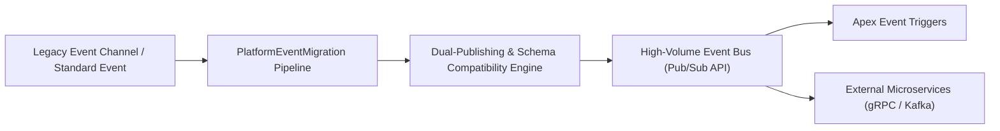

## Architectural Overview

As event-driven architectures evolve within enterprise Salesforce ecosystems, messaging backbones must scale to accommodate massive transactional volumes. First-generation platform event channels and standard-volume event configurations imposed strict daily publishing limits and shorter replay retention windows.

The `PlatformEventMigration` metadata type facilitates zero-downtime architectural transitions from legacy event structures to high-volume event buses and the modern gRPC Pub/Sub API. By defining migration pipelines in metadata, Technical Architects can orchestrate schema transitions, reroute event consumers, and preserve historical replay offsets across enterprise messaging boundaries without service interruption.



## Directory and File Conventions

In SFDX source format, `PlatformEventMigration` components are stored within the `platformEventMigrations/` folder.

| Property | Value |
| :--- | :--- |
| **Metadata Type Name** | `PlatformEventMigration` |
| **SFDX Directory** | `force-app/main/default/platformEventMigrations/` |
| **File Suffix** | `.platformEventMigration-meta.xml` |
| **Full File Path** | `force-app/main/default/platformEventMigrations/<MigrationName>.platformEventMigration-meta.xml` |

## Key Metadata Fields

The XML schema of `PlatformEventMigration` defines source-to-target mapping and replay behaviors:

| Field Name | Field Type | Required | Architectural Description |
| :--- | :--- | :--- | :--- |
| `sourceEventName` | `string` | Yes | API name of the origin platform event or channel being transitioned. |
| `targetEventName` | `string` | Yes | Target high-volume platform event or unified streaming channel. |
| `migrationStatus` | `string` | Yes | Current phase of migration (`Planned`, `InFlight`, `Completed`, `RolledBack`). |
| `replayMode` | `string` | No | Governs message replay alignment during migration (`PreserveReplayId`, `ResetReplayId`). |

> [!NOTE]
> High-volume platform events publish asynchronously and do not participate in database rollbacks when published with `publishImmediately`. Ensure downstream subscribers are designed for idempotent message handling.

## Declarative XML and Package Manifest Examples

Below is a declarative XML definition migrating an order event stream to high-volume architecture:

```xml title="force-app/main/default/platformEventMigrations/Order_Event_HV_Migration.platformEventMigration-meta.xml"
<?xml version="1.0" encoding="UTF-8"?>
<PlatformEventMigration xmlns="http://soap.sforce.com/2006/04/metadata">
    <migrationStatus>InFlight</migrationStatus>
    <replayMode>PreserveReplayId</replayMode>
    <sourceEventName>Order_Status_Update__e</sourceEventName>
    <targetEventName>Order_Status_HV__e</targetEventName>
</PlatformEventMigration>
```

### Package Manifest (`package.xml`)

```xml title="manifest/package.xml"
<?xml version="1.0" encoding="UTF-8"?>
<Package xmlns="http://soap.sforce.com/2006/04/metadata">
    <types>
        <members>Order_Event_HV_Migration</members>
        <name>PlatformEventMigration</name>
    </types>
    <types>
        <members>Order_Status_HV__e</members>
        <name>CustomObject</name>
    </types>
    <version>68.0</version>
</Package>
```

## CLI Retrieval and Deployment Commands

Manage `PlatformEventMigration` using the Salesforce CLI:

```bash
# Retrieve platform event migrations
sf project retrieve start --metadata PlatformEventMigration

# Deploy migration metadata along with target high-volume event definitions
sf project deploy start --metadata PlatformEventMigration,CustomObject:Order_Status_HV__e

# Validate deployment into staging sandbox
sf project deploy validate --metadata PlatformEventMigration
```

## Architect Best Practices and Gotchas

- **Idempotency and Message Ordering:** High-volume platform events guarantee at-least-once delivery, but network partitions can cause message duplication or slight out-of-order delivery. Design subscriber handlers in [ApexClass](/docs/metadata/apex-class-metadata-type/) or external middleware with deduplication keys.
- **Trigger Concurrency Tuning:** High-volume platform event triggers run under the Automated Process system user in chunks of up to 2,000 events. Tune trigger batch sizes via `PlatformEventSubscriberConfig` to prevent CPU governor limits during migration spikes.
- **Monitoring Event Bus Health:** Use the EventBusSubscriber SOQL entity or Tooling API to monitor trigger execution positions (`Position`) versus the bus tip (`Tip`) during in-flight migrations.

> [!WARNING]
> Completing a migration pipeline permanently severs consumers subscribed to legacy standard channels. Ensure all external gRPC and CometD subscribers have updated their channel URIs before marking migration complete.
