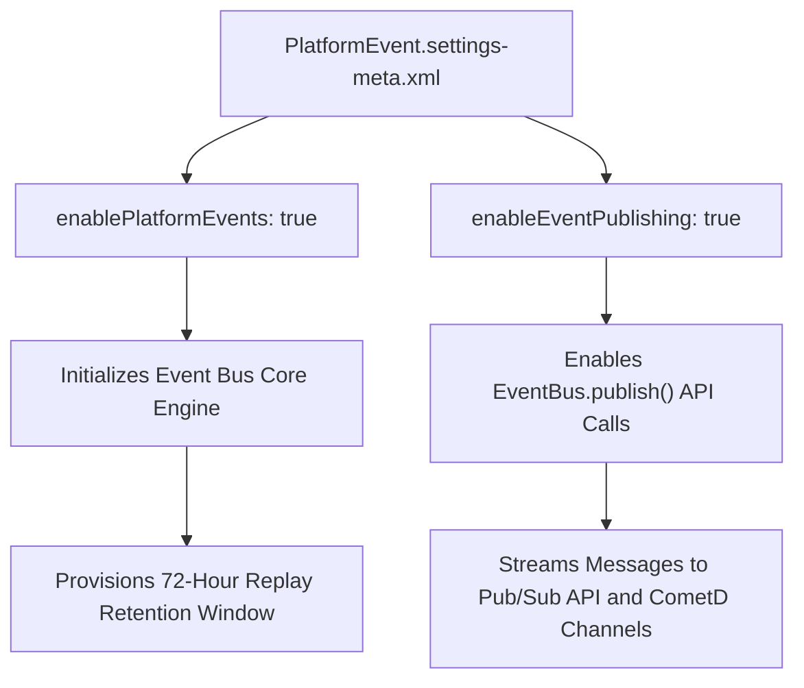

## Architectural Overview

The `PlatformEventSettings` metadata type represents the foundational environment-level configuration for the Salesforce event bus. In distributed enterprise systems, platform events decouple publishers (e.g., core CRM workflows, [ApexClass](/docs/metadata/apex-class-metadata-type/) triggers) from subscribers (e.g., microservices, Kafka pipelines, external ERPs, and automated flows).

`PlatformEventSettings` controls the availability of the event publishing pipeline, retention parameters, and cross-system streaming connectivity. In scratch org automation and deployment pipelines, deploying `PlatformEvent.settings-meta.xml` guarantees that integration test suites have an active event bus initialized with the correct throughput limits.



## Directory and File Conventions

In SFDX source format, `PlatformEventSettings` is stored in the `settings/` directory and referenced using the `Settings` type with member `PlatformEvent`.

| Property | Value |
| :--- | :--- |
| **Metadata Type Name** | `Settings` (member: `PlatformEvent`) / `PlatformEventSettings` |
| **SFDX Directory** | `force-app/main/default/settings/` |
| **File Suffix** | `.settings-meta.xml` |
| **Full File Path** | `force-app/main/default/settings/PlatformEvent.settings-meta.xml` |
| **Scratch Org Setting Key** | `platformEventSettings` |

## Key Metadata Fields

The XML schema of `PlatformEventSettings` exposes settings governing the event infrastructure:

| Field Name | Field Type | Required | Architectural Description |
| :--- | :--- | :--- | :--- |
| `enablePlatformEvents` | `boolean` | No | Globally enables platform event definitions and bus infrastructure. |
| `enableEventPublishing` | `boolean` | No | Controls whether publishing new events via Apex or APIs is permitted. |

> [!NOTE]
> When `enablePlatformEvents` is active, high-volume platform events automatically retain messages in the bus for 72 hours, enabling subscribers to replay events starting from any valid `ReplayId`.

## Declarative XML and Package Manifest Examples

Below is a declarative XML configuration for an active event bus:

```xml title="force-app/main/default/settings/PlatformEvent.settings-meta.xml"
<?xml version="1.0" encoding="UTF-8"?>
<PlatformEventSettings xmlns="http://soap.sforce.com/2006/04/metadata">
    <enableEventPublishing>true</enableEventPublishing>
    <enablePlatformEvents>true</enablePlatformEvents>
</PlatformEventSettings>
```

### Scratch Org Definition Configuration

When testing event streaming pipelines in scratch orgs:

```json title="config/project-scratch-def.json"
{
  "orgName": "Event Streaming Dev Org",
  "edition": "Enterprise",
  "settings": {
    "platformEventSettings": {
      "enablePlatformEvents": true,
      "enableEventPublishing": true
    }
  }
}
```

### Package Manifest (`package.xml`)

```xml title="manifest/package.xml"
<?xml version="1.0" encoding="UTF-8"?>
<Package xmlns="http://soap.sforce.com/2006/04/metadata">
    <types>
        <members>PlatformEvent</members>
        <name>Settings</name>
    </types>
    <version>68.0</version>
</Package>
```

## CLI Retrieval and Deployment Commands

Manage `PlatformEventSettings` via the Salesforce CLI:

```bash
# Retrieve PlatformEventSettings from target org
sf project retrieve start --metadata Settings:PlatformEvent

# Deploy PlatformEventSettings to remote environment
sf project deploy start --metadata Settings:PlatformEvent

# Validate settings deployment
sf project deploy validate --metadata Settings:PlatformEvent
```

## Architect Best Practices and Gotchas

- **Emergency Circuit Breaker:** Setting `enableEventPublishing` to `false` serves as an emergency architectural circuit breaker during runaway trigger loops or external API outages, immediately stopping new event publication without altering custom code.
- **Publish Behavior Matching:** Align platform event definitions (`CustomObject` with `__e`) with business semantics: use `Publish After Commit` for transactional data where database rollbacks must suppress events, and `Publish Immediately` for audit logging or uncommitted status notifications.
- **Allocations and Governor Limits:** While high-volume platform events support substantial daily throughput, each publishing call via `EventBus.publish()` consumes standard DML call limits per Apex transaction.

> [!WARNING]
> Toggling `enableEventPublishing` to `false` in production will cause synchronous `EventBus.publish()` calls in Apex to return failure result statuses, which must be handled gracefully by calling code.
