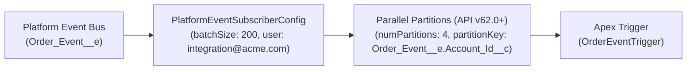

## Why Every Platform Event Apex Trigger Needs a `PlatformEventSubscriberConfig`

When you write an [ApexTrigger](/docs/metadata/apex-trigger-metadata-type/) on a Platform Event (`Order_Status_Event__e`), two default platform behaviors catch even experienced developers off guard:

1. **Default Batch Size Is `2,000` (Not `200`!):** Under high event load, Salesforce passes up to **2,000 event messages** into a single trigger invocation. If each event inserts or updates SObject records that fire downstream triggers and Flows, your transaction will immediately hit the 10,000-row DML limit or 10-second CPU timeout.
2. **Default Running User Is `Automated Process`:** The system `Automated Process` user cannot send emails via `Messaging.sendEmail()`, cannot access user-licensed managed packages, and complicates debug log capture.

**`PlatformEventSubscriberConfig`** (`PlatformEventSubscriberConfigs/<Name>.platformEventSubscriberConfig-meta.xml`) solves both issues declaratively—and starting in **API v62.0**, also unlocks **Parallel Subscriptions (`numPartitions`)** for up to 10x horizontal throughput!



---

## Key Metadata Fields on `PlatformEventSubscriberConfig`

| Field | Type | Required | Description |
|---|---|---|---|
| `platformEventConsumer` | `string` | Yes | Developer name of the Platform Event [ApexTrigger](/docs/metadata/apex-trigger-metadata-type/) being configured. |
| `masterLabel` | `string` | Yes | Display label of the subscriber configuration. |
| `batchSize` | `int` | No | Maximum events processed per trigger execution (`1` to `2000`; default is `2000`, recommended is `100`–`200` when performing SObject DML). |
| `user` | `string` | No | Username of the active Salesforce User that the trigger executes as (replaces `Automated Process`). |
| `numPartitions` | `int` | No | *(API v62.0+)* Number of parallel trigger subscriptions (`1` to `10`) for high-scale event processing. |
| `partitionKey` | `string` | No | *(API v62.0+)* Field hashed to route related events to the same partition thread (`EventUuid` or `<EventName>__e.<FieldName>__c`). |

---

## Real-World XML Example (`PlatformEventSubscriberConfigs/OrderEventTriggerConfig.platformEventSubscriberConfig-meta.xml`)

```xml
<?xml version="1.0" encoding="UTF-8"?>
<PlatformEventSubscriberConfig xmlns="http://soap.sforce.com/2006/04/metadata">
    <batchSize>200</batchSize>
    <isProtected>false</isProtected>
    <masterLabel>OrderEventTriggerConfig</masterLabel>
    <numPartitions>4</numPartitions>
    <partitionKey>Order_Event__e.External_Account_ID__c</partitionKey>
    <platformEventConsumer>OrderEventTrigger</platformEventConsumer>
    <user>integration.bot@acme.example.com</user>
</PlatformEventSubscriberConfig>
```

---

## Querying `PlatformEventSubscriberConfig` and `EventBusSubscriber`

### 1. Monitor Live Trigger Replay Positions and Errors in SOQL (`EventBusSubscriber`)

```sql
SELECT ExternalId, Name, Topic, Type, Status, Position, Tip, Retries, LastError
FROM EventBusSubscriber
WHERE Type = 'ApexTrigger'
ORDER BY Topic ASC
```

### 2. Audit Configured `batchSize` and Running Users via Tooling API

```sql
SELECT Id, DeveloperName, MasterLabel, BatchSize, NumPartitions, PartitionKey, UserId
FROM PlatformEventSubscriberConfig
```

---

## Senior Architect Best Practices & Gotchas

> [!WARNING]
> **Preventing Record Lock Contention with `partitionKey`:** When using `<numPartitions>` greater than `1`, never leave `<partitionKey>` as the default `EventUuid` if events for the same `Account` or `Order` must be processed in strict chronological sequence! Set `<partitionKey>Order_Event__e.Account_Id__c</partitionKey>` so all events for the same Account hash to the exact same partition thread, eliminating `UNABLE_TO_LOCK_ROW` collisions and out-of-order updates.
