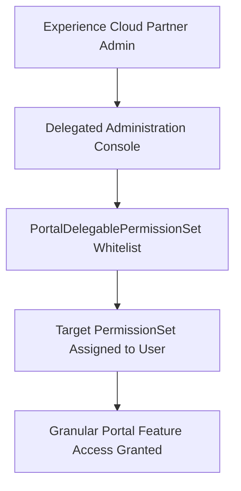

## Architectural Overview

In multi-tier B2B architectures and Experience Cloud portals, delegated administration empowers external partner and customer super-users to administer accounts within their authorized hierarchy. Internal administrators cannot manually fulfill every user onboarding and permission assignment request across thousands of external partner organizations. However, granting external users broad administrative authority introduces severe security risks.

The `PortalDelegablePermissionSet` metadata type establishes a secure, bounded delegation model. It explicitly defines which [PermissionSet](/docs/metadata/permission-set-metadata-type/) metadata instances an external delegated administrator is authorized to assign to or revoke from other external users.



By maintaining `PortalDelegablePermissionSet` definitions in version control, enterprise architects guarantee that partner administration privileges remain strictly governed across scratch orgs, sandboxes, and production environments.

## Directory and File Conventions

In SFDX source format, `PortalDelegablePermissionSet` metadata resides in the `portalDelegablePermissionSets/` directory.

| Property | Value |
| :--- | :--- |
| **Metadata Type Name** | `PortalDelegablePermissionSet` |
| **SFDX Directory** | `force-app/main/default/portalDelegablePermissionSets/` |
| **File Suffix** | `.portalDelegablePermissionSet-meta.xml` |
| **Full File Path Example** | `force-app/main/default/portalDelegablePermissionSets/Partner_Deal_Desk.portalDelegablePermissionSet-meta.xml` |
| **Packaging Scope** | Unlocked packages, Managed packages, First-party changesets |

## Key Metadata Fields

The XML structure of `PortalDelegablePermissionSet` references the target permission set and defines delegation bounds:

| Field Name | Field Type | Required | Architectural Description |
| :--- | :--- | :--- | :--- |
| `permissionSet` | `string` | Yes | Developer name of the [PermissionSet](/docs/metadata/permission-set-metadata-type/) permitted for external assignment. |
| `isMajor` | `boolean` | No | Indicates whether this delegable assignment represents a primary role capability. |

> [!NOTE]
> The target permission set must be deployed and available in the org before or alongside the `PortalDelegablePermissionSet` manifest.

## Declarative XML and Package Manifest Examples

Below is an enterprise XML definition delegating a deal registration permission set to external partner administrators:

```xml title="force-app/main/default/portalDelegablePermissionSets/Partner_Deal_Desk.portalDelegablePermissionSet-meta.xml"
<?xml version="1.0" encoding="UTF-8"?>
<PortalDelegablePermissionSet xmlns="http://soap.sforce.com/2006/04/metadata">
    <permissionSet>Partner_Deal_Desk_Access</permissionSet>
</PortalDelegablePermissionSet>
```

### Accompanying Permission Set Definition

The referenced permission set must be explicitly restricted to external community user licenses:

```xml title="force-app/main/default/permissionsets/Partner_Deal_Desk_Access.permissionset-meta.xml"
<?xml version="1.0" encoding="UTF-8"?>
<PermissionSet xmlns="http://soap.sforce.com/2006/04/metadata">
    <hasActivationRequired>false</hasActivationRequired>
    <label>Partner Deal Desk Access</label>
    <license>Partner Community</license>
    <objectPermissions>
        <allowCreate>true</allowCreate>
        <allowDelete>false</allowDelete>
        <allowEdit>true</allowEdit>
        <allowRead>true</allowRead>
        <modifyAllRecords>false</modifyAllRecords>
        <object>Opportunity</object>
        <viewAllRecords>false</viewAllRecords>
    </objectPermissions>
</PermissionSet>
```

### Package Manifest (`package.xml`)

```xml title="manifest/package.xml"
<?xml version="1.0" encoding="UTF-8"?>
<Package xmlns="http://soap.sforce.com/2006/04/metadata">
    <types>
        <members>Partner_Deal_Desk</members>
        <name>PortalDelegablePermissionSet</name>
    </types>
    <types>
        <members>Partner_Deal_Desk_Access</members>
        <name>PermissionSet</name>
    </types>
    <version>68.0</version>
</Package>
```

## CLI Retrieval and Deployment Commands

Manage `PortalDelegablePermissionSet` records via the Salesforce CLI (`sf`):

```bash
# Retrieve all delegable permission set configurations
sf project retrieve start --metadata PortalDelegablePermissionSet

# Deploy a specific delegable permission set with its target permission set
sf project deploy start --metadata "PortalDelegablePermissionSet:Partner_Deal_Desk" --metadata "PermissionSet:Partner_Deal_Desk_Access"

# Validate deployment into a target environment
sf project deploy validate --metadata PortalDelegablePermissionSet
```

## Architect Best Practices and Gotchas

- **License Compatibility Constraints:** The referenced `PermissionSet` must align with the external community license of the portal users. If the permission set includes system permissions reserved for standard internal users (such as `ModifyAllData` or `ViewSetup`), deployment will fail.
- **Dependency Ordering in CI/CD:** Always ensure the target [PermissionSet](/docs/metadata/permission-set-metadata-type/) is included in the same deployment or deployed prior to `PortalDelegablePermissionSet`.
- **Audit Logging and Monitoring:** In high-compliance environments, monitor `SetupAuditTrail` to track which partner administrators assign delegable permission sets to community users.

> [!WARNING]
> Deleting a `PortalDelegablePermissionSet` metadata file from source control removes the delegation rule, preventing partner admins from assigning the set. Existing user assignments remain active until explicitly revoked.
