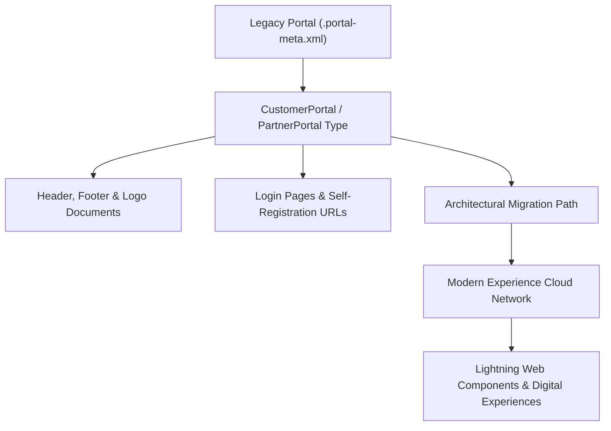

## Architectural Overview

The `Portal` metadata type represents first-generation Salesforce Customer Portal and Partner Portal configurations. Long before the introduction of Experience Cloud and Lightning Communities (governed by the `Network` metadata type), enterprise organizations deployed Customer and Partner Portals to give external users direct access to Salesforce cases, knowledge bases, and partner lead distribution.

While legacy portals are grandfathered in mature enterprise organizations, Salesforce no longer allows new legacy portal provisioning. Understanding `Portal` metadata is essential for Enterprise Technical Architects managing org technical debt, executing modern cloud migrations, and safely refactoring legacy portal login workflows, document attachments, and user profiles to Experience Cloud.



## Directory and File Conventions

In SFDX source format, `Portal` configurations are stored in the `portals/` directory.

| Property | Value |
| :--- | :--- |
| **Metadata Type Name** | `Portal` |
| **SFDX Directory** | `force-app/main/default/portals/` |
| **File Suffix** | `.portal-meta.xml` |
| **Full File Path** | `force-app/main/default/portals/<PortalName>.portal-meta.xml` |

## Key Metadata Fields

The XML structure of `Portal` includes branding, authentication, and layout elements:

| Field Name | Field Type | Required | Architectural Description |
| :--- | :--- | :--- | :--- |
| `active` | `boolean` | Yes | Indicates whether external users can authenticate into this portal instance. |
| `description` | `string` | No | Architectural documentation describing the portal's target audience and business function. |
| `type` | `string` | Yes | Portal architecture classification (`CustomerSuccess`, `Partner`). |
| `loginPage` | `string` | No | Path or Visualforce page used as the entry authentication interface. |
| `logoDocument` | `string` | No | Developer name or path to the Document resource containing the portal brand logo. |
| `footerDocument` | `string` | No | Document reference containing standard HTML footer styling. |
| `headerDocument` | `string` | No | Document reference containing standard HTML header styling. |

> [!NOTE]
> New Salesforce orgs created after Spring '13 default to Experience Cloud (`Network`). Attempting to deploy `Portal` metadata into newer scratch orgs or sandboxes without legacy portal permissions will result in deployment rejections.

## Declarative XML and Package Manifest Examples

Below is a declarative XML file representing a legacy Customer Portal:

```xml title="force-app/main/default/portals/Customer_Self_Service.portal-meta.xml"
<?xml version="1.0" encoding="UTF-8"?>
<Portal xmlns="http://soap.sforce.com/2006/04/metadata">
    <active>true</active>
    <description>Legacy customer self-service support portal for tier-1 case submission.</description>
    <footerDocument>SharedDocuments/Portal_Footer_HTML</footerDocument>
    <headerDocument>SharedDocuments/Portal_Header_HTML</headerDocument>
    <logoDocument>SharedDocuments/Company_Branded_Logo</logoDocument>
    <type>CustomerSuccess</type>
</Portal>
```

### Package Manifest (`package.xml`)

```xml title="manifest/package.xml"
<?xml version="1.0" encoding="UTF-8"?>
<Package xmlns="http://soap.sforce.com/2006/04/metadata">
    <types>
        <members>Customer_Self_Service</members>
        <name>Portal</name>
    </types>
    <version>68.0</version>
</Package>
```

## CLI Retrieval and Deployment Commands

Manage `Portal` metadata via Salesforce CLI:

```bash
# Retrieve all portal configurations from legacy org
sf project retrieve start --metadata Portal

# Retrieve a specific named portal
sf project retrieve start --metadata Portal:Customer_Self_Service

# Deploy portal definition to sandbox environment
sf project deploy start --metadata Portal:Customer_Self_Service
```

## Architect Best Practices and Gotchas

- **Experience Cloud Migration Strategy:** Legacy portals should be systematically refactored into Experience Cloud digital sites (`Network`). Modern digital sites leverage Lightning Web Components, Salesforce CMS, and advanced identity verification (Headless Identity and MFA).
- **User License Compatibility:** Users assigned legacy portal user licenses (e.g., Customer Portal Manager, High Volume Customer Portal) can be migrated to Customer Community or Customer Community Plus licenses to preserve historical record ownership and access.
- **Document Dependencies:** `Portal` metadata explicitly links to static documents for headers, footers, and logos via the `Document` metadata type. Deploying a `Portal` XML without deploying the referenced `Document` assets will fail.

> [!WARNING]
> Deactivating a legacy `Portal` immediately severs login access for all assigned portal users, blocking external case logging and ticket tracking.
