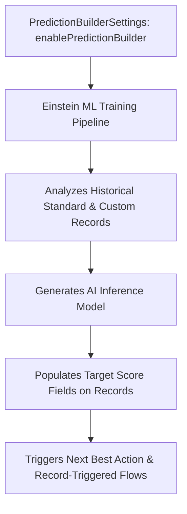

## Architectural Overview

Einstein Prediction Builder delivers custom machine learning capabilities across the Salesforce platform without requiring dedicated data science pipelines. By analyzing historical records on standard and custom objects, it automatically trains predictive models to calculate outcomes such as customer churn risk, invoice late-payment probability, and opportunity win likelihood.

The `PredictionBuilderSettings` metadata type represents the administrative settings governing Einstein Prediction Builder. Enabling this metadata type activates the AI inference engine, establishes data processing connections, and permits models to write calculated scores directly to custom fields.



In automated CI/CD environments, deploying `PredictionBuilderSettings` ensures that developer sandboxes and scratch orgs match production predictive capabilities, preventing regression in intelligent automation.

## Directory and File Conventions

`PredictionBuilderSettings` is stored as a singleton settings file within the `settings/` directory:

| Property | Value |
| :--- | :--- |
| **Metadata Type Name** | `Settings` (member: `PredictionBuilder`) / `PredictionBuilderSettings` |
| **SFDX Directory** | `force-app/main/default/settings/` |
| **File Suffix** | `.settings-meta.xml` |
| **Full File Path** | `force-app/main/default/settings/PredictionBuilder.settings-meta.xml` |
| **Scratch Org Setting Key** | `predictionBuilderSettings` |

## Key Metadata Fields

The XML schema of `PredictionBuilderSettings` provides top-level enablement switches:

| Field Name | Field Type | Required | Architectural Description |
| :--- | :--- | :--- | :--- |
| `enablePredictionBuilder` | `boolean` | No | Activates the core Einstein Prediction Builder machine learning engine in the org. |
| `isPredictionBuilderTrial` | `boolean` | No | Indicates whether the tenant is running under an evaluation or trial license. |

> [!NOTE]
> Enabling `PredictionBuilderSettings` requires appropriate CRM Analytics Plus, Einstein Predictions, or Platform AI feature licensing assigned to the Salesforce tenant.

## Declarative XML and Package Manifest Examples

Below is a production `PredictionBuilder.settings-meta.xml` configuration:

```xml title="force-app/main/default/settings/PredictionBuilder.settings-meta.xml"
<?xml version="1.0" encoding="UTF-8"?>
<PredictionBuilderSettings xmlns="http://soap.sforce.com/2006/04/metadata">
    <enablePredictionBuilder>true</enablePredictionBuilder>
    <isPredictionBuilderTrial>false</isPredictionBuilderTrial>
</PredictionBuilderSettings>
```

### Scratch Org Configuration (`config/project-scratch-def.json`)

```json title="config/project-scratch-def.json"
{
  "orgName": "Einstein Prediction Scratch Org",
  "edition": "Enterprise",
  "features": ["EinsteinPredictionBuilder"],
  "settings": {
    "predictionBuilderSettings": {
      "enablePredictionBuilder": true
    }
  }
}
```

### Package Manifest (`package.xml`)

```xml title="manifest/package.xml"
<?xml version="1.0" encoding="UTF-8"?>
<Package xmlns="http://soap.sforce.com/2006/04/metadata">
    <types>
        <members>PredictionBuilder</members>
        <name>Settings</name>
    </types>
    <version>68.0</version>
</Package>
```

## CLI Retrieval and Deployment Commands

Manage `PredictionBuilderSettings` using Salesforce CLI commands:

```bash
# Retrieve PredictionBuilder settings
sf project retrieve start --metadata Settings:PredictionBuilder

# Deploy PredictionBuilder settings to the target org
sf project deploy start --metadata Settings:PredictionBuilder

# Deploy and validate in a single transaction
sf project deploy validate --metadata Settings:PredictionBuilder
```

## Architect Best Practices and Gotchas

- **Feature License Dependencies:** Attempting to deploy `enablePredictionBuilder: true` into an org lacking Einstein Prediction Builder licenses will trigger deployment errors such as `Feature not supported`.
- **Target Custom Field Provisioning:** Before deploying or activating models created in Prediction Builder, ensure the receiving [CustomField](/docs/metadata/custom-field-metadata-type/) (typically a `Number(3, 0)` for probabilities or `Text` for categories) exists in the target environment.
- **Trigger Recursion Awareness:** Predictions update records via background automated processes. If target records have heavy record-triggered [Flow](/docs/metadata/flow-metadata-type/) or Apex triggers, ensure recursion guards are implemented to prevent governor limit exhaustion during bulk scoring cycles.

> [!TIP]
> Use score fields populated by Prediction Builder as entry criteria in record-triggered flows to automatically escalate high-risk cases or trigger VIP outreach for high-propensity leads.
