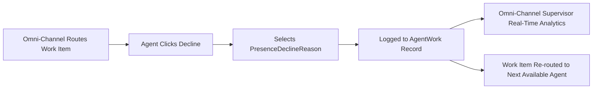

## Architectural Overview

In mission-critical contact centers powered by Service Cloud Omni-Channel, routing telemetry is crucial for operational excellence. When customer inquiries (Cases, Chats, Voice Calls, Messaging Sessions) are pushed to available agents, agents may occasionally decline work due to shifting priorities, insufficient skill sets, or imminent end-of-shift transitions.

The `PresenceDeclineReason` metadata type defines standardized decline reasons presented in the Omni-Channel utility widget. When an agent clicks "Decline", they must select an architect-approved reason.



Telemetry captured via `PresenceDeclineReason` is logged to `AgentWork` records, empowering Workforce Management (WFM) leaders to pinpoint routing imbalances, identify training gaps, and optimize staffing schedules.

## Directory and File Conventions

In SFDX source projects, `PresenceDeclineReason` metadata files are organized in the `presenceDeclineReasons/` directory:

| Property | Value |
| :--- | :--- |
| **Metadata Type Name** | `PresenceDeclineReason` |
| **SFDX Directory** | `force-app/main/default/presenceDeclineReasons/` |
| **File Suffix** | `.presenceDeclineReason-meta.xml` |
| **Full File Path Example** | `force-app/main/default/presenceDeclineReasons/Shift_Ending.presenceDeclineReason-meta.xml` |
| **Feature Prerequisite** | Requires Omni-Channel enabled in `ServiceCloudSettings` |

## Key Metadata Fields

The XML definition of `PresenceDeclineReason` consists of user-facing labels:

| Field Name | Field Type | Required | Architectural Description |
| :--- | :--- | :--- | :--- |
| `label` | `string` | Yes | Localized label displayed to agents in the Omni-Channel console utility. |
| `developerName` | `string` | Yes | Unique API developer name referenced in presence configurations. |

> [!NOTE]
> Declining work can also trigger automatic status changes (e.g. setting the agent to "Busy" or "Unavailable") if configured in the agent's `PresenceUserConfig`.

## Declarative XML and Package Manifest Examples

Below is a declarative XML definition for an agent end-of-shift decline reason:

```xml title="force-app/main/default/presenceDeclineReasons/Shift_Ending.presenceDeclineReason-meta.xml"
<?xml version="1.0" encoding="UTF-8"?>
<PresenceDeclineReason xmlns="http://soap.sforce.com/2006/04/metadata">
    <label>Shift Ending / Handover in Progress</label>
</PresenceDeclineReason>
```

### Paired Presence User Configuration Reference

Decline reasons must be added to `PresenceUserConfig` to be visible to agents:

```xml title="force-app/main/default/presenceUserConfigs/Tier_2_Support_Config.presenceUserConfig-meta.xml"
<?xml version="1.0" encoding="UTF-8"?>
<PresenceUserConfig xmlns="http://soap.sforce.com/2006/04/metadata">
    <capacity>5</capacity>
    <declineReasons>
        <declineReason>Shift_Ending</declineReason>
    </declineReasons>
    <enableAutoAccept>false</enableAutoAccept>
    <enableDecline>true</enableDecline>
    <enableDeclineReason>true</enableDeclineReason>
    <masterLabel>Tier 2 Support Config</masterLabel>
</PresenceUserConfig>
```

### Package Manifest (`package.xml`)

```xml title="manifest/package.xml"
<?xml version="1.0" encoding="UTF-8"?>
<Package xmlns="http://soap.sforce.com/2006/04/metadata">
    <types>
        <members>Shift_Ending</members>
        <name>PresenceDeclineReason</name>
    </types>
    <types>
        <members>Tier_2_Support_Config</members>
        <name>PresenceUserConfig</name>
    </types>
    <version>68.0</version>
</Package>
```

## CLI Retrieval and Deployment Commands

Manage `PresenceDeclineReason` metadata with the Salesforce CLI:

```bash
# Retrieve all presence decline reasons
sf project retrieve start --metadata PresenceDeclineReason

# Deploy specific decline reason with presence configurations
sf project deploy start --metadata "PresenceDeclineReason:Shift_Ending" --metadata "PresenceUserConfig:Tier_2_Support_Config"

# Validate deployment into sandbox environment
sf project deploy validate --metadata PresenceDeclineReason
```

## Architect Best Practices and Gotchas

- **Presence Configuration Linking:** Deploying a `PresenceDeclineReason` without binding it to active `PresenceUserConfig` definitions leaves the reason dormant; agents will not see it in the console.
- **Reporting Dependencies on AgentWork:** Before renaming or deleting a decline reason, review SOQL queries and CRM Analytics dashboards querying `AgentWork.DeclineReason` to prevent reporting interruptions.
- **Limit Decline Reasons for Speed:** Provide 4 to 6 clear, actionable decline reasons. Presenting excessive choices slows agent response times and inflates customer wait queues.

> [!TIP]
> Combine decline telemetry with Omni-Channel Supervisor alerts to notify team leads when agents decline multiple consecutive items.
