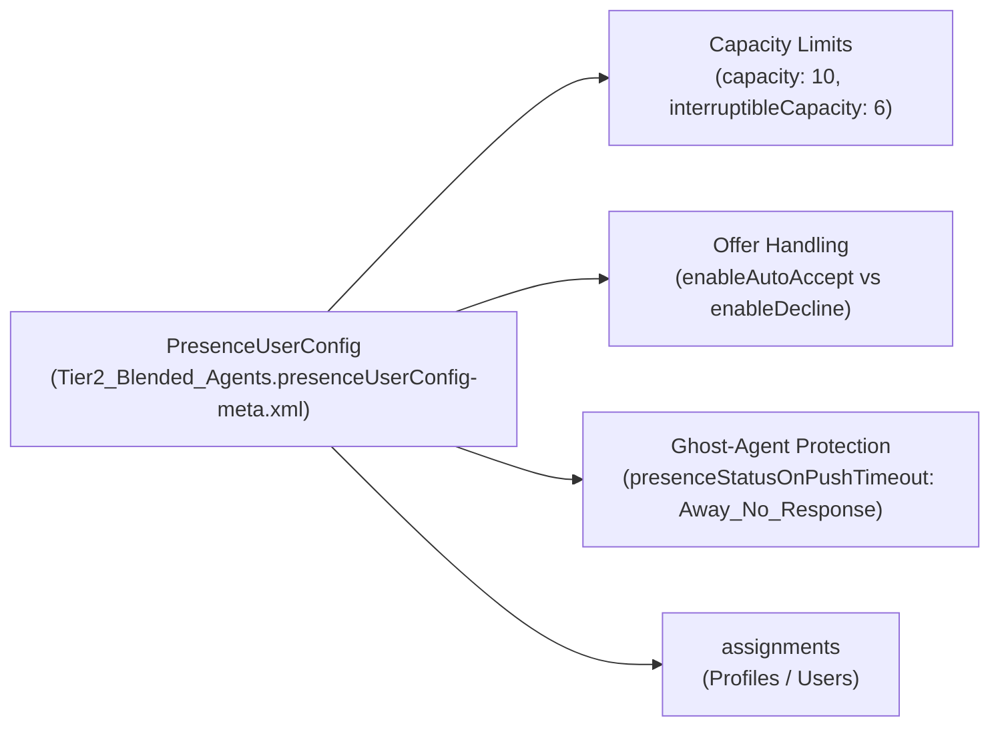

## Why the `PresenceUserConfig` Metadata Type Controls the Agent Experience

While [ServiceChannel](/docs/metadata/service-channel-metadata-type/) defines *what* is routed and [QueueRoutingConfig](/docs/metadata/queue-routing-config-metadata-type/) defines *how* items are prioritized, **`PresenceUserConfig`** (`presenceUserConfigs/<Name>.presenceUserConfig-meta.xml`) governs the **agent's Omni-Channel console behavior and capacity limits**:

1. **Total & Interruptible Capacity (`capacity`, `interruptibleCapacity`):** Maximum workload units an agent can hold at once, plus separate capacity for background/interruptible work (`Case` / `Email`) vs. live synchronous channels (`Voice` / `Messaging`).
2. **Auto-Accept vs. Manual Decline (`enableAutoAccept`, `enableDecline`, `declineReasons`):** Whether work opens automatically or allows agents to reject offers with an audited reason.
3. **Automatic Away Status on Missed Push (`presenceStatusOnPushTimeout`, `presenceStatusOnDecline`):** Prevents "ghost agents" who walk away from their desk without logging out of Omni-Channel from stalling the routing queue.



---

## Key Metadata Fields on `PresenceUserConfig`

| Field | Type | Required | Description |
|---|---|---|---|
| `label` | `string` | Yes | Display name of the Presence Configuration in Setup. |
| `capacity` | `int` | Yes | Maximum primary capacity units an agent assigned to this configuration can hold simultaneously. |
| `interruptibleCapacity` | `int` | No | *(API v57.0+)* Maximum capacity units allowed for interruptible work items (where `QueueRoutingConfig.isInterruptible = true`). |
| `enableAutoAccept` | `boolean` | No | Automatically accepts pushed work items without requiring the agent to click Accept (cannot be combined with `enableDecline = true`). |
| `enableDecline` | `boolean` | No | Allows agents to decline pushed work offers. |
| `enableDeclineReason` | `boolean` | No | Requires agents to pick a reason (`declineReasons`) when declining a work item. |
| `presenceStatusOnDecline` | `string` | No | `ServicePresenceStatus` developer name automatically applied when an agent declines an offer. |
| `presenceStatusOnPushTimeout` | `string` | No | `ServicePresenceStatus` developer name automatically applied when a push offer times out (`QueueRoutingConfig.pushTimeout`). |
| `acwExtensionEnabled` | `boolean` | No | *(API v60.0+)* Allows agents to extend their After Conversation Work (ACW) wrap-up timer. |
| `maxExtensions` / `acwExtensionDuration` | `int` | No | *(API v60.0+)* Number of allowed ACW extensions and seconds per extension. |

---

## Real-World XML Example (`presenceUserConfigs/Blended_Voice_And_Case_Agents.presenceUserConfig-meta.xml`)

```xml
<?xml version="1.0" encoding="UTF-8"?>
<PresenceUserConfig xmlns="http://soap.sforce.com/2006/04/metadata">
    <acwExtensionDuration>60</acwExtensionDuration>
    <acwExtensionEnabled>true</acwExtensionEnabled>
    <capacity>10</capacity>
    <declineReasons>On_Customer_Escalation_Call</declineReasons>
    <declineReasons>Shift_Ending_Within_10_Mins</declineReasons>
    <enableAutoAccept>false</enableAutoAccept>
    <enableDisconnectSound>true</enableDisconnectSound>
    <enableDecline>true</enableDecline>
    <enableDeclineReason>true</enableDeclineReason>
    <enableRequestSound>true</enableRequestSound>
    <interruptibleCapacity>6</interruptibleCapacity>
    <label>Blended Voice and Case Agents</label>
    <maxExtensions>2</maxExtensions>
    <presenceStatusOnPushTimeout>Busy_Missed_Offer</presenceStatusOnPushTimeout>
</PresenceUserConfig>
```

---

## Querying `PresenceUserConfig` and Assigned Users via SOQL

Both `PresenceUserConfig` and `PresenceUserConfigUser` / `PresenceUserConfigProfile` are queryable in SOQL.

### 1. Audit All Presence Configurations and Their Capacity Limits

```sql
SELECT Id, DeveloperName, MasterLabel, Capacity, InterruptibleCapacity,
       ShouldAutoAcceptEnabled, ShouldDeclineEnabled,
       PresenceStatusOnPushTimeoutId, PresenceStatusOnDeclineId
FROM PresenceUserConfig
ORDER BY MasterLabel ASC
```

### 2. List Users Assigned to a Specific `PresenceUserConfig`

```sql
SELECT Id, PresenceUserConfig.DeveloperName, User.Name, User.Username
FROM PresenceUserConfigUser
WHERE User.IsActive = true
ORDER BY PresenceUserConfig.DeveloperName, User.Name
```

---

## Senior Architect Best Practices & Gotchas

> [!WARNING]
> **Never Commit `<assignments><users>` to Git:** If you assign individual users to a `PresenceUserConfig` in Setup and retrieve the metadata, Salesforce populates `<assignments><users>jane@acme.com.sandbox</users></assignments>`. Deploying that file to Production or another Sandbox will fail because the sandbox username does not exist. Always strip `<assignments><users>` from version control!

- **Always Configure `presenceStatusOnPushTimeout`:** Without `presenceStatusOnPushTimeout` mapped to a busy/away `ServicePresenceStatus`, an agent who steps away from their computer with their Omni-Channel status set to `Available` will continuously receive and time out on every high-priority work item in the queue.
