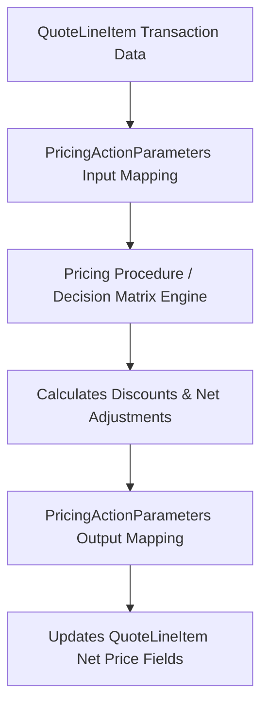

## Architectural Overview

In Salesforce Revenue Cloud, Industries CPQ, and Revenue Lifecycle Management (RLM), dynamic pricing calculations require decoupled, high-performance execution. Pricing engines calculate list prices, volume discounts, tiered surcharges, and contractual adjustments via modular pricing procedures and calculation matrices.

The `PricingActionParameters` metadata type defines the formal interface contract between transactional records (e.g., Quotes, Orders, Assets) and pricing calculation engines. It establishes parameter names, data types, default values, and directional mapping (Input vs. Output).



By decoupling parameter contracts from UI logic, enterprise architects enable pricing strategies to evolve rapidly without requiring breaking code changes in quoting components or integration layers.

## Directory and File Conventions

In SFDX source projects, `PricingActionParameters` files are organized in the `pricingActionParameters/` directory:

| Property | Value |
| :--- | :--- |
| **Metadata Type Name** | `PricingActionParameters` |
| **SFDX Directory** | `force-app/main/default/pricingActionParameters/` |
| **File Suffix** | `.pricingActionParameters-meta.xml` |
| **Full File Path Example** | `force-app/main/default/pricingActionParameters/Volume_Discount_Param.pricingActionParameters-meta.xml` |
| **Application Domain** | Salesforce Revenue Cloud / Industries Pricing Engine |

## Key Metadata Fields

The XML schema of `PricingActionParameters` controls parameter directionality and validation:

| Field Name | Field Type | Required | Architectural Description |
| :--- | :--- | :--- | :--- |
| `actionName` | `string` | Yes | Developer name of the pricing procedure or calculation action binding this parameter. |
| `parameterName` | `string` | Yes | Unique variable name referenced inside pricing calculation expressions. |
| `dataType` | `string` | Yes | Primitive or collection data type (e.g. `Currency`, `Percent`, `Number`, `Text`). |
| `direction` | `string` | Yes | Flow direction: `Input` (from cart to engine) or `Output` (from engine to cart). |
| `description` | `string` | No | Architectural description of business calculation rules and boundaries. |

> [!NOTE]
> Parameter names are case-sensitive within calculation procedures and decision matrices; ensure exact matching across your metadata repository.

## Declarative XML and Package Manifest Examples

Below is an enterprise XML definition mapping a volume discount percentage parameter:

```xml title="force-app/main/default/pricingActionParameters/Volume_Discount_Param.pricingActionParameters-meta.xml"
<?xml version="1.0" encoding="UTF-8"?>
<PricingActionParameters xmlns="http://soap.sforce.com/2006/04/metadata">
    <actionName>Enterprise_Hardware_Pricing_Procedure</actionName>
    <dataType>Percent</dataType>
    <description>Passes tier-based volume discount percentage back to quote line items.</description>
    <direction>Output</direction>
    <parameterName>VolumeDiscountPercent</parameterName>
</PricingActionParameters>
```

### Package Manifest (`package.xml`)

```xml title="manifest/package.xml"
<?xml version="1.0" encoding="UTF-8"?>
<Package xmlns="http://soap.sforce.com/2006/04/metadata">
    <types>
        <members>Volume_Discount_Param</members>
        <name>PricingActionParameters</name>
    </types>
    <version>68.0</version>
</Package>
```

## CLI Retrieval and Deployment Commands

Manage `PricingActionParameters` via the Salesforce CLI:

```bash
# Retrieve all pricing action parameters
sf project retrieve start --metadata PricingActionParameters

# Deploy specific pricing action parameters to sandbox
sf project deploy start --metadata "PricingActionParameters:Volume_Discount_Param"

# Validate parameter bindings before deployment
sf project deploy validate --metadata PricingActionParameters
```

## Architect Best Practices and Gotchas

- **Strict Type Alignment:** Ensure the `dataType` specified in `PricingActionParameters` matches the corresponding target [CustomField](/docs/metadata/custom-field-metadata-type/) on `QuoteLineItem` or `OrderItem`. Passing a `Text` parameter into a `Currency` field causes runtime calculation exceptions.
- **Deployment Sequencing:** Deploy underlying custom fields and calculation matrices before deploying `PricingActionParameters` and pricing procedures to avoid unresolved dependency errors.
- **Bulk Transaction Performance:** When designing calculation inputs, avoid passing unnecessary long text fields into pricing actions; keep payloads lean to optimize calculation throughput during large quote imports.

> [!WARNING]
> Renaming an existing `parameterName` without updating all referencing pricing procedures will cause active quotes and checkout flows to fail pricing evaluation.
