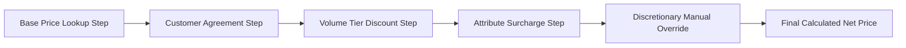

## Architectural Overview

In high-scale CPQ and B2B Commerce implementations, enterprise pricing is rarely a simple lookup. Quoting engines must compute base catalog prices, factor in customer-specific negotiated pricing, evaluate multi-tiered volume discounts, apply bundle and attribute surcharges, and adjust for regional tax requirements.

`PricingRecipe` metadata defines the calculation pipeline in Salesforce Revenue Cloud and Next-Gen CPQ. It establishes the sequential execution flow of pricing steps, specifying how calculation matrices and decision procedures interact to arrive at net unit prices and line totals.



By organizing pricing logic into modular, declarative recipes, enterprise architects eliminate monolithic Apex pricing rules, reduce quoting latency, and ensure auditability across complex contract negotiations.

## Directory and File Conventions

In SFDX source format, `PricingRecipe` metadata files reside in the `pricingRecipes/` directory:

| Property | Value |
| :--- | :--- |
| **Metadata Type Name** | `PricingRecipe` |
| **SFDX Directory** | `force-app/main/default/pricingRecipes/` |
| **File Suffix** | `.pricingRecipe-meta.xml` |
| **Full File Path Example** | `force-app/main/default/pricingRecipes/Enterprise_B2B_Recipe.pricingRecipe-meta.xml` |
| **Prerequisites** | Revenue Cloud / Industries CPQ enabled in the tenant |

## Key Metadata Fields

The XML schema of `PricingRecipe` models calculation order and status:

| Field Name | Field Type | Required | Architectural Description |
| :--- | :--- | :--- | :--- |
| `label` | `string` | Yes | Human-readable name displayed in Pricing Administration consoles. |
| `description` | `string` | No | Architectural overview of pricing sequence and business context. |
| `status` | `string` | Yes | Activation status: `Draft`, `Active`, or `Inactive`. |
| `pricingSteps` | `PricingStep[]` | Yes | Ordered collection of calculation procedures, conditions, and actions. |

> [!NOTE]
> Activating a new `PricingRecipe` automatically deactivates any existing recipe assigned to the same context.

## Declarative XML and Package Manifest Examples

Below is a declarative XML definition of an enterprise pricing recipe:

```xml title="force-app/main/default/pricingRecipes/Enterprise_B2B_Recipe.pricingRecipe-meta.xml"
<?xml version="1.0" encoding="UTF-8"?>
<PricingRecipe xmlns="http://soap.sforce.com/2006/04/metadata">
    <description>Executes base price lookup, contract pricing, and volume tiers for enterprise accounts.</description>
    <label>Enterprise B2B Pricing Recipe</label>
    <pricingSteps>
        <actionName>Base_Catalog_Price_Lookup</actionName>
        <sequenceNumber>1</sequenceNumber>
        <stepType>Lookup</stepType>
    </pricingSteps>
    <pricingSteps>
        <actionName>Volume_Tier_Calculation</actionName>
        <sequenceNumber>2</sequenceNumber>
        <stepType>Matrix</stepType>
    </pricingSteps>
    <pricingSteps>
        <actionName>Contract_Negotiated_Discount</actionName>
        <sequenceNumber>3</sequenceNumber>
        <stepType>Procedure</stepType>
    </pricingSteps>
    <status>Active</status>
</PricingRecipe>
```

### Package Manifest (`package.xml`)

```xml title="manifest/package.xml"
<?xml version="1.0" encoding="UTF-8"?>
<Package xmlns="http://soap.sforce.com/2006/04/metadata">
    <types>
        <members>Enterprise_B2B_Recipe</members>
        <name>PricingRecipe</name>
    </types>
    <version>68.0</version>
</Package>
```

## CLI Retrieval and Deployment Commands

Manage `PricingRecipe` metadata using the Salesforce CLI:

```bash
# Retrieve all pricing recipes
sf project retrieve start --metadata PricingRecipe

# Deploy specific pricing recipe to sandbox
sf project deploy start --metadata "PricingRecipe:Enterprise_B2B_Recipe"

# Validate recipe deployment
sf project deploy validate --metadata PricingRecipe
```

## Architect Best Practices and Gotchas

- **Step Dependency Ordering:** Ensure each step in `<pricingSteps>` does not depend on output values calculated later in the sequence. Circular or out-of-order dependencies cause runtime calculation nulls.
- **Pre-deployment Verification:** Validate that all decision matrices and procedures referenced by `<actionName>` exist in the target org before deploying the recipe.
- **Sandbox Performance Testing:** Benchmark high-line-count quotes (e.g., 500+ lines) against the new recipe in staging sandboxes to verify calculation response times meet user experience SLAs.

> [!WARNING]
> Deploying a `PricingRecipe` with `status: Active` immediately impacts active quotes and shopping cart checkouts in the target environment.
