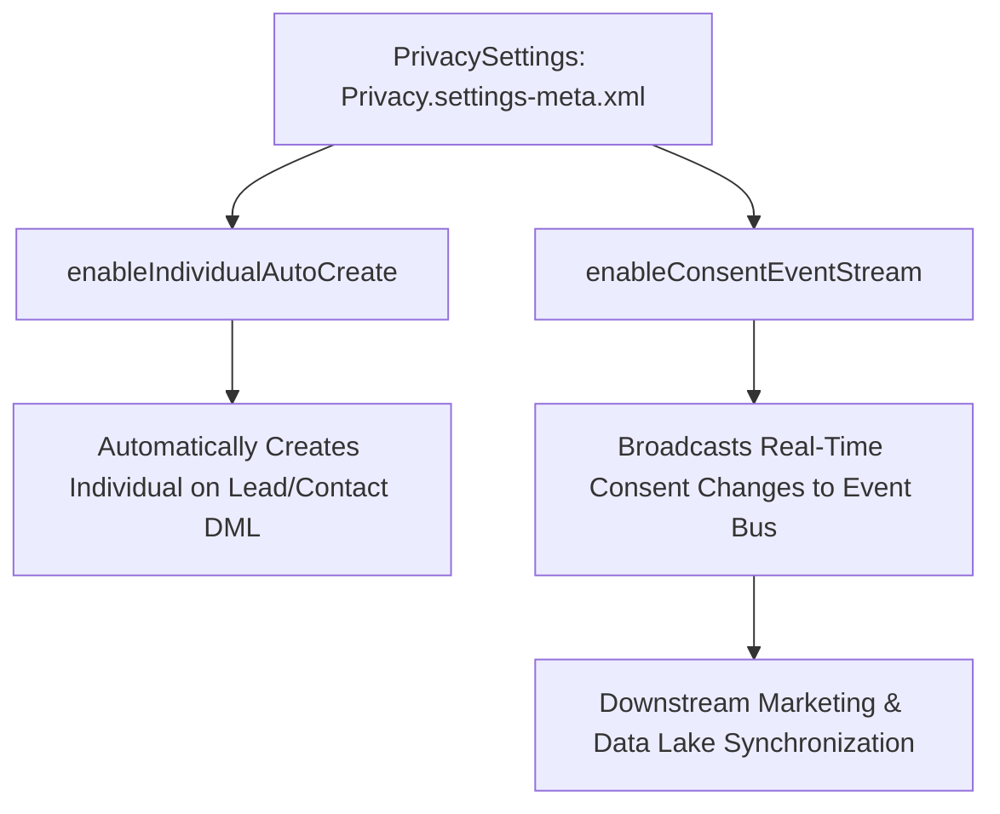

## Architectural Overview

Data privacy regulations—including the General Data Protection Regulation (GDPR) and California Consumer Privacy Act (CCPA)—require enterprises to manage consumer consent, track communication channels, and honor "Right to be Forgotten" requests. Salesforce addresses these requirements natively through data privacy objects anchored by the `Individual` entity.

The `PrivacySettings` metadata type controls organization-wide automation for data privacy and consent management. It governs automated creation of `Individual` records, enables data privacy masking policies, and activates `ConsentEventStream` to broadcast consent modifications across the enterprise architecture.



Deploying `PrivacySettings` through automated CI/CD pipelines ensures that privacy compliance controls are immutably replicated across all staging and production environments.

## Directory and File Conventions

In SFDX source format, `PrivacySettings` is managed as a settings singleton:

| Property | Value |
| :--- | :--- |
| **Metadata Type Name** | `Settings` (member: `Privacy`) / `PrivacySettings` |
| **SFDX Directory** | `force-app/main/default/settings/` |
| **File Suffix** | `.settings-meta.xml` |
| **Full File Path** | `force-app/main/default/settings/Privacy.settings-meta.xml` |
| **Scratch Org Setting Key** | `privacySettings` |

## Key Metadata Fields

The XML schema of `PrivacySettings` contains key regulatory switches:

| Field Name | Field Type | Required | Architectural Description |
| :--- | :--- | :--- | :--- |
| `enableIndividualAutoCreate` | `boolean` | No | Automatically provisions an `Individual` record whenever a Lead or Contact is inserted. |
| `enableConsentEventStream` | `boolean` | No | Publishes real-time streaming events when consent records are updated or revoked. |
| `enablePrivacyDataManagement` | `boolean` | No | Activates core privacy data governance tooling and record-level tracking. |

> [!NOTE]
> When `enableIndividualAutoCreate` is true, Lead conversion automatically preserves the linked `Individual` record on the converted Contact.

## Declarative XML and Package Manifest Examples

Below is a production `Privacy.settings-meta.xml` configuration:

```xml title="force-app/main/default/settings/Privacy.settings-meta.xml"
<?xml version="1.0" encoding="UTF-8"?>
<PrivacySettings xmlns="http://soap.sforce.com/2006/04/metadata">
    <enableConsentEventStream>true</enableConsentEventStream>
    <enableIndividualAutoCreate>true</enableIndividualAutoCreate>
    <enablePrivacyDataManagement>true</enablePrivacyDataManagement>
</PrivacySettings>
```

### Scratch Org Definition Configuration

```json title="config/project-scratch-def.json"
{
  "orgName": "Privacy & Compliance Scratch Org",
  "edition": "Enterprise",
  "settings": {
    "privacySettings": {
      "enableIndividualAutoCreate": true,
      "enableConsentEventStream": true,
      "enablePrivacyDataManagement": true
    }
  }
}
```

### Package Manifest (`package.xml`)

```xml title="manifest/package.xml"
<?xml version="1.0" encoding="UTF-8"?>
<Package xmlns="http://soap.sforce.com/2006/04/metadata">
    <types>
        <members>Privacy</members>
        <name>Settings</name>
    </types>
    <version>68.0</version>
</Package>
```

## CLI Retrieval and Deployment Commands

Manage `PrivacySettings` via the Salesforce CLI:

```bash
# Retrieve Privacy settings from the org
sf project retrieve start --metadata Settings:Privacy

# Deploy Privacy settings to target org
sf project deploy start --metadata Settings:Privacy

# Validate deployment into staging environment
sf project deploy validate --metadata Settings:Privacy
```

## Architect Best Practices and Gotchas

- **DML Trigger Side-Effects:** Enabling `enableIndividualAutoCreate` causes Salesforce to fire an implicit insert DML on `Individual` during Lead and Contact creation. Custom triggers and [Flow](/docs/metadata/flow-metadata-type/) definitions on `Individual` must be bulkified to prevent governor limit failures during bulk data imports.
- **Event Bus Consumer Scalability:** When `enableConsentEventStream` is active, mass consent updates (e.g., preference center batch updates) can generate large volumes of streaming events. Ensure external consumers handle high throughput without message loss.
- **Storage Considerations:** Individual records consume standard data storage. Large B2C orgs with millions of Leads should account for the additional record storage overhead.

> [!TIP]
> Subscribe to `ConsentEventStream` using Salesforce Pub/Sub API or Amazon EventBridge to keep external data warehouses and marketing engines synchronized with user opt-outs.
