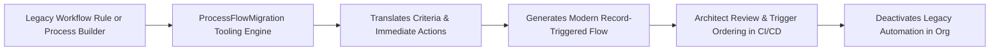

## Architectural Overview

With Salesforce's retirement of legacy automation tools (Workflow Rules and Process Builder), enterprise organizations must modernize their declarative automation architectures. Record-Triggered Flows provide significantly higher execution speed, lower CPU utilization, and fine-grained trigger ordering via Flow Trigger Explorer.

The `ProcessFlowMigration` metadata type manages and records the conversion parameters when utilizing Salesforce's automated migration tooling. It maps legacy source definitions to target [Flow](/docs/metadata/flow-metadata-type/) components, logging translation decisions, criteria evaluations, and migration statuses.



For technical architects overseeing multi-year technical debt reduction programs, version-controlling migration artifacts provides a clear audit trail of legacy automation transitions across sandbox environments.

## Directory and File Conventions

In SFDX source format, `ProcessFlowMigration` metadata files reside in the `processFlowMigrations/` directory:

| Property | Value |
| :--- | :--- |
| **Metadata Type Name** | `ProcessFlowMigration` |
| **SFDX Directory** | `force-app/main/default/processFlowMigrations/` |
| **File Suffix** | `.processFlowMigration-meta.xml` |
| **Full File Path Example** | `force-app/main/default/processFlowMigrations/Case_Escalation_Migration.processFlowMigration-meta.xml` |
| **Associated Types** | Interacts directly with `WorkflowRule` and `Flow` metadata |

## Key Metadata Fields

The XML schema of `ProcessFlowMigration` captures the mapping and lifecycle state:

| Field Name | Field Type | Required | Architectural Description |
| :--- | :--- | :--- | :--- |
| `sourceProcessName` | `string` | Yes | Developer name of the originating Workflow Rule or Process Builder. |
| `targetFlowName` | `string` | Yes | API name of the newly generated record-triggered [Flow](/docs/metadata/flow-metadata-type/). |
| `migrationStatus` | `string` | Yes | Status of the conversion: `Migrated`, `InProgress`, or `PendingReview`. |
| `migrationNotes` | `string` | No | Architectural notes, edge cases, and manual post-migration adjustments required. |

> [!NOTE]
> Complex processes containing scheduled actions or cross-object field updates may require manual architectural refactoring after migration.

## Declarative XML and Package Manifest Examples

Below is a declarative XML definition tracking the migration of an Opportunity qualification rule:

```xml title="force-app/main/default/processFlowMigrations/Opportunity_Qual_Migration.processFlowMigration-meta.xml"
<?xml version="1.0" encoding="UTF-8"?>
<ProcessFlowMigration xmlns="http://soap.sforce.com/2006/04/metadata">
    <migrationNotes>Converted immediate field updates and Chatter notification; scheduled action relocated to asynchronous path.</migrationNotes>
    <migrationStatus>Migrated</migrationStatus>
    <sourceProcessName>Opportunity_Qualification_Process</sourceProcessName>
    <targetFlowName>Opportunity_After_Save_Qualification</targetFlowName>
</ProcessFlowMigration>
```

### Package Manifest (`package.xml`)

```xml title="manifest/package.xml"
<?xml version="1.0" encoding="UTF-8"?>
<Package xmlns="http://soap.sforce.com/2006/04/metadata">
    <types>
        <members>Opportunity_Qual_Migration</members>
        <name>ProcessFlowMigration</name>
    </types>
    <types>
        <members>Opportunity_After_Save_Qualification</members>
        <name>Flow</name>
    </types>
    <version>68.0</version>
</Package>
```

## CLI Retrieval and Deployment Commands

Manage `ProcessFlowMigration` metadata using the Salesforce CLI:

```bash
# Retrieve all migration records
sf project retrieve start --metadata ProcessFlowMigration

# Deploy migration record alongside the generated flow
sf project deploy start --metadata "ProcessFlowMigration:Opportunity_Qual_Migration" --metadata "Flow:Opportunity_After_Save_Qualification"

# Validate deployment into sandbox
sf project deploy validate --metadata ProcessFlowMigration
```

## Architect Best Practices and Gotchas

- **Prevent Duplicate Execution:** Always deactivate the legacy Workflow Rule or Process Builder in the same deployment package that activates the new Flow. Running both simultaneously will trigger duplicate field updates, notifications, and validation errors.
- **Trigger Order Consolidation:** Do not leave migrated flows scattered haphazardly. Use `triggerOrder` attributes in [Flow](/docs/metadata/flow-metadata-type/) or adopt a one-flow-per-object design pattern to orchestrate subflows cleanly.
- **Bulk Testing and Apex Regression:** Migrated flows execute earlier or later in the Save Order of Execution compared to Workflow Rules. Run full regression test suites to verify that [ApexClass](/docs/metadata/apex-class-metadata-type/) triggers and validation rules behave as expected.

> [!TIP]
> Prioritize migrating Workflow Rules that perform same-record field updates into "Fast Field Updates" (Before-Save Flows) to eliminate extra save cycles and optimize CPU time.
