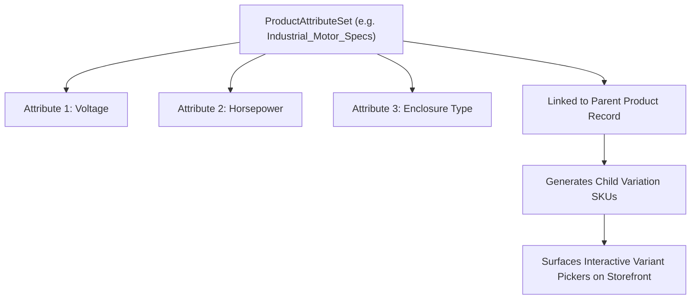

## Architectural Overview

In B2B and D2C Commerce architectures, products often exist as families of configurable variations—for instance, an industrial motor available in multiple voltages, mounting types, and horsepower ratings. Managing each variation as an isolated catalog item leads to catalog bloat and fragmented buyer experiences.

The `ProductAttributeSet` metadata type groups reusable product attributes (such as Size, Color, or Material) into structured sets. When linked to a parent product (`Product2`), the attribute set automatically structures child variation SKUs, generates storefront facet filters, and guides buyer selections.



Managing attribute sets as source-controlled metadata enables catalog architects to version attribute models, streamline product lifecycle management, and replicate catalog architectures across staging and production storefronts.

## Directory and File Conventions

In SFDX source format, `ProductAttributeSet` metadata files are organized in the `productAttributeSets/` directory:

| Property | Value |
| :--- | :--- |
| **Metadata Type Name** | `ProductAttributeSet` |
| **SFDX Directory** | `force-app/main/default/productAttributeSets/` |
| **File Suffix** | `.productAttributeSet-meta.xml` |
| **Full File Path Example** | `force-app/main/default/productAttributeSets/Apparel_Size_Color.productAttributeSet-meta.xml` |
| **Product Domain** | B2B Commerce, D2C Commerce, Revenue Cloud |

## Key Metadata Fields

The XML schema of `ProductAttributeSet` contains administrative labels and attribute items:

| Field Name | Field Type | Required | Architectural Description |
| :--- | :--- | :--- | :--- |
| `masterLabel` | `string` | Yes | User-friendly label displayed in Commerce Product Workspace. |
| `description` | `string` | No | Architectural description of the attribute set and product category mapping. |
| `developerName` | `string` | Yes | Unique developer API name referenced in catalog integration APIs. |
| `attributes` | `ProductAttributeSetItem[]` | Yes | List of custom fields or picklist attributes bundled into this set. |

> [!NOTE]
> The custom fields referenced in attribute set items must be created on the `ProductAttribute` or `Product2` object prior to deployment.

## Declarative XML and Package Manifest Examples

Below is a declarative XML definition grouping size and color attributes for apparel catalogs:

```xml title="force-app/main/default/productAttributeSets/Apparel_Size_Color.productAttributeSet-meta.xml"
<?xml version="1.0" encoding="UTF-8"?>
<ProductAttributeSet xmlns="http://soap.sforce.com/2006/04/metadata">
    <description>Standard apparel variations including garment sizing and colorway picklists.</description>
    <masterLabel>Apparel Size and Color</masterLabel>
</ProductAttributeSet>
```

### Package Manifest (`package.xml`)

```xml title="manifest/package.xml"
<?xml version="1.0" encoding="UTF-8"?>
<Package xmlns="http://soap.sforce.com/2006/04/metadata">
    <types>
        <members>Apparel_Size_Color</members>
        <name>ProductAttributeSet</name>
    </types>
    <version>68.0</version>
</Package>
```

## CLI Retrieval and Deployment Commands

Manage `ProductAttributeSet` metadata using the Salesforce CLI:

```bash
# Retrieve all product attribute sets
sf project retrieve start --metadata ProductAttributeSet

# Deploy specific product attribute set
sf project deploy start --metadata "ProductAttributeSet:Apparel_Size_Color"

# Validate deployment into sandbox org
sf project deploy validate --metadata ProductAttributeSet
```

## Architect Best Practices and Gotchas

- **Attribute Field Dependencies:** All custom fields bundled within an attribute set must exist in the target org. Always include the underlying [CustomField](/docs/metadata/custom-field-metadata-type/) metadata in your deployment package.
- **Localization and Global Picklists:** When selling internationally, bind attribute sets to Global Picklists (`GlobalValueSet`) and deploy corresponding translations so facet filters render in the buyer's localized language.
- **Variant SKU Limits:** Keep attribute dimensions reasonable. An attribute set with 4 dimensions each having 10 values creates 10,000 permutation possibilities, which can exceed storefront index and governor limits.

> [!TIP]
> Pair `ProductAttributeSet` with Commerce Search Indexing configurations to ensure new variation attributes are immediately searchable on the storefront.
