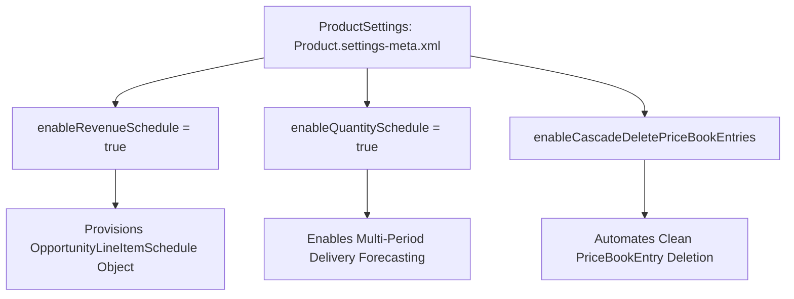

## Architectural Overview

In Salesforce Sales Cloud, products and price books form the transactional backbone for opportunities, quotes, and orders. Enterprise organizations with recurring revenue or subscription billing models frequently leverage Product Schedules to track multi-period revenue recognition and phased product deliveries.

The `ProductSettings` metadata type is a foundational org configuration file. It provisions standard scheduling objects—specifically `OpportunityLineItemSchedule`—and governs whether users can establish revenue schedules, quantity schedules, or default standard price book associations.



In automated enterprise CI/CD pipelines, deploying `ProductSettings` prior to schema, Apex, or Flow deployments is essential to avoid build failures caused by missing scheduling sObjects.

## Directory and File Conventions

In SFDX source format, `ProductSettings` is stored in the `settings/` directory and referenced as `Settings:Product`:

| Property | Value |
| :--- | :--- |
| **Metadata Type Name** | `Settings` (member: `Product`) / `ProductSettings` |
| **SFDX Directory** | `force-app/main/default/settings/` |
| **File Suffix** | `.settings-meta.xml` |
| **Full File Path** | `force-app/main/default/settings/Product.settings-meta.xml` |
| **Scratch Org Setting Key** | `productSettings` |

## Key Metadata Fields

The XML schema of `ProductSettings` exposes several critical commercial flags:

| Field Name | Field Type | Required | Architectural Description |
| :--- | :--- | :--- | :--- |
| `enableRevenueSchedule` | `boolean` | No | Enables Revenue Schedules on `Product2` and provisions `OpportunityLineItemSchedule`. |
| `enableQuantitySchedule` | `boolean` | No | Enables Quantity Schedules on `Product2` for multi-delivery forecasting. |
| `enableCascadeDeletePriceBookEntries` | `boolean` | No | Allows deleting a Price Book without manually unlinking individual price book entries. |
| `enableProductsStandardPriceBook` | `boolean` | No | Enforces standard price book creation rules when new products are inserted. |

> [!NOTE]
> Once Revenue or Quantity schedules are enabled, individual products must still have scheduling enabled on their `Product2` record to generate line item schedules.

## Declarative XML and Package Manifest Examples

Below is a production `Product.settings-meta.xml` file configured for recurring revenue business models:

```xml title="force-app/main/default/settings/Product.settings-meta.xml"
<?xml version="1.0" encoding="UTF-8"?>
<ProductSettings xmlns="http://soap.sforce.com/2006/04/metadata">
    <enableCascadeDeletePriceBookEntries>true</enableCascadeDeletePriceBookEntries>
    <enableQuantitySchedule>true</enableQuantitySchedule>
    <enableRevenueSchedule>true</enableRevenueSchedule>
</ProductSettings>
```

### Scratch Org Definition Configuration

```json title="config/project-scratch-def.json"
{
  "orgName": "SaaS Billing Scratch Org",
  "edition": "Enterprise",
  "settings": {
    "productSettings": {
      "enableRevenueSchedule": true,
      "enableQuantitySchedule": true,
      "enableCascadeDeletePriceBookEntries": true
    }
  }
}
```

### Package Manifest (`package.xml`)

```xml title="manifest/package.xml"
<?xml version="1.0" encoding="UTF-8"?>
<Package xmlns="http://soap.sforce.com/2006/04/metadata">
    <types>
        <members>Product</members>
        <name>Settings</name>
    </types>
    <version>68.0</version>
</Package>
```

## CLI Retrieval and Deployment Commands

Manage `ProductSettings` using Salesforce CLI commands:

```bash
# Retrieve ProductSettings from the target org
sf project retrieve start --metadata Settings:Product

# Deploy ProductSettings to the target org
sf project deploy start --metadata Settings:Product

# Validate settings deployment without committing changes
sf project deploy validate --metadata Settings:Product
```

## Architect Best Practices and Gotchas

- **CI/CD Pipeline Sequencing:** If any [ApexClass](/docs/metadata/apex-class-metadata-type/) or Flow references `OpportunityLineItemSchedule`, `ProductSettings` must be deployed before compiling code; otherwise, deployments fail with `sObject type does not exist`.
- **Irreversible Deactivation Constraints:** Salesforce blocks disabling `enableRevenueSchedule` if active `OpportunityLineItemSchedule` records exist in the database.
- **Reporting and Forecasting Impact:** Changing scheduling settings directly alters how collaborative forecasting engines aggregate pipeline revenue across fiscal periods.

> [!WARNING]
> Disabling product schedules deletes existing schedule records and strips multi-period projections from opportunity pipeline reports.
