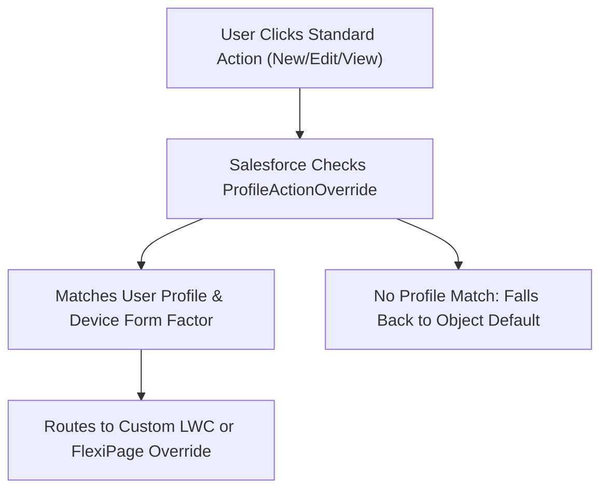

## Architectural Overview

Standard Salesforce record actions—such as New, Edit, View, and Tab—provide out-of-the-box modal dialogues and record views. However, in sophisticated enterprise systems, different user roles require tailored interaction models. For instance, customer service representatives may need a guided wizard for creating Cases, while back-office operations require a compact, bulk-entry layout.

The `ProfileActionOverride` metadata type allows architects to map standard record actions to custom Lightning Web Components (LWCs), Aura components, or [FlexiPage](/docs/metadata/flexipage-metadata-type/) metadata based on the user's assigned [Profile](/docs/metadata/profile-metadata-type/) and device form factor (Desktop vs. Mobile).



By maintaining profile-specific overrides in source control, architects ensure tailored user experiences are delivered consistently without brittle URL hacking or custom redirect controllers.

## Directory and File Conventions

`ProfileActionOverride` elements are embedded directly within [Profile](/docs/metadata/profile-metadata-type/) metadata files or managed in action override structures:

| Property | Value |
| :--- | :--- |
| **Metadata Type Name** | `ProfileActionOverride` (Child of `Profile` / Object Action Overrides) |
| **SFDX Directory** | `force-app/main/default/profiles/` |
| **File Suffix** | `.profile-meta.xml` |
| **Full File Path Example** | `force-app/main/default/profiles/Custom_Support_Agent.profile-meta.xml` |
| **Form Factor Scopes** | `Large` (Desktop), `Small` (Mobile) |

## Key Metadata Fields

The XML structure of `ProfileActionOverride` defines the target action and component binding:

| Field Name | Field Type | Required | Architectural Description |
| :--- | :--- | :--- | :--- |
| `actionName` | `string` | Yes | Standard action overridden: `New`, `Edit`, `View`, or `Tab`. |
| `content` | `string` | Yes | Name of the Lightning Component, LWC, or [FlexiPage](/docs/metadata/flexipage-metadata-type/). |
| `formFactor` | `string` | Yes | Device target: `Large` (Desktop) or `Small` (Phone). |
| `pageOrSobjectType` | `string` | Yes | API name of the target standard or custom object. |
| `type` | `string` | Yes | Technology type: `Flexipage`, `LightningComponent`, or `Visualforce`. |

> [!NOTE]
> The component or FlexiPage referenced in `content` must be deployed before or within the same transaction as the profile override.

## Declarative XML and Package Manifest Examples

Below is an XML snippet embedded inside a Profile metadata file:

```xml title="force-app/main/default/profiles/Support_Agent.profile-meta.xml"
<?xml version="1.0" encoding="UTF-8"?>
<Profile xmlns="http://soap.sforce.com/2006/04/metadata">
    <custom>true</custom>
    <profileActionOverrides>
        <actionName>New</actionName>
        <content>Case_Creation_Wizard_Page</content>
        <formFactor>Large</formFactor>
        <pageOrSobjectType>Case</pageOrSobjectType>
        <type>Flexipage</type>
    </profileActionOverrides>
    <profileActionOverrides>
        <actionName>Edit</actionName>
        <content>caseEditLwc</content>
        <formFactor>Large</formFactor>
        <pageOrSobjectType>Case</pageOrSobjectType>
        <type>LightningComponent</type>
    </profileActionOverrides>
</Profile>
```

### Package Manifest (`package.xml`)

```xml title="manifest/package.xml"
<?xml version="1.0" encoding="UTF-8"?>
<Package xmlns="http://soap.sforce.com/2006/04/metadata">
    <types>
        <members>Support_Agent</members>
        <name>Profile</name>
    </types>
    <types>
        <members>Case_Creation_Wizard_Page</members>
        <name>FlexiPage</name>
    </types>
    <version>68.0</version>
</Package>
```

## CLI Retrieval and Deployment Commands

Manage profile action overrides via the Salesforce CLI:

```bash
# Retrieve profiles including action overrides
sf project retrieve start --metadata Profile:Support_Agent

# Deploy profile alongside target FlexiPage
sf project deploy start --metadata "Profile:Support_Agent" --metadata "FlexiPage:Case_Creation_Wizard_Page"

# Validate deployment into sandbox
sf project deploy validate --metadata Profile:Support_Agent
```

## Architect Best Practices and Gotchas

- **Component Availability:** If the referenced LWC or FlexiPage does not exist in the target org, profile deployment fails with `Content does not exist`. Ensure complete dependency manifests.
- **Form Factor Parity:** If an override is configured for `Large` (Desktop) but omitted for `Small` (Mobile), mobile users will see the standard mobile record layout, creating behavioral discrepancies.
- **Permission Sets vs. Profiles Strategy:** While permission sets are preferred for permissions, action overrides bound to profiles remain a valid pattern when different business personas require completely different screen interactions.

> [!WARNING]
> Visualforce action overrides do not inherit Lightning Experience styling automatically. Prefer modern `Flexipage` or `LightningComponent` overrides.
