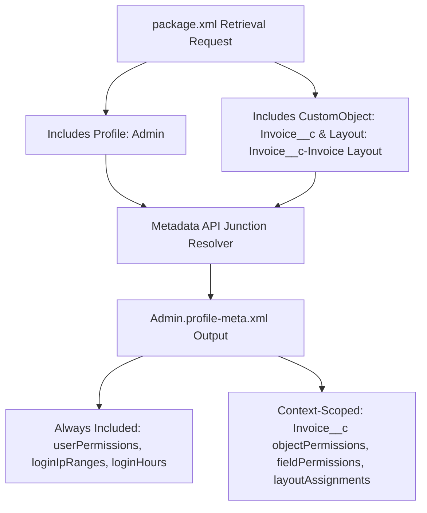

## Overview

The `Profile` metadata type (`profiles/<ProfileName>.profile-meta.xml`) represents a user's baseline environment configuration in Salesforce. Every user has exactly one `Profile`. While Salesforce's modern security architecture moves functional CRUD, Field-Level Security (FLS), and Apex access into [PermissionSet](/docs/metadata/permission-set-metadata-type/) and [PermissionSetGroup](/docs/metadata/permission-set-group-metadata-type/) metadata, `Profile` remains essential for five exclusive settings: **Page Layout assignments (`layoutAssignments`)**, **Default Record Types (`recordTypeVisibilities`)**, **Login Hours (`loginHours`)**, **Login IP Ranges (`loginIpRanges`)**, and **Login Flows (`loginFlows`)**.

For DevOps engineers and architects, `Profile` behaves completely differently from `PermissionSet` during retrieval and deployment:
- **Context-Sensitive Retrieval:** Retrieving `<name>Profile</name>` alone only retrieves system `userPermissions`, `loginHours`, and `loginIpRanges`. Junction permissions (`objectPermissions`, `fieldPermissions`, `layoutAssignments`, `classAccesses`, `tabVisibilities`) are only included for components that are **also listed in the same `package.xml` manifest**.
- **Additive/Partial Merge on Deploy:** Deploying a `.profile-meta.xml` file merges the specified XML nodes into the target org's profile without wiping out unspecified object or field permissions.



As illustrated in the diagram above, Metadata API dynamically scopes `Admin.profile-meta.xml` based on the sibling metadata types (`CustomObject`, `Layout`, `ApexClass`, `CustomTab`) requested in the same `package.xml` manifest.

## Prerequisites

- **Permissions:** "Manage Profiles and Permission Sets" and "Customize Application" permissions.
- **API Version:** Verified against API version `68.0` (Winter '27).

## Standard Profile UI Labels vs Metadata API Names

Standard profiles use internal API names in `package.xml` and the `profiles/` folder:

| UI Profile Label | Metadata API Name (`<members>`) | Source File Name |
| :--- | :--- | :--- |
| **System Administrator** | `Admin` | `Admin.profile-meta.xml` |
| **Standard User** | `Standard` | `Standard.profile-meta.xml` |
| **Standard Platform User** | `StandardAul` | `StandardAul.profile-meta.xml` |
| **Solution Manager** | `SolutionManager` | `SolutionManager.profile-meta.xml` |
| **Marketing User** | `MarketingProfile` | `MarketingProfile.profile-meta.xml` |
| **Contract Manager** | `ContractManager` | `ContractManager.profile-meta.xml` |
| **Read Only** | `ReadOnly` | `ReadOnly.profile-meta.xml` |
| **Minimum Access - Salesforce** | `Minimum Access - Salesforce` | `Minimum Access - Salesforce.profile-meta.xml` |

## Exclusive Profile XML Elements

Keep your source-controlled `.profile-meta.xml` files lean by tracking only settings that cannot live in a `PermissionSet`:

| XML Element | Purpose & Best Practice |
| :--- | :--- |
| `layoutAssignments` | Maps an object (and optional `recordType`) to a specific [Layout](/docs/metadata/layout-metadata-type/) (`<layout>Invoice__c-Invoice Layout</layout>`). |
| `recordTypeVisibilities` | Sets `<visible>true</visible>` and `<default>true</default>` for a [RecordType](/docs/metadata/record-type-metadata-type/) (`PermissionSet` can grant visibility, but cannot set the `default` record type). |
| `loginIpRanges` | Restricts profile login access to corporate VPN CIDR blocks (`startAddress` and `endAddress`). |
| `loginHours` | Restricts the days and times (`mondayStart` through `sundayEnd` in minutes from midnight) users can stay logged in. |
| `applicationVisibilities` | Sets both `<visible>` and `<default>` for Lightning apps (`default` app requires a Profile). |

## Querying Profile and Shadow PermissionSets via SOQL

In the Salesforce database, every `Profile` automatically owns an underlying `PermissionSet` record where `IsOwnedByProfile = true`. Querying that shadow `PermissionSet` is the fastest way to inspect profile CRUD and FLS via SOQL.

### 1. Query Object CRUD Permissions Across Profiles via Shadow PermissionSet
```soql
SELECT Parent.Profile.Name, SobjectType,
       PermissionsCreate, PermissionsRead, PermissionsEdit, PermissionsDelete,
       PermissionsViewAllRecords, PermissionsModifyAllRecords
FROM ObjectPermissions
WHERE Parent.IsOwnedByProfile = true
  AND SobjectType = 'Invoice__c'
ORDER BY Parent.Profile.Name ASC
```

### 2. Query Field-Level Security (FLS) for a Profile
```soql
SELECT Parent.Profile.Name, Field, PermissionsRead, PermissionsEdit
FROM FieldPermissions
WHERE Parent.IsOwnedByProfile = true
  AND SobjectType = 'Invoice__c'
  AND Parent.Profile.Name = 'System Administrator'
ORDER BY Field ASC
```

### 3. Count Active Users Assigned per Profile
Identify bloated or unused profiles during a profile-to-permission-set migration:

```soql
SELECT Profile.Name, Profile.UserLicense.Name, COUNT(Id) activeUsers
FROM User
WHERE IsActive = true
GROUP BY Profile.Name, Profile.UserLicense.Name
ORDER BY COUNT(Id) DESC
```

## Example

The following lean `Minimum_Sales_Base.profile-meta.xml` defines a custom base profile that configures Page Layout assignments, Default Record Types, Default App visibility, and corporate VPN Login IP Ranges—leaving functional CRUD and FLS to Permission Sets.

```xml title="force-app/main/default/profiles/Minimum_Sales_Base.profile-meta.xml"
<?xml version="1.0" encoding="UTF-8"?>
<Profile xmlns="http://soap.sforce.com/2006/04/metadata">
    <applicationVisibilities>
        <application>standard__LightningSales</application>
        <default>true</default>
        <visible>true</visible>
    </applicationVisibilities>
    <custom>true</custom>
    <description>Minimal baseline profile for Sales users. Functional CRUD/FLS is granted via Permission Set Groups.</description>
    <layoutAssignments>
        <layout>Account-Account Layout</layout>
    </layoutAssignments>
    <layoutAssignments>
        <layout>Invoice__c-Enterprise Invoice Layout</layout>
        <recordType>Invoice__c.Enterprise_Billing</recordType>
    </layoutAssignments>
    <loginIpRanges>
        <description>Corporate Zero-Trust Egress Gateway</description>
        <endAddress>198.51.100.255</endAddress>
        <startAddress>198.51.100.0</startAddress>
    </loginIpRanges>
    <recordTypeVisibilities>
        <default>true</default>
        <recordType>Invoice__c.Enterprise_Billing</recordType>
        <visible>true</visible>
    </recordTypeVisibilities>
    <userLicense>Salesforce</userLicense>
</Profile>
```

### Retrieving Profile Layout Assignments with `package.xml`

To retrieve `layoutAssignments` and `recordTypeVisibilities` for `Invoice__c` on a profile, you must include `CustomObject`, `Layout`, and `RecordType` in the same manifest:

```xml title="manifest/package.xml"
<?xml version="1.0" encoding="UTF-8"?>
<Package xmlns="http://soap.sforce.com/2006/04/metadata">
    <types>
        <members>Invoice__c</members>
        <name>CustomObject</name>
    </types>
    <types>
        <members>Invoice__c-Enterprise Invoice Layout</members>
        <name>Layout</name>
    </types>
    <types>
        <members>Invoice__c.Enterprise_Billing</members>
        <name>RecordType</name>
    </types>
    <types>
        <members>Minimum_Sales_Base</members>
        <name>Profile</name>
    </types>
    <version>68.0</version>
</Package>
```

## Limits and Gotchas

- **API v50.0+ Standard Profile Restriction:** Attempting to deploy `<objectPermissions>` changes on standard profiles (`Standard`, `ReadOnly`, `MarketingProfile`) in API v50.0+ fails with `You can't edit tab settings or object permissions on a standard profile`.
- **Disabled Permissions Omitted on Retrieve:** In API version 29.0+, `<userPermissions>` only retrieves permissions that are `<enabled>true</enabled>`, and `<objectPermissions>` only retrieves objects where `allowRead` is `true`. To explicitly revoke a permission on a profile via Metadata API deployment, you must manually add the node with `<enabled>false</enabled>` or `<allowRead>false</allowRead>`.
- **`personAccountDefault` vs `default` on Record Types:** When configuring `recordTypeVisibilities` on `Account` or `Contact` in an org with Person Accounts enabled, always include both `<default>` (for business accounts) and `<personAccountDefault>` (for person accounts).

## Related Official Documentation

- [Profile Metadata API Reference](https://developer.salesforce.com/docs/atlas.en-us.api_meta.meta/api_meta/meta_profile.htm): Complete XML specification for `Profile` settings and layout assignments.
- [Profile Object Reference](https://developer.salesforce.com/docs/atlas.en-us.object_reference.meta/object_reference/sforce_api_objects_profile.htm): Querying profiles and shadow permission sets via SOQL.
