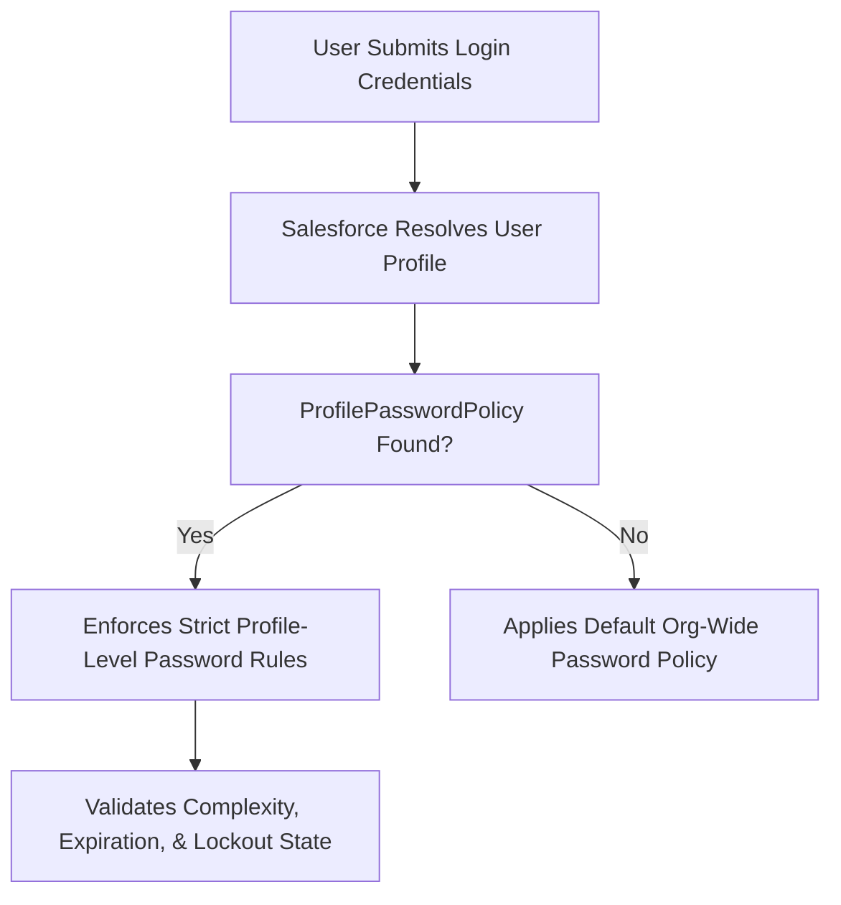

## Architectural Overview

In defense-in-depth cybersecurity architectures, treating all user accounts with the same security policies creates vulnerability. Privileged user accounts—such as System Administrators, Financial Controllers, and Security Auditors—represent high-value targets for credential stuffing and brute-force attacks.

The `ProfilePasswordPolicy` metadata type enables architects to enforce granular password security parameters on a per-profile basis. This allows stricter rules (e.g., 90-day expiration, 16-character minimums, lockout after 3 failed attempts) for administrative profiles, while business users follow baseline policies or SSO federations.



Deploying password policies as version-controlled metadata ensures enterprise compliance standards are immutably maintained across all corporate environments.

## Directory and File Conventions

In SFDX source format, `ProfilePasswordPolicy` metadata files reside in the `profilePasswordPolicies/` directory:

| Property | Value |
| :--- | :--- |
| **Metadata Type Name** | `ProfilePasswordPolicy` |
| **SFDX Directory** | `force-app/main/default/profilePasswordPolicies/` |
| **File Suffix** | `.profilePasswordPolicy-meta.xml` |
| **Full File Path Example** | `force-app/main/default/profilePasswordPolicies/Admin_Password_Policy.profilePasswordPolicy-meta.xml` |
| **Parent Entity** | Binds to a specific `Profile` developer name |

## Key Metadata Fields

The XML schema of `ProfilePasswordPolicy` controls cryptographic and lockout thresholds:

| Field Name | Field Type | Required | Architectural Description |
| :--- | :--- | :--- | :--- |
| `profile` | `string` | Yes | Developer name of the [Profile](/docs/metadata/profile-metadata-type/) governed by this policy. |
| `passwordExpiration` | `int` | Yes | Days before expiration: `30`, `60`, `90`, `180`, `365`, or `0` (Never). |
| `minimumPasswordLength` | `int` | Yes | Minimum character length required (typically 8 to 128). |
| `passwordComplexity` | `int` | Yes | Complexity requirement: `1` (AlphaNumeric), `3` (Special Characters), etc. |
| `maxLoginAttempts` | `int` | Yes | Failed attempts before lockout: `3`, `5`, `10`, or `0` (No limit). |
| `lockoutInterval` | `int` | Yes | Lockout duration in minutes: `15`, `30`, `60`, or `0` (Forever). |

> [!NOTE]
> Setting `lockoutInterval` to `0` means the account is locked forever until an administrator manually resets it via Setup or User management APIs.

## Declarative XML and Package Manifest Examples

Below is a production `ProfilePasswordPolicy` enforcing strict controls for an administrator profile:

```xml title="force-app/main/default/profilePasswordPolicies/Admin_Password_Policy.profilePasswordPolicy-meta.xml"
<?xml version="1.0" encoding="UTF-8"?>
<ProfilePasswordPolicy xmlns="http://soap.sforce.com/2006/04/metadata">
    <lockoutInterval>60</lockoutInterval>
    <maxLoginAttempts>3</maxLoginAttempts>
    <minimumPasswordLength>16</minimumPasswordLength>
    <passwordComplexity>3</passwordComplexity>
    <passwordExpiration>90</passwordExpiration>
    <passwordHistory>12</passwordHistory>
    <profile>Admin</profile>
</ProfilePasswordPolicy>
```

### Package Manifest (`package.xml`)

```xml title="manifest/package.xml"
<?xml version="1.0" encoding="UTF-8"?>
<Package xmlns="http://soap.sforce.com/2006/04/metadata">
    <types>
        <members>Admin_Password_Policy</members>
        <name>ProfilePasswordPolicy</name>
    </types>
    <version>68.0</version>
</Package>
```

## CLI Retrieval and Deployment Commands

Manage `ProfilePasswordPolicy` via the Salesforce CLI:

```bash
# Retrieve all profile password policies
sf project retrieve start --metadata ProfilePasswordPolicy

# Deploy a specific profile password policy
sf project deploy start --metadata "ProfilePasswordPolicy:Admin_Password_Policy"

# Validate deployment into sandbox
sf project deploy validate --metadata ProfilePasswordPolicy
```

## Architect Best Practices and Gotchas

- **Integration Service Account Caution:** Setting `maxLoginAttempts: 3` and `lockoutInterval: 0` on profiles used by automated ETL or API tools can cause sudden enterprise integration downtime if invalid tokens are sent during certificate rollouts.
- **Target Profile Dependency:** The referenced profile must exist in the target environment or be included in the same deployment manifest.
- **SSO Compatibility:** Users logging in via SAML 2.0 or OpenID Connect Single Sign-On (SSO) bypass Salesforce password complexity checks, as authentication is delegated to the identity provider.

> [!TIP]
> For privileged administrative accounts, combine strict `ProfilePasswordPolicy` rules with mandatory multi-factor authentication (MFA) session security levels.
