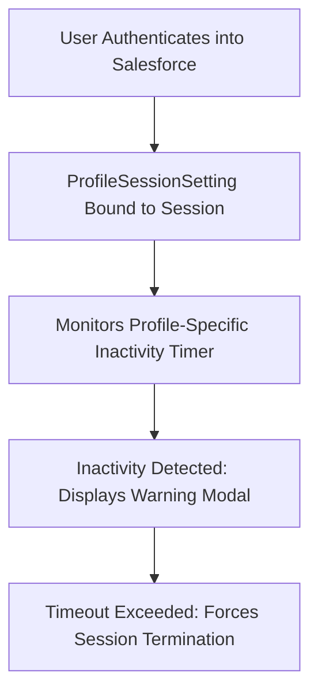

## Architectural Overview

Session management is a critical pillar of enterprise cybersecurity governance. Regulatory frameworks such as HIPAA, PCI-DSS, and FedRAMP mandate strict inactivity timeouts for users handling sensitive cardholder or medical information. Conversely, setting aggressive 15-minute timeouts globally can frustrate standard sales users and reduce adoption.

The `ProfileSessionSetting` metadata type enables architects to tailor session lifespans per profile. Privileged administrator and financial profiles can be constrained with a 15-minute idle timeout and forced logout, while standard operational profiles enjoy extended 2-hour or 4-hour sessions.



Managing session parameters declaratively in source control guarantees that corporate governance standards are uniformly applied across all production and sandbox instances.

## Directory and File Conventions

In SFDX source projects, `ProfileSessionSetting` metadata files are organized in the `profileSessionSettings/` directory:

| Property | Value |
| :--- | :--- |
| **Metadata Type Name** | `ProfileSessionSetting` |
| **SFDX Directory** | `force-app/main/default/profileSessionSettings/` |
| **File Suffix** | `.profileSessionSetting-meta.xml` |
| **Full File Path Example** | `force-app/main/default/profileSessionSettings/Admin_Session_Setting.profileSessionSetting-meta.xml` |
| **Security Scope** | Governs browser session timeouts and MFA assurance levels |

## Key Metadata Fields

The XML schema of `ProfileSessionSetting` configures session thresholds:

| Field Name | Field Type | Required | Architectural Description |
| :--- | :--- | :--- | :--- |
| `profile` | `string` | Yes | Developer name of the target [Profile](/docs/metadata/profile-metadata-type/). |
| `sessionTimeout` | `int` | Yes | Idle timeout in minutes: `15`, `30`, `60`, `120`, `240`, `480`, `720`, or `1440`. |
| `sessionTimeoutWarning` | `boolean` | Yes | Whether to display a countdown warning modal before session termination. |
| `forceLogout` | `boolean` | Yes | Forces the user back to the login screen upon expiration. |
| `sessionSecurityLevel` | `string` | No | Required session assurance: `Standard` or `HighAssurance`. |

> [!NOTE]
> Requiring `HighAssurance` session level mandates that users satisfy multi-factor authentication (MFA) requirements to access the application.

## Declarative XML and Package Manifest Examples

Below is a production `ProfileSessionSetting` configured for a privileged administrator profile:

```xml title="force-app/main/default/profileSessionSettings/Admin_Session_Setting.profileSessionSetting-meta.xml"
<?xml version="1.0" encoding="UTF-8"?>
<ProfileSessionSetting xmlns="http://soap.sforce.com/2006/04/metadata">
    <forceLogout>true</forceLogout>
    <profile>Admin</profile>
    <sessionSecurityLevel>HighAssurance</sessionSecurityLevel>
    <sessionTimeout>15</sessionTimeout>
    <sessionTimeoutWarning>true</sessionTimeoutWarning>
</ProfileSessionSetting>
```

### Package Manifest (`package.xml`)

```xml title="manifest/package.xml"
<?xml version="1.0" encoding="UTF-8"?>
<Package xmlns="http://soap.sforce.com/2006/04/metadata">
    <types>
        <members>Admin_Session_Setting</members>
        <name>ProfileSessionSetting</name>
    </types>
    <version>68.0</version>
</Package>
```

## CLI Retrieval and Deployment Commands

Manage `ProfileSessionSetting` metadata via the Salesforce CLI:

```bash
# Retrieve all profile session settings
sf project retrieve start --metadata ProfileSessionSetting

# Deploy specific profile session setting
sf project deploy start --metadata "ProfileSessionSetting:Admin_Session_Setting"

# Validate deployment into target sandbox
sf project deploy validate --metadata ProfileSessionSetting
```

## Architect Best Practices and Gotchas

- **HighAssurance Configuration Verification:** Ensure Identity Verification and MFA settings are configured in the target org before setting `sessionSecurityLevel: HighAssurance`; otherwise, users may be unable to authenticate.
- **Unsaved Work and Force Logout:** Setting `forceLogout: true` on profiles where users compose long-form notes (e.g. Case descriptions) will cause unsaved data loss on session timeout. Always enable `sessionTimeoutWarning: true` to give users adequate notice.
- **Profile Name Resolution:** The `profile` field must resolve to an exact Profile developer name. Custom profile renames in lower environments will break session settings deployments.

> [!WARNING]
> Setting session timeouts below 30 minutes on integration profiles using Web Server OAuth flows can cause unexpected token refreshes and API rate limit spikes.
