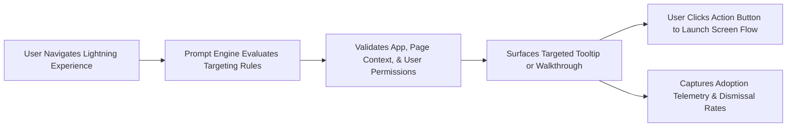

## Architectural Overview

User adoption and change management often represent the greatest hurdles to maximizing CRM return on investment. When new features, custom Lightning Web Components, or restructured business processes are introduced, users require contextual, just-in-time training rather than static training manuals.

The `Prompt` metadata type defines Salesforce In-App Guidance components within Lightning Experience. Prompts can be configured as floating notifications, targeted tooltips anchored directly to specific UI fields or buttons, or multi-step interactive walkthroughs that guide users through end-to-end business workflows.



Managing `Prompt` definitions as declarative code enables enterprise architects to coordinate user enablement campaigns directly alongside software release cycles in CI/CD pipelines.

## Directory and File Conventions

In SFDX source projects, `Prompt` metadata files are organized in the `prompts/` directory:

| Property | Value |
| :--- | :--- |
| **Metadata Type Name** | `Prompt` |
| **SFDX Directory** | `force-app/main/default/prompts/` |
| **File Suffix** | `.prompt-meta.xml` |
| **Full File Path Example** | `force-app/main/default/prompts/New_Deal_Desk_Walkthrough.prompt-meta.xml` |
| **Experience Domain** | Lightning Experience desktop and mobile apps |

## Key Metadata Fields

The XML schema of `Prompt` encapsulates versioning, display parameters, and targeting criteria:

| Field Name | Field Type | Required | Architectural Description |
| :--- | :--- | :--- | :--- |
| `masterLabel` | `string` | Yes | Administrative label displayed in In-App Guidance Builder. |
| `promptVersions` | `PromptVersion[]` | Yes | Array of prompt steps, versions, and localization properties. |
| `displayType` | `string` | Yes | Visual form factor: `Floating`, `Targeted`, or `DockedComposer`. |
| `targetApp` | `string` | No | API name of the Lightning App scoping this prompt. |
| `targetPageType` | `string` | No | Scoped page: `standard__objectPage`, `standard__recordPage`, etc. |
| `timesToDisplay` | `int` | Yes | Maximum times the prompt appears before permanent dismissal. |

> [!NOTE]
> Multi-step walkthroughs require In-App Guidance Walkthrough user licenses or CRM Analytics feature licensing.

## Declarative XML and Package Manifest Examples

Below is a declarative XML definition of a targeted prompt announcing a new deal desk discount calculator:

```xml title="force-app/main/default/prompts/Deal_Desk_Calculator_Notice.prompt-meta.xml"
<?xml version="1.0" encoding="UTF-8"?>
<Prompt xmlns="http://soap.sforce.com/2006/04/metadata">
    <masterLabel>Deal Desk Calculator Notice</masterLabel>
    <promptVersions>
        <body>Use the new Deal Desk Calculator component to model multi-year tier discounts before submitting for manager approval.</body>
        <delayDays>1</delayDays>
        <displayType>Targeted</displayType>
        <isPublished>true</isPublished>
        <masterLabel>Deal Desk Calculator Notice v1</masterLabel>
        <publishedDate>2026-11-12</publishedDate>
        <shouldDisplayActionButton>true</shouldDisplayActionButton>
        <actionButtonLabel>Launch Training Flow</actionButtonLabel>
        <actionButtonUrl>/flow/Deal_Desk_Onboarding_Flow</actionButtonUrl>
        <targetApp>LightningSales</targetApp>
        <targetPageType>standard__recordPage</targetPageType>
        <timesToDisplay>3</timesToDisplay>
        <title>New Deal Desk Calculator Available</title>
        <userAccess>Everyone</userAccess>
    </promptVersions>
</Prompt>
```

### Package Manifest (`package.xml`)

```xml title="manifest/package.xml"
<?xml version="1.0" encoding="UTF-8"?>
<Package xmlns="http://soap.sforce.com/2006/04/metadata">
    <types>
        <members>Deal_Desk_Calculator_Notice</members>
        <name>Prompt</name>
    </types>
    <types>
        <members>Deal_Desk_Onboarding_Flow</members>
        <name>Flow</name>
    </types>
    <version>68.0</version>
</Package>
```

## CLI Retrieval and Deployment Commands

Manage `Prompt` metadata via the Salesforce CLI:

```bash
# Retrieve all prompts from the target environment
sf project retrieve start --metadata Prompt

# Deploy a specific prompt alongside referenced flows
sf project deploy start --metadata "Prompt:Deal_Desk_Calculator_Notice" --metadata "Flow:Deal_Desk_Onboarding_Flow"

# Validate prompt deployment into staging sandbox
sf project deploy validate --metadata Prompt
```

## Architect Best Practices and Gotchas

- **UI Element Selector Stability:** Targeted prompts bind to specific DOM elements or component wrappers. If a custom LWC or [FlexiPage](/docs/metadata/flexipage-metadata-type/) is redesigned, test targeted prompts to ensure the visual anchor still renders accurately.
- **Prompt Fatigue Governance:** Establish an org-wide In-App Guidance schedule. Overloading end users with simultaneous floating prompts leads to reflexive dismissal without reading.
- **License Boundary Checks:** Deploying multi-step walkthroughs to scratch orgs lacking `InAppGuidanceWalkthrough` feature licenses will cause deployment errors.

> [!TIP]
> Use `actionButtonUrl` to deep-link users directly into interactive screen [Flow](/docs/metadata/flow-metadata-type/) experiences for hands-on learning.
