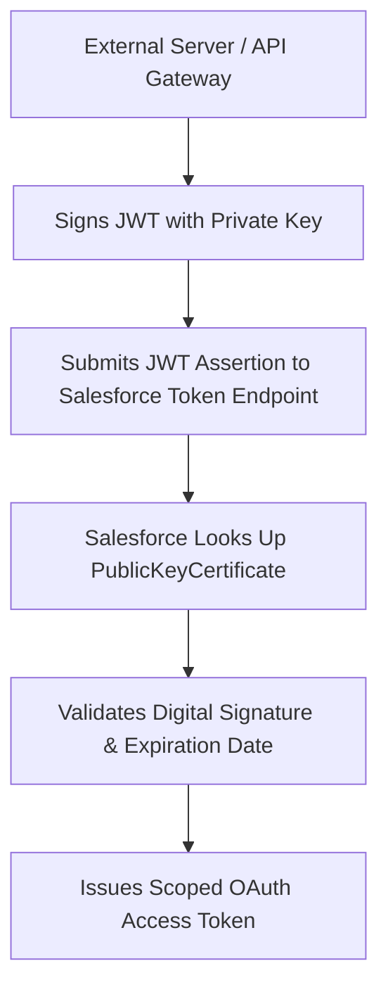

## Architectural Overview

Cryptographic trust establishment is essential for enterprise application integration. Organizations implementing headless architectures, server-to-server microservices, and event-driven pipelines require strong authentication mechanisms that do not rely on fragile, static user passwords.

The `PublicKeyCertificate` metadata type manages public X.509 digital certificates within Salesforce. It serves as the cryptographic verification anchor for:
1. **OAuth 2.0 JWT Bearer Flow:** Verifying digital signatures on client assertions submitted by external systems to [ConnectedApp](/docs/metadata/connected-app-metadata-type/) endpoints.
2. **Mutual TLS (mTLS):** Validating client certificates during bidirectional TLS handshakes on port 8443.
3. **Outbound Callout Trust:** Validating external server identity during API callouts.



Managing public key certificates in source control allows DevOps teams to automate certificate deployment across lower environments without manual file uploads in Setup.

## Directory and File Conventions

In SFDX source projects, `PublicKeyCertificate` metadata files are organized in the `publicKeyCertificates/` directory:

| Property | Value |
| :--- | :--- |
| **Metadata Type Name** | `PublicKeyCertificate` |
| **SFDX Directory** | `force-app/main/default/publicKeyCertificates/` |
| **File Suffix** | `.publicKeyCertificate-meta.xml` |
| **Full File Path Example** | `force-app/main/default/publicKeyCertificates/MuleSoft_Gateway_Cert.publicKeyCertificate-meta.xml` |
| **Security Scope** | Public cryptographic key verification |

## Key Metadata Fields

The XML schema of `PublicKeyCertificate` encapsulates cryptographic certificate attributes:

| Field Name | Field Type | Required | Architectural Description |
| :--- | :--- | :--- | :--- |
| `certificate` | `string` | Yes | Base64-encoded PEM or CRT format public key certificate. |
| `masterLabel` | `string` | Yes | Human-readable certificate label displayed in Setup. |
| `keySize` | `int` | No | Cryptographic key length in bits (e.g. `2048`, `4096`). |
| `expirationDate` | `dateTime` | No | Valid expiration timestamp calculated from the X.509 certificate. |

> [!NOTE]
> Never store private keys in version control or metadata files. Only the public portion of the X.509 keypair belongs in `PublicKeyCertificate`.

## Declarative XML and Package Manifest Examples

Below is a declarative XML definition of an enterprise public key certificate:

```xml title="force-app/main/default/publicKeyCertificates/MuleSoft_Gateway_Cert.publicKeyCertificate-meta.xml"
<?xml version="1.0" encoding="UTF-8"?>
<PublicKeyCertificate xmlns="http://soap.sforce.com/2006/04/metadata">
    <certificate>MIIBIjANBgkqhkiG9w0BAQEFAAOCAQ8AMIIBCgKCAQEA0Y1o7X...[TRUNCATED_BASE64_CERTIFICATE]...</certificate>
    <keySize>2048</keySize>
    <masterLabel>MuleSoft API Gateway Public Cert</masterLabel>
</PublicKeyCertificate>
```

### Package Manifest (`package.xml`)

```xml title="manifest/package.xml"
<?xml version="1.0" encoding="UTF-8"?>
<Package xmlns="http://soap.sforce.com/2006/04/metadata">
    <types>
        <members>MuleSoft_Gateway_Cert</members>
        <name>PublicKeyCertificate</name>
    </types>
    <version>68.0</version>
</Package>
```

## CLI Retrieval and Deployment Commands

Manage `PublicKeyCertificate` metadata via the Salesforce CLI:

```bash
# Retrieve public key certificates
sf project retrieve start --metadata PublicKeyCertificate

# Deploy a specific public key certificate to sandbox
sf project deploy start --metadata "PublicKeyCertificate:MuleSoft_Gateway_Cert"

# Validate certificate deployment
sf project deploy validate --metadata PublicKeyCertificate
```

## Architect Best Practices and Gotchas

- **Zero-Downtime Rotation Planning:** Certificates have finite lifetimes (typically 1 to 2 years). Plan certificate rotations at least 60 days before expiration. Use `PublicKeyCertificateSet` or parallel connected app configurations to support overlapping keys during rotation.
- **Cryptographic Strength Requirements:** Mandate minimum 2048-bit RSA keys (or modern ECC curves) for all public certificates to satisfy SOC 2 and PCI-DSS compliance audits.
- **Automated Expiry Monitoring:** Implement scheduled monitoring jobs querying the `Certificate` or `PublicKeyCertificate` tooling entities to send automated Slack or email alerts when certificates approach 30 days to expiration.

> [!WARNING]
> Expired certificates cause immediate API authorization failures for all external microservices relying on JWT bearer token authentication.
