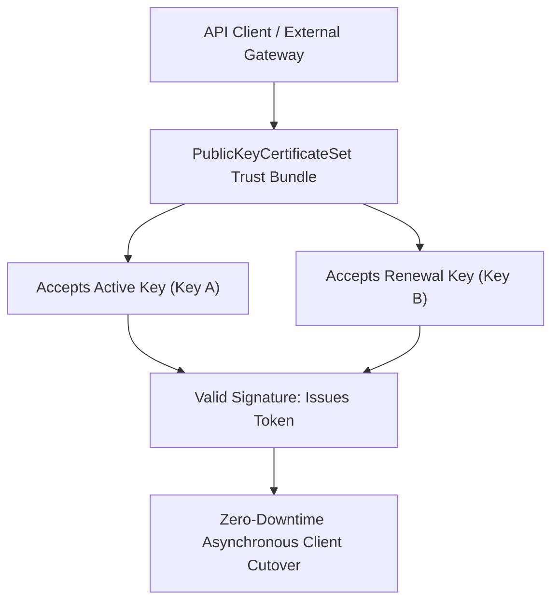

## Architectural Overview

One of the most frequent causes of unplanned enterprise integration downtime is cryptographic certificate expiration. When an integration relies on a single certificate, rotating that certificate requires synchronous coordination between the Salesforce platform and external client systems—a process prone to human error and service interruptions.

The `PublicKeyCertificateSet` metadata type solves this challenge by grouping multiple `PublicKeyCertificate` instances into a unified trust bundle. During scheduled rotation windows, both the current production certificate and the new renewal certificate reside simultaneously inside the certificate set.



This multi-key architecture allows external integration clients to switch to their new private key asynchronously. Once the transition is verified, architects deploy an updated `PublicKeyCertificateSet` removing the decommissioned key.

## Directory and File Conventions

In SFDX source projects, `PublicKeyCertificateSet` metadata files are organized in the `publicKeyCertificateSets/` directory:

| Property | Value |
| :--- | :--- |
| **Metadata Type Name** | `PublicKeyCertificateSet` |
| **SFDX Directory** | `force-app/main/default/publicKeyCertificateSets/` |
| **File Suffix** | `.publicKeyCertificateSet-meta.xml` |
| **Full File Path Example** | `force-app/main/default/publicKeyCertificateSets/ERP_Integration_Cert_Set.publicKeyCertificateSet-meta.xml` |
| **Associated Metadata** | Binds to multiple `PublicKeyCertificate` members |

## Key Metadata Fields

The XML schema of `PublicKeyCertificateSet` defines the bundle properties:

| Field Name | Field Type | Required | Architectural Description |
| :--- | :--- | :--- | :--- |
| `masterLabel` | `string` | Yes | Human-readable label displayed in Integration Security consoles. |
| `description` | `string` | No | Architectural overview explaining key rotation schedules and owners. |
| `certificates` | `string[]` | Yes | Array of developer names of member `PublicKeyCertificate` records. |

> [!NOTE]
> All child certificates listed in `certificates` must exist in the target org or be included in the same deployment manifest.

## Declarative XML and Package Manifest Examples

Below is a declarative XML definition of a certificate set containing both primary and secondary rotation certificates:

```xml title="force-app/main/default/publicKeyCertificateSets/ERP_Integration_Cert_Set.publicKeyCertificateSet-meta.xml"
<?xml version="1.0" encoding="UTF-8"?>
<PublicKeyCertificateSet xmlns="http://soap.sforce.com/2006/04/metadata">
    <description>Bundles primary and renewal public certificates for SAP ERP integration.</description>
    <masterLabel>ERP Integration Certificate Set</masterLabel>
</PublicKeyCertificateSet>
```

### Package Manifest (`package.xml`)

```xml title="manifest/package.xml"
<?xml version="1.0" encoding="UTF-8"?>
<Package xmlns="http://soap.sforce.com/2006/04/metadata">
    <types>
        <members>ERP_Integration_Cert_Set</members>
        <name>PublicKeyCertificateSet</name>
    </types>
    <types>
        <members>SAP_Gateway_Primary_Cert</members>
        <members>SAP_Gateway_Renewal_Cert</members>
        <name>PublicKeyCertificate</name>
    </types>
    <version>68.0</version>
</Package>
```

## CLI Retrieval and Deployment Commands

Manage `PublicKeyCertificateSet` metadata via the Salesforce CLI:

```bash
# Retrieve all certificate sets and member certificates
sf project retrieve start --metadata PublicKeyCertificateSet --metadata PublicKeyCertificate

# Deploy certificate set to target sandbox
sf project deploy start --metadata "PublicKeyCertificateSet:ERP_Integration_Cert_Set"

# Validate deployment before cutover
sf project deploy validate --metadata PublicKeyCertificateSet
```

## Architect Best Practices and Gotchas

- **Phased Rotation Protocol:** Execute rotations in three distinct phases: (1) Deploy the new certificate to the set; (2) Switch external client traffic to sign with the new key; (3) Deploy updated metadata removing the decommissioned certificate.
- **Dependency Ordering:** Ensure child `PublicKeyCertificate` files are included in the same deployment transaction as the `PublicKeyCertificateSet` to avoid unresolved reference failures.
- **Audit Logging:** Maintain git commit messages documenting why certificates were added or retired to support annual SOC 2 security compliance audits.

> [!TIP]
> Bind `PublicKeyCertificateSet` to [ConnectedApp](/docs/metadata/connected-app-metadata-type/) definitions for enterprise middleware like MuleSoft or Boomi to guarantee 99.999% integration uptime.
