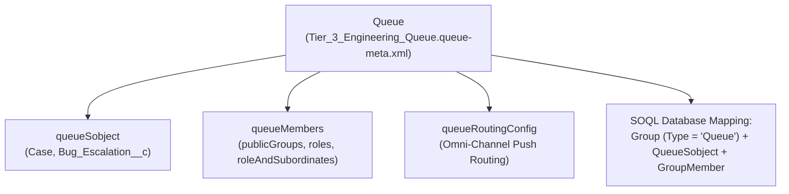

The `Queue` metadata type represents a shared ownership pool for records that await triage, assignment, or Omni-Channel routing—such as inbound `Lead` records, support `Case` tickets, `MessagingSession` conversations, or custom objects (`Invoice_Approval__c`). Introduced in API version 24.0, a `Queue` defines which SObjects can be assigned to it (`queueSobject`), which users, roles, or public groups belong to it (`queueMembers`), and whether Omni-Channel pushes work automatically (`queueRoutingConfig`).

In Salesforce DX projects, queue files are stored in `force-app/main/default/queues/` with the `.queue-meta.xml` suffix.



## Key Metadata Fields

| Field | Type | Required | Description |
|---|---|---|---|
| `name` | `string` | Yes | UI display label of the queue |
| `email` | `string` | No | Shared distribution email address for queue notifications |
| `doesSendEmailToMembers` | `boolean` | No | Whether queue members receive an email when a new record is assigned to the queue |
| `doesIncludeBosses` | `boolean` | No | Controls whether role hierarchy bosses inherit access (API version 67.0+) |
| `queueRoutingConfig` | `string` | No | Developer name of the Omni-Channel `QueueRoutingConfig` |
| `queueSobject` | `QueueSobject[]` | No | List of `<sobjectType>` entries allowed to be owned by this queue |
| `queueMembers` | `QueueMembers` | No | Membership lists (`publicGroups`, `roles`, `roleAndSubordinates`, `roleAndSubordinatesInternal`, `users`) |

## Production-Grade XML Example

Below is a CI/CD-safe `Queue` definition (`Tier_3_Engineering_Queue.queue-meta.xml`) that assigns membership via a [Group](/docs/metadata/group-metadata-type/) and [Role](/docs/metadata/role-metadata-type/) rather than brittle environment-specific usernames:

```xml
<?xml version="1.0" encoding="UTF-8"?>
<Queue xmlns="http://soap.sforce.com/2006/04/metadata">
    <doesSendEmailToMembers>false</doesSendEmailToMembers>
    <email>tier3-support@example.com</email>
    <name>Tier 3 Engineering Queue</name>
    <queueMembers>
        <publicGroups>
            <publicGroup>Tier_3_Support_Engineers</publicGroup>
        </publicGroups>
        <roleAndSubordinatesInternal>
            <roleAndSubordinateInternal>Director_Support_Engineering</roleAndSubordinateInternal>
        </roleAndSubordinatesInternal>
    </queueMembers>
    <queueSobject>
        <sobjectType>Case</sobjectType>
    </queueSobject>
    <queueSobject>
        <sobjectType>Incident</sobjectType>
    </queueSobject>
</Queue>
```

> [!WARNING]
> **Never Commit `<users>` in `queueMembers` to Git**: Usernames (`john.doe@company.com.uat`) differ across dev sandboxes, scratch orgs, and production. If a `.queue-meta.xml` file contains `<user>` tags, deployments to scratch orgs will fail with `Cannot find a user that matches...`. Always reference a `<publicGroup>` or `<role>` in `queueMembers`.

## Querying Queues, Supported Objects, and Members with SOQL

In Apex and SOQL, a `Queue` is stored as a record in the `Group` table where `Type = 'Queue'`:

```sql
-- 1. Get Queue Id by DeveloperName (for assigning OwnerId in Apex/Flows)
SELECT Id, Name, DeveloperName, Email, DoesSendEmailToMembers, RelatedId
FROM Group
WHERE Type = 'Queue'
  AND DeveloperName = 'Tier_3_Engineering_Queue'

-- 2. List all SObjects supported by each Queue
SELECT Id, QueueId, Queue.DeveloperName, Queue.Name, SobjectType
FROM QueueSobject
WHERE SobjectType = 'Case'
ORDER BY Queue.Name ASC

-- 3. Inspect direct members (Users or nested Groups) of a Queue
SELECT Id, GroupId, Group.DeveloperName, UserOrGroupId
FROM GroupMember
WHERE Group.Type = 'Queue'
  AND Group.DeveloperName = 'Tier_3_Engineering_Queue'
```

