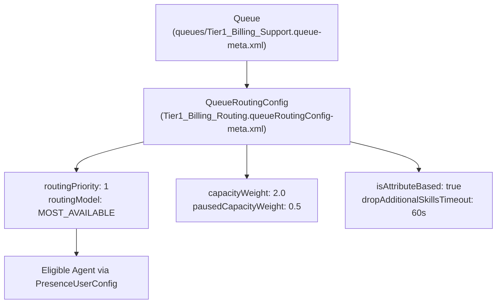

## Why the `QueueRoutingConfig` Metadata Type Is the Brain of Omni-Channel

When an incoming Case, MessagingSession, or Lead enters an Omni-Channel [Queue](/docs/metadata/queue-metadata-type/) (or is routed via an Omni-Channel Flow), **`QueueRoutingConfig`** (`queueRoutingConfigs/<Name>.queueRoutingConfig-meta.xml`) determines:

1. **Queue Priority (`routingPriority`):** Lower numbers (`1` vs `5`) are pushed to agents first across competing queues.
2. **Agent Selection Algorithm (`routingModel`):** `LEAST_ACTIVE`, `MOST_AVAILABLE`, or `EXTERNAL_ROUTING`.
3. **Work Item Size (`capacityWeight` vs. `capacityPercentage`):** How much of an agent's capacity (defined in [PresenceUserConfig](/docs/metadata/presence-user-config-metadata-type/)) one work item consumes—including separate `pausedCapacityWeight` (API v64.0+) when status-based work is paused.
4. **Push Timeouts & Skill Fallback (`pushTimeout`, `dropAdditionalSkillsTimeout`):** How long an agent's widget rings before re-routing, and when optional skills are dropped so work doesn't stall.



---

## Key Metadata Fields on `QueueRoutingConfig`

| Field | Type | Required | Description |
|---|---|---|---|
| `label` | `string` | Yes | Display name of the routing configuration in Setup. |
| `routingModel` | `RoutingModel` | Yes | `LEAST_ACTIVE`, `MOST_AVAILABLE`, or `EXTERNAL_ROUTING`. |
| `routingPriority` | `int` | Yes | Priority integer (`1` is highest priority). Items from priority `1` queues always route before priority `2`. |
| `capacityWeight` | `double` | Conditional | Exact unit capacity consumed by each work item (mutually exclusive with `capacityPercentage`). |
| `capacityPercentage` | `double` | Conditional | Percentage (`0`–`100`) of an agent's capacity consumed by each work item. |
| `pausedCapacityWeight` | `double` | No | *(API v64.0+)* Capacity units consumed while a status-based work item is in a `PAUSED` state. |
| `pushTimeout` | `int` | No | Seconds before an unanswered push offer is recalled from the agent and routed to the next available agent. |
| `isAttributeBased` | `boolean` | No | Enables Skills-Based Routing rules (`SkillMappingConfig`) for this routing config. |
| `dropAdditionalSkillsTimeout` | `int` | No | Seconds before additional (non-mandatory) skills are dropped so any core-skilled agent can take the work item. |
| `isInterruptible` | `boolean` | No | *(API v57.0+)* Marks work items from this config as interruptible by real-time channels like Voice or Chat. |

---

## Real-World XML Example (`queueRoutingConfigs/VIP_Case_Routing.queueRoutingConfig-meta.xml`)

```xml
<?xml version="1.0" encoding="UTF-8"?>
<QueueRoutingConfig xmlns="http://soap.sforce.com/2006/04/metadata">
    <capacityWeight>2.0</capacityWeight>
    <dropAdditionalSkillsTimeout>120</dropAdditionalSkillsTimeout>
    <isAttributeBased>false</isAttributeBased>
    <isInterruptible>true</isInterruptible>
    <label>VIP Case Routing</label>
    <pausedCapacityWeight>0.5</pausedCapacityWeight>
    <pushTimeout>45</pushTimeout>
    <routingModel>MOST_AVAILABLE</routingModel>
    <routingPriority>1</routingPriority>
</QueueRoutingConfig>
```

---

## Querying `QueueRoutingConfig` and Linked Queues via SOQL

You can query `QueueRoutingConfig` in standard SOQL and join it to `Group` (`Type = 'Queue'`) to audit your entire Omni-Channel routing matrix.

### 1. Audit All Omni-Channel Routing Configurations by Priority

```sql
SELECT Id, DeveloperName, MasterLabel, RoutingPriority, RoutingModel,
       CapacityWeight, CapacityPercentage, PushTimeout, DropAdditionalSkillsTimeout
FROM QueueRoutingConfig
ORDER BY RoutingPriority ASC, DeveloperName ASC
```

### 2. Find Which Queues Use Each `QueueRoutingConfig`

```sql
SELECT Id, Name, DeveloperName, QueueRoutingConfigId
FROM Group
WHERE Type = 'Queue'
  AND QueueRoutingConfigId != null
ORDER BY Name ASC
```

---

## Senior Architect Best Practices

- **Link `QueueRoutingConfig` Inside Your `Queue` Metadata:** A `QueueRoutingConfig` does nothing on its own until it is referenced by `<queueRoutingConfig>VIP_Case_Routing</queueRoutingConfig>` inside a [Queue](/docs/metadata/queue-metadata-type/) metadata file or selected in an Omni-Channel Flow `Route Work` action. Always deploy `QueueRoutingConfig` before (or alongside) `Queue`.
- **Use `MOST_AVAILABLE` When Mixing Part-Time and Senior Agents:** If senior agents have a total capacity of `10` and junior agents have a capacity of `4`, `LEAST_ACTIVE` will keep routing to a junior agent with `2` active items over a senior agent with `3` active items. `MOST_AVAILABLE` routes to the senior agent (`7` free units vs. `2` free units).
