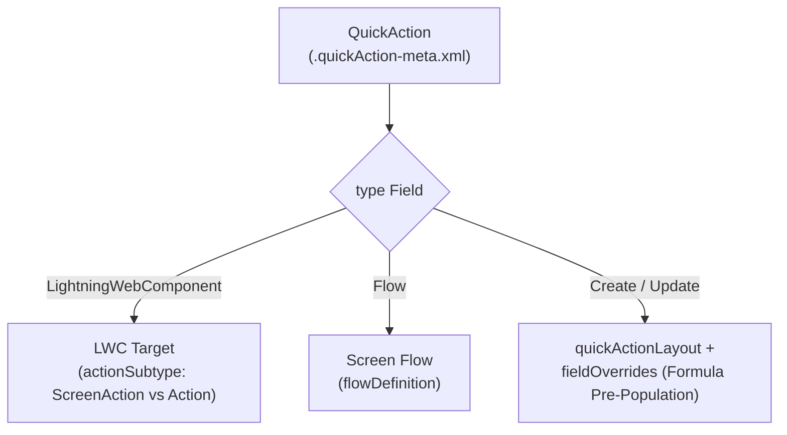

The `QuickAction` metadata type represents an object-specific or global action in Salesforce. Introduced in API version 28.0, `QuickAction` powers the buttons in the Lightning Experience Highlights Panel, Chatter publisher, and Salesforce Mobile action bar—enabling admins and developers to launch [LightningComponentBundle](/docs/metadata/lightning-component-bundle-metadata-type/) modals, headless JavaScript actions, screen [Flow](/docs/metadata/flow-metadata-type/) wizards, or rapid record creation/update forms with predefined `fieldOverrides`.

In Salesforce DX projects, quick actions live in `force-app/main/default/quickActions/` with the `.quickAction-meta.xml` suffix.



## Object-Specific vs. Global Naming Conventions

- **Object-Specific QuickAction**: Prefixed with `<ObjectName>.` in the filename—for example, `force-app/main/default/quickActions/Case.Escalate_To_Engineering.quickAction-meta.xml`.
- **Global QuickAction**: No object prefix—for example, `force-app/main/default/quickActions/New_Enterprise_Lead.quickAction-meta.xml`.

## Key Metadata Fields

| Field | Type | Required | Description |
|---|---|---|---|
| `type` | `QuickActionType` | Yes | `Create`, `Update`, `LightningWebComponent`, `Flow`, `VisualforcePage`, `LightningComponent`, `SendEmail`, or `LogACall` |
| `label` | `string` | Conditional | Custom button label (required if `standardLabel` is not set) |
| `optionsCreateFeedItem` | `boolean` | Yes | Required. Controls whether executing the action posts a feed item (must be `false` for `LightningWebComponent` and `Flow`) |
| `lightningWebComponent` | `string` | Conditional | Developer name of the LWC bundle when `type` is `LightningWebComponent` (v52.0+) |
| `actionSubtype` | `ActionSubtype` | Conditional | `ScreenAction` (modal LWC) or `Action` (headless `@api invoke()` LWC) |
| `flowDefinition` | `string` | Conditional | Developer name of the screen Flow when `type` is `Flow` |
| `targetObject` | `string` | Conditional | Child or target SObject created when `type` is `Create` |
| `targetParentField` | `string` | Conditional | Lookup/Master-Detail field linking `targetObject` to the context record |
| `fieldOverrides` | `FieldOverride[]` | No | Pre-populates fields using `<field>`, `<formula>`, or `<literalValue>` |
| `quickActionLayout` | `QuickActionLayout` | Conditional | Defines the 1- or 2-column form fields for `Create`, `Update`, and `LogACall` actions |

## Production-Grade XML Examples

### 1. Headless LWC QuickAction (`Order.Sync_To_ERP.quickAction-meta.xml`)

Executes an LWC's `@api invoke()` method immediately upon button click without opening a modal:

```xml
<?xml version="1.0" encoding="UTF-8"?>
<QuickAction xmlns="http://soap.sforce.com/2006/04/metadata">
    <actionSubtype>Action</actionSubtype>
    <description>Triggers an immediate real-time ERP order sync via a headless LWC action.</description>
    <label>Sync to ERP</label>
    <lightningWebComponent>orderErpSyncAction</lightningWebComponent>
    <optionsCreateFeedItem>false</optionsCreateFeedItem>
    <type>LightningWebComponent</type>
</QuickAction>
```

### 2. Record Update Action with Predefined Formula Values (`Case.Close_As_Resolved.quickAction-meta.xml`)

```xml
<?xml version="1.0" encoding="UTF-8"?>
<QuickAction xmlns="http://soap.sforce.com/2006/04/metadata">
    <description>Quickly resolves a Case with pre-populated status and resolution timestamp.</description>
    <fieldOverrides>
        <field>Status</field>
        <literalValue>Closed</literalValue>
    </fieldOverrides>
    <fieldOverrides>
        <field>Engineering_Notes__c</field>
        <formula>&quot;Resolved by &quot; &amp; $User.FirstName &amp; &quot; &quot; &amp; $User.LastName</formula>
    </fieldOverrides>
    <label>Close as Resolved</label>
    <optionsCreateFeedItem>false</optionsCreateFeedItem>
    <quickActionLayout>
        <layoutSectionStyle>TwoColumnsLeftToRight</layoutSectionStyle>
        <quickActionLayoutColumns>
            <quickActionLayoutItems>
                <emptySpace>false</emptySpace>
                <field>Status</field>
                <uiBehavior>Required</uiBehavior>
            </quickActionLayoutItems>
            <quickActionLayoutItems>
                <emptySpace>false</emptySpace>
                <field>Engineering_Notes__c</field>
                <uiBehavior>Required</uiBehavior>
            </quickActionLayoutItems>
        </quickActionLayoutColumns>
        <quickActionLayoutColumns/>
    </quickActionLayout>
    <successMessage>Case has been closed and marked resolved.</successMessage>
    <type>Update</type>
</QuickAction>
```

## Querying `QuickActionDefinition` via Tooling API

You can audit all object-specific and global QuickActions in your org using the Tooling API:

```sql
-- Query QuickActions via Tooling API
SELECT Id, DeveloperName, MasterLabel, SobjectType, Type, TargetSobjectType, FlowDefinition
FROM QuickActionDefinition
WHERE SobjectType = 'Case'
ORDER BY MasterLabel ASC
```

