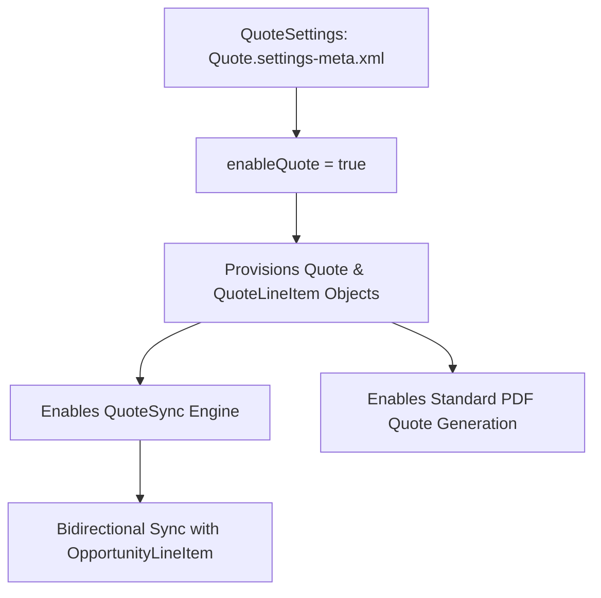

## Architectural Overview

In Sales Cloud implementations, transitioning from basic pipeline tracking to structured commercial negotiation requires standard Quoting capabilities. Sales representatives generate formal customer proposals, track quote revisions, generate PDF contracts, and synchronize line items with Opportunities.

The `QuoteSettings` metadata type represents the administrative settings governing Sales Cloud Quotes. Setting `enableQuote` to true provisions the standard `Quote`, `QuoteLineItem`, and `QuoteDocument` objects, while unlocking native bidirectional synchronization (`QuoteSync`) between the active quote and the parent `Opportunity`.



In CI/CD automation and scratch org provisioning, deploying `QuoteSettings` prior to code or layouts that reference `Quote` is critical for build stability.

## Directory and File Conventions

In SFDX source format, `QuoteSettings` is managed in the `settings/` directory as `Settings:Quote`:

| Property | Value |
| :--- | :--- |
| **Metadata Type Name** | `Settings` (member: `Quote`) / `QuoteSettings` |
| **SFDX Directory** | `force-app/main/default/settings/` |
| **File Suffix** | `.settings-meta.xml` |
| **Full File Path** | `force-app/main/default/settings/Quote.settings-meta.xml` |
| **Scratch Org Setting Key** | `quoteSettings` |

## Key Metadata Fields

The XML schema of `QuoteSettings` contains the primary enablement switch:

| Field Name | Field Type | Required | Architectural Description |
| :--- | :--- | :--- | :--- |
| `enableQuote` | `boolean` | Yes | Provisions the standard `Quote` object hierarchy and synchronization engine. |

> [!NOTE]
> Once enabled, page layouts for Opportunity and Quote must be configured to expose the Quotes related list and Sync button.

## Declarative XML and Package Manifest Examples

Below is a production `Quote.settings-meta.xml` configuration:

```xml title="force-app/main/default/settings/Quote.settings-meta.xml"
<?xml version="1.0" encoding="UTF-8"?>
<QuoteSettings xmlns="http://soap.sforce.com/2006/04/metadata">
    <enableQuote>true</enableQuote>
</QuoteSettings>
```

### Scratch Org Definition Configuration

```json title="config/project-scratch-def.json"
{
  "orgName": "Sales Cloud Quoting Scratch Org",
  "edition": "Enterprise",
  "settings": {
    "quoteSettings": {
      "enableQuote": true
    }
  }
}
```

### Package Manifest (`package.xml`)

```xml title="manifest/package.xml"
<?xml version="1.0" encoding="UTF-8"?>
<Package xmlns="http://soap.sforce.com/2006/04/metadata">
    <types>
        <members>Quote</members>
        <name>Settings</name>
    </types>
    <version>68.0</version>
</Package>
```

## CLI Retrieval and Deployment Commands

Manage `QuoteSettings` using the Salesforce CLI:

```bash
# Retrieve QuoteSettings from the org
sf project retrieve start --metadata Settings:Quote

# Deploy QuoteSettings to the target org
sf project deploy start --metadata Settings:Quote

# Validate settings deployment without committing changes
sf project deploy validate --metadata Settings:Quote
```

## Architect Best Practices and Gotchas

- **CI/CD Build Dependencies:** If any [ApexClass](/docs/metadata/apex-class-metadata-type/), trigger, or [Flow](/docs/metadata/flow-metadata-type/) references `Quote` or `QuoteLineItem`, `QuoteSettings` must be deployed first; otherwise, deployments fail with `sObject type does not exist`.
- **Quote Synchronization Automation:** When Quote Sync is active, modifications to `QuoteLineItem` automatically trigger updates on `OpportunityLineItem` (and vice-versa). Ensure Apex triggers and record-triggered flows on both objects include recursion protection.
- **Product and Pricebook Dependencies:** Quoting requires products to have active price book entries in the opportunity's selected price book.

> [!WARNING]
> Disabling Quotes in an org where active quote synchronizations exist is blocked by Salesforce until all synchronizations are severed.
